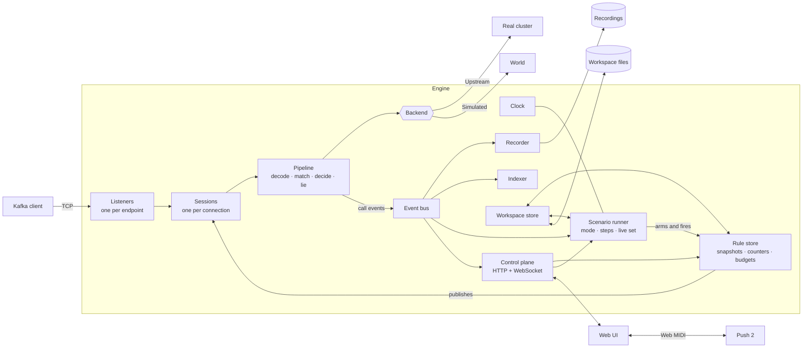

# Target architecture

GaslightMQ runs as one **engine**.
The engine hosts sessions, evaluates rules, runs scenarios
and answers calls through a backend.
A single web UI controls the engine, whatever its backend.

| Document | What it covers |
|---|---|
| [Request pipeline](request-pipeline.md) | What happens to one call, stage by stage. |
| [Backends](backends.md) | Upstream and Simulated, their capabilities, the overlay and event emulation. |
| [Storage](storage.md) | The workspace, live state and recordings. |
| [Control plane](control-plane.md) | The API the UI, the CLI and hardware use. |
| [Crate layout](crates.md) | The crates of the workspace, what each one holds and which ones are sans-IO. |

## Components

| Component | Responsibility |
|---|---|
| **Listeners** | Accept connections on the bootstrap endpoint and one endpoint per broker. Refuse connections when a broker is down. |
| **Sessions** | Run one connection each. Hold identity, the rule snapshot, per-session counters and in-flight calls. Share a client context with the other connections of the same client. |
| **Pipeline** | Take one call through the stages in [request pipeline](request-pipeline.md). |
| **Backend** | Answer a call with the truth, from a real cluster or from the World. Apply or emulate events. |
| **Rule store** | Hold every rule and its state, workspace rules and live rules alike. Publish an immutable snapshot of armed rules in priority order on every change. Hold each armed rule's shared counter and budget as atomics. |
| **Scenario runner** | Run the active scenario and the live set: turn the mode into a priority order, advance steps, expand events into their consequences and hand them to the backend. |
| **Clock** | Tell the time for triggers, lifetimes, steps, generators and timeouts. |
| **Event bus** | Carry call events, rule changes and world changes to everyone who listens. |
| **Recorder** | Write call events to a recording while recording is on. |
| **Indexer** | Maintain the facets of the current recording. |
| **Workspace store** | Load definitions from files, watch them for changes and write edits back. |
| **Control plane** | Expose the engine to the UI, the CLI and tests. |

## Principles

- **The data plane never waits for the control plane.**
  Sessions read an immutable snapshot of armed rules.
  A rule change publishes a new snapshot,
  and sessions pick it up at the next call.
  The snapshot carries the priority order, so a session resolves conflicts on its own.
- **Budgets are exact.**
  Shared counters and budgets are atomics next to the snapshot.
  A session takes from a budget at the moment a rule fires.
  A lifetime of three firings or a step that ends after three firings never yields a fourth,
  although the new snapshot reaches other sessions a moment later.
- **One snapshot per call.**
  A call is evaluated against one snapshot from start to finish,
  even if rules change while it is in flight.
- **Determinism is designed in, and its limits are stated.**
  Dice derive from the seed, the rule and the match number.
  See [dice](../domains/rules.md#dice).
  With the same seed, the same match numbers fire in every run.
  Per-session counters make each connection reproducible on its own.
  A shared counter hands out match numbers in arrival order,
  so across connections, which call gets the 3rd match depends on timing.
  The explanation records the match number of every call.
  On the Simulated backend, the virtual clock removes timing as a source of difference.
- **The engine is headless.**
  The UI is one client of the control plane.
  The CLI and test libraries are others.
  Hardware connects through the UI with Web MIDI,
  so the engine needs no device drivers.

## Clock

The engine has one clock.
Time triggers, duration lifetimes, step endings, generators and the World's timeouts all read it.

| Backend | Clock |
|---|---|
| Simulated | Virtual. It can run faster than real time, or step on demand. |
| Upstream | The wall clock. |

## Deployment shapes

| Shape | Backend | Use |
|---|---|---|
| `gmq proxy --upstream kafka:9092` | Upstream | Put GaslightMQ in front of a real cluster. Explore with the UI. |
| `gmq broker --world orders-sim` | Simulated | Run a fake cluster. Explore with the UI. |
| `gmq run <scenario> [--world <world>]` | Either | Run a scenario headless, for example in CI. Exit when the last step ends, or when stopped. |
| Library and testcontainers | Either | Start an engine from a test, drive it through the control plane, assert on explanations. |

All shapes are the same engine with a different backend and a different front end.

`gmq run` reports whether the scenario loaded and ran to its end.
It does not judge the client under test.
A scenario has no expectations yet,
so tests decide pass or fail by [asserting on the recording](control-plane.md#tests).
