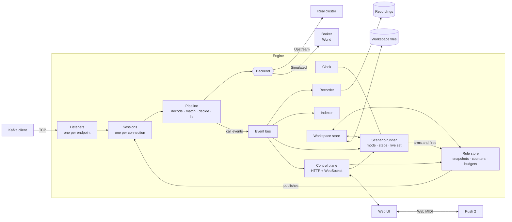
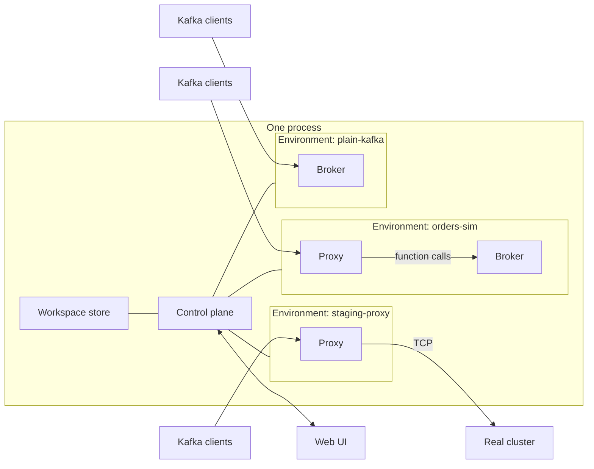

# Target architecture

GaslightMQ is built from two kinds of instances.

- A **proxy** stands in front of a cluster and decides what clients get to see.
  It hosts sessions, evaluates rules, runs scenarios and lies.
- A **broker** is a simulated Kafka cluster.
  It holds a [World](../domains/world.md) and answers calls truthfully from it.
  A broker never lies.

A proxy's backend is a real cluster, or a broker in the same process.
One process hosts any number of proxies and brokers,
and a single web UI controls all of them.

These documents call the runtime of one proxy the **engine**.

| Document | What it covers |
|---|---|
| [Request pipeline](request-pipeline.md) | What happens to one call, stage by stage. |
| [Backends](backends.md) | Upstream and Simulated, their capabilities, the overlay and event emulation. |
| [Storage and configuration](storage.md) | The workspace, environments, secrets, live state and recordings. |
| [Control plane](control-plane.md) | The API the UI, the CLI and hardware use. |
| [Crate layout](crates.md) | The crates of the workspace, what each one holds and which ones are sans-IO. |

## Components



| Component | Responsibility |
|---|---|
| **Host** | Start and stop environments in one process. Share the workspace store and the control plane between them. |
| **Listeners** | Accept connections on the bootstrap endpoint and one endpoint per broker. Refuse connections when a broker is down. |
| **Sessions** | Run one connection each. Hold identity, the rule snapshot, per-session counters and in-flight calls. Share a client context with the other connections of the same client. |
| **Pipeline** | Take one call through the stages in [request pipeline](request-pipeline.md). |
| **Backend** | Answer a call with the truth, from a real cluster or from the World. Apply or emulate events. |
| **Rule store** | Hold every rule and its state, workspace rules and live rules alike. Publish an immutable snapshot of armed rules in priority order on every change. Hold each armed rule's shared counter and budget as atomics. |
| **Scenario runner** | Run the active scenario and the live set: turn the mode into a priority order, advance steps, expand events into their consequences and hand them to the backend. |
| **Clock** | Tell the time for triggers, lifetimes, steps, arriving records and timeouts. |
| **Event bus** | Carry call events, rule changes and world changes to everyone who listens. |
| **Recorder** | Write call events and journal entries to a recording while recording is on. |
| **Journal** | Keep what changed and who changed it: arms, disarms, parameter changes, steps and events. |
| **Indexer** | Maintain the facets of the current recording. |
| **Workspace store** | Load definitions from files, watch them for changes and write edits back. Keep live rules in the scratch file. |
| **Control plane** | Expose the engine to the UI, the CLI and tests. |

## Principles

- **The data plane never waits for the control plane.**
  Sessions read an immutable snapshot of armed rules.
  A rule change publishes a new snapshot,
  and sessions pick it up at the next call.
  The snapshot carries the priority order, so a session resolves conflicts on its own.
- **Budgets are exact.**
  Shared counters and budgets are atomics next to the snapshot.
  A session takes from a budget at the moment a rule fires.
  A lifetime of three firings or a step that ends after three firings never yields a fourth,
  although the new snapshot reaches other sessions a moment later.
- **One snapshot per call.**
  A call is evaluated against one snapshot from start to finish,
  even if rules change while it is in flight.
- **Determinism is designed in, and its limits are stated.**
  Dice derive from the seed, the rule and the match number.
  See [dice](../domains/rules.md#dice).
  With the same seed, the same match numbers fire in every run.
  Per-session counters make each connection reproducible on its own.
  A shared counter hands out match numbers in arrival order,
  so across connections, which call gets the 3rd match depends on timing.
  The explanation records the match number of every call.
  On the Simulated backend, the virtual clock removes timing as a source of difference.
- **A restart is a clean slate.**
  The engine keeps its live state in memory and has no database.
  After a restart, nothing is armed.
  See [live state](storage.md#live-state).
- **The engine is headless.**
  The UI is one client of the control plane.
  The CLI and test libraries are others.
  Hardware connects through the UI with Web MIDI,
  so the engine needs no device drivers.

## Clock

The engine has one clock.
Time triggers, duration lifetimes, step endings, arriving records and the World's timeouts all read it.

| Backend | Clock |
|---|---|
| Simulated | Virtual. It is the broker's clock, and the proxy in front of the broker reads it. It can run faster than real time, or step on demand. |
| Upstream | The wall clock. |

## Instances and processes

Proxies and brokers combine into three shapes.

| Shape | Instances | Use |
|---|---|---|
| A proxy in front of a real cluster | One proxy | Lie about real traffic. |
| A proxy in front of a broker | One proxy, one broker | A fake cluster that lies, fully reproducible. |
| A broker alone | One broker | A truthful fake Kafka, for tests that need no lies. |



- **A proxy calls its broker directly.**
  Both are sans-IO, so the proxy hands a request to the broker as a function call.
  There is no socket between them, and both read the same virtual clock.
- **An [environment](storage.md#environments) names one shape.**
  A process starts one environment or several.
  Each environment has its own listeners and its own live state.
  Environments share the workspace and the control plane.
- **Lies happen in one place.**
  A proxy lies, and a broker does not.
  A fake cluster that lies is a proxy in front of a broker.
- **A process can run without a control plane.**
  It is then one proxy or one broker, set up by flags and files alone.

A library user creates the same instances in a test:

```rust
let broker = gmq::Broker::new(world);
let proxy = gmq::Proxy::builder()
    .backend(&broker)
    .workspace(workspace)
    .build();
```

The sketch shows the shape of the interface, not its final names.

## Deployment shapes

| Command | Starts | Use |
|---|---|---|
| `gmq proxy --upstream kafka:9092` | A proxy in front of a real cluster | Explore with the UI. Needs no workspace. |
| `gmq proxy --world orders-sim` | A proxy in front of a broker | A fake cluster that lies. Explore with the UI. |
| `gmq broker --world orders-sim` | A broker alone | A truthful fake Kafka. |
| `gmq start --env <environment> …` | One or more [environments](storage.md#environments) from the workspace | Several proxies and brokers in one process, with one UI. |
| `gmq run <scenario> --env <environment>` | One environment | Run a scenario without the UI, for example in CI. Exit when the last step ends, or when stopped. |
| Library and testcontainers | Instances in a test | Create a proxy or a broker from a test, drive it through the control plane, assert on explanations. |

Every command takes `--no-control` to run without a control plane.

`gmq init` creates a new workspace.
The flags of `gmq proxy` and `gmq broker` describe an environment without a file.

`gmq run` reports whether the scenario loaded and ran to its end.
It does not judge the client under test.
A scenario has no expectations yet,
so tests decide pass or fail by [asserting on the recording](control-plane.md#tests).
