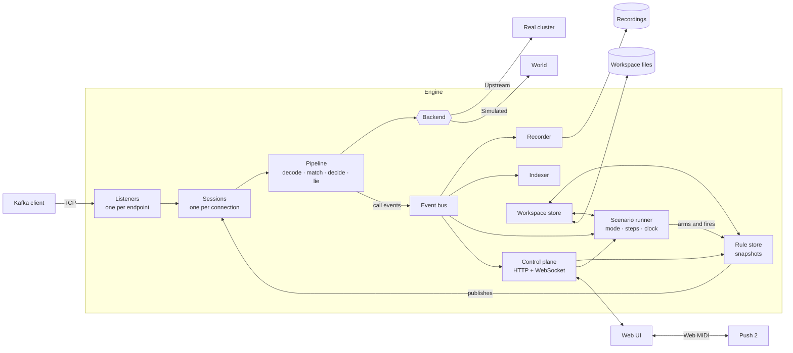

# Target architecture

GaslightMQ runs as one **engine**.
The engine hosts sessions, evaluates rules, runs scenarios
and answers calls through a backend.
A single web UI controls the engine, whatever its backend.

| Document | What it covers |
|---|---|
| [Request pipeline](request-pipeline.md) | What happens to one call, stage by stage. |
| [Backends](backends.md) | Upstream and Simulated, their capabilities, and event emulation. |
| [Storage](storage.md) | The workspace, live state and recordings. |
| [Control plane](control-plane.md) | The API the UI, the CLI and hardware use. |

## Components

| Component | Responsibility |
|---|---|
| **Listeners** | Accept connections on the bootstrap endpoint and one endpoint per broker. Refuse connections when a broker is down. |
| **Sessions** | Run one connection each. Hold identity, the rule snapshot, dice, session counters and in-flight calls. |
| **Pipeline** | Take one call through the stages in [request pipeline](request-pipeline.md). |
| **Backend** | Answer a call from a real cluster or from the World. |
| **Rule store** | Hold every rule and its state. Publish an immutable snapshot of armed rules on every change. |
| **Scenario runner** | Run the active scenario: apply its mode, advance its steps, keep the clock, hold client and global counters. |
| **Event bus** | Carry call events, rule changes and world changes to everyone who listens. |
| **Recorder** | Write call events to a recording while recording is on. |
| **Indexer** | Maintain the facets of the current recording. |
| **Workspace store** | Load definitions from files, watch them for changes and write edits back. |
| **Control plane** | Expose the engine to the UI, the CLI and tests. |

## Principles

- **The data plane never waits for the control plane.**
  Sessions read an immutable snapshot of armed rules.
  A rule change publishes a new snapshot,
  and sessions pick it up at the next call.
- **One snapshot per call.**
  A call is evaluated against one snapshot from start to finish,
  even if rules change while it is in flight.
- **Determinism is designed in.**
  Dice derive from the [seed hierarchy](../domains/session.md#dice).
  The Simulated backend runs on a virtual clock.
  With the same seed, the same world and the same client behaviour,
  a run produces the same verdicts.
- **The engine is headless.**
  The UI is one client of the control plane.
  The CLI and test libraries are others.
  Hardware connects through the UI with Web MIDI,
  so the engine needs no device drivers.

## Deployment shapes

| Shape | Backend | Use |
|---|---|---|
| `gmq proxy --upstream kafka:9092` | Upstream | Put GaslightMQ in front of a real cluster. Explore with the UI. |
| `gmq broker --world orders-sim` | Simulated | Run a fake cluster. Explore with the UI. |
| `gmq run <scenario> [--world <world>]` | Either | Run a scenario headless, for example in CI. Exit with the result. |
| Library and testcontainers | Either | Start an engine from a test, drive it through the control plane, assert on explanations. |

All shapes are the same engine with a different backend and a different front end.
