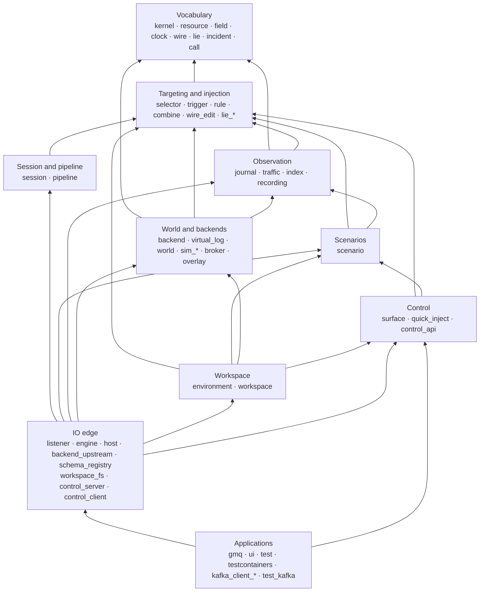

# Crate layout

The workspace splits GaslightMQ into many small crates.
Each crate holds one district of the [town plan](../townplan/README.md),
or one component of the [engine](README.md#components).
This document describes the target layout.
Moving the current crates to it is a separate plan.

Every crate name starts with `gaslightmq_` and uses underscores, never hyphens.
The name in `Cargo.toml`, the directory and the path in code are then one string,
so one search finds all three.
The tables leave the prefix out: `selector` is the crate `gaslightmq_selector`.
Two crates stand apart: the facade is plain `gaslightmq`, and the binary is `gmq`.
The workspace's own checks are tooling, and not product code: they live in `xtask/`, outside these tables.

## Principles

- **Logic is sans-IO.**
  A sans-IO crate has no async code, no sockets, no file access, no system clock and no global randomness.
  It takes inputs and the current time as arguments, and returns what should happen.
  Tests drive it with plain function calls.
- **IO lives at the edge.**
  Only a few crates touch the network, the file system or a runtime.
  They are async and thin, and they call the sans-IO crates.
  No crate comes in a blocking and an async variant.
  See [the IO edge is async](#the-io-edge-is-async).
- **A crate boundary needs a reason.**
  A crate exists because something else reuses it,
  because it keeps a heavy dependency away from the rest,
  or because its types travel to the UI, so it must compile to WebAssembly without the Kafka codec.
  Code that always changes together stays in one crate.
- **An internal crate stays inside the crates that use it.**
  Some crates only hold what other crates share, such as the one rule that every name follows.
  Such a crate is internal, and its types are a detail of the crates that use it.
  A crate that uses one offers types of its own: a selector has a `SelectorName` with a `SelectorNameError`.
  Nothing it offers and nothing it documents names the internal crate or one of its types.
  See [internal crates](#internal-crates).
- **Dependencies follow the town plan.**
  Vocabulary crates depend only on other vocabulary crates.
  Logic crates depend on vocabulary.
  The engine depends on logic.
  Nothing depends on the engine except the binaries and the test library.
- **Definitions live with their domain.**
  The crate that owns a concept owns its definition type and its `serde` mapping.
  The `workspace` crate only assembles and cross-checks them.
- **The UI shares types, not logic.**
  The UI reaches the engine only through the control plane.
  It shares the engine's definition types.
  It runs none of the engine's behaviour and none of the Kafka codec.
  See [what compiles to WebAssembly](#what-compiles-to-webassembly).
- **A name says what a thing means.**
  A type, a variant, a method or a module carries a word of the [glossary](../domains/README.md#glossary),
  or it says what it holds or what went wrong.
  It never says which crate, module or type a thing came from, and it never says how the thing is built.
  A partition number that is not a number is an `InvalidPartition`, and not a `Kernel` error.
- **A value object owns its error.**
  A type that checks its value has an error type of its own, named after it:
  `TopicName` has `TopicNameError`, and `Offset` has `OffsetError`.
  Its constructor, its `TryFrom`, its `FromStr` and its `serde` form all return that type.
  The error holds only what can go wrong with that value, and each variant says what is wrong:
  a topic name is `Empty` or `TooLong`, and an offset is `Negative`.
  A type made of parts says which part failed, and it keeps the error of that part:
  `TopicPartitionError::InvalidPartition` holds a `PartitionNumberError`.
  A whole that checks its members does the same: `SelectorSet` has `SelectorSetError`.
  A type that checks nothing has no error type.
  Types may share their checks as private helpers.
- **A variant is something its caller decides on.**
  What a crate does can fail too: it decodes a frame, tells a lie or opens a listener.
  The crate has error types of its own for that.
  A variant is a case for which the caller does something else: it tries again, it closes a connection, it ends a session.
  The rest of what went wrong is text in the message.
  Operations that fail in different ways have an error each:
  a transport that receives and sends has a `ReceiveError` and a `SendError`.
  Operations that fail in the same ways share one: every call of a client returns a `ClientError`.
  No caller writes an arm for a variant that cannot come from what it called.
  An error that asks for such an arm is two errors.
  A crate that only holds value objects has no error of this kind.
- **A contract holds its errors.**
  A crate that holds a contract holds the errors of that contract, one for each thing the caller asks.
  `backend` is the model.
  A call that gets no answer ends with a `BackendFailure`.
  A listener that clients cannot be sent to gets a `ListenerRejection`.
  An incident that cannot happen gets an `IncidentRejection`.
  The engine does something else with each one, and it never handles two of them in one place.
  An implementation returns only the errors of its contract.
  Those errors hold no error of what an implementation uses:
  a lie returns a `LieError`, whatever it reads or writes to tell its lie.
- **A crate turns the errors it meets into its own.**
  A crate handles an error where it calls what failed: another crate, a library or the system.
  It returns a variant of its own error, in the words of its own subject.
  No variant, field or type names the tool, the library or the mechanism behind a failure:
  a connection is `ConnectionLost`, and the error is no `IoError`.
  What a library or the system said is text.
  The variant keeps it in a field, named `reason`.
  A variant keeps the error of a crate of the workspace, in a field named `error`, in two cases.
  The error is the error of a part: a `TopicPartitionError` keeps the `PartitionNumberError` of its partition.
  Or the caller reads it: `Refused { error: ResponseError }` of `test_kafka` keeps the error that the broker answered,
  and a test reads from it that its topic exists already.
  In every other case, what the other crate said is text in a `reason`.
  No variant copies the variant below it.
  `ResponseOfAnotherCall` stands in three crates, each time with the API and the correlation ID of both sides.
  A crate says what the failure below it means for its own caller, and no more.
  No error is made up to fill a field:
  a backend that finds an answer out of step has no error of the codec to show, so it does not build one.
  Nothing names `dyn Error`: no signature, no field, no doc example and no test.
  A doc example returns one error type, by its name.
- **No error type is `#[non_exhaustive]`.**
  A new variant is a new decision for every caller.
  With the attribute, every `match` outside the crate ends in an arm for whatever comes,
  and that arm takes the new variant without anyone deciding.
  Without it, a new variant breaks every `match` that decides on the error, and someone decides.
- **An error says everything in one message.**
  A file reader, the control plane and the UI show one line, and not a chain of causes.
  A variant that holds another error names its own value first, and then writes that error, once.
  It names the text it read too, when the other error read only a part of it:
  ``lifetime `0 firings`: a count is at least one``.
  A variant that holds a `reason` writes it the same way, once.
  The variant keeps the other error in a field, named `error`, for code that wants to look at it.
  No error type writes `source()`, because a reporter that walks the chain would print the cause twice.
  The path of a value in a file comes from the [reader](storage.md#reading), and not from the error of the value:
  `trigger.every: a count is at least one`.
- **Nothing tunable is hardcoded.**
  A timeout, a wait, a size, a count or an interval that someone may want to change is a property of a configuration.
  The property has a name and a default, and the code that waits or counts reads the property.
  A client waits for a response for its `request_timeout`, which is 30 seconds until someone sets it,
  and not for a `Duration::from_secs(30)` in the code that sends the request.
  A value with rules is a value object: a number of attempts that is at least one is not a plain `u32`.
  A number that the Kafka protocol fixes is not tunable, and stays a constant.
- **A Kafka client has Kafka's own properties.**
  A property that Kafka's own clients have keeps its name, its meaning, its unit and its default in our client.
  The configuration of the Java client is the reference.
  The doc comment of the field names the property, so someone who knows Kafka finds it at once:
  `request_timeout` is `request.timeout.ms`.
  A property that Kafka does not have is added only when the client needs it, and its doc comment says that it is ours.
  No property exists for behaviour that the client does not have.

The workspace rules apply to every crate:
Rust edition 2024, native async traits and workspace dependency versions.

## Checks

`cargo xtask` checks the rules of this document that a machine can decide and the compiler cannot see.
`cargo xtask sans-io` runs one check alone.
`just checks` and CI run them all.

| Check | Fails when |
|---|---|
| `dependencies` | A crate depends on a workspace crate that its row does not list, or its row lists one that it does not depend on. |
| `crate-names` | A crate name does not start with `gaslightmq_` or holds a hyphen, or the crate's directory does not carry the name. |
| `wasm-boundary` | A crate that [compiles to WebAssembly](#what-compiles-to-webassembly) reaches `kafka-protocol`. |
| `workspace-rules` | A crate builds with another edition than 2024, depends on `async-trait`, or names a dependency without `workspace = true`. |
| `sans-io` | [Sans-IO code](#sans-io-code) is async, or it names a runtime, a socket, the file system, the system clock, the process or global randomness. |
| `wrapped-errors` | An error type holds another error in a field that is not named `error`, its `source()` returns something other than `None`, or it makes another error its source. |
| `internal-crates` | A crate names an [internal crate](#internal-crates) it depends on, or one of its types, in something that other crates see or in a doc comment. |

A check reads the names in the code, and not what the code does.
The documentation of each check, in `xtask/src/`, says what it does not catch.
The other principles need a reviewer.

### Sans-IO code

A crate whose row does not say "This crate does IO" is sans-IO as a whole.
The `sans-io` check reads its dependencies and every file of its source.

A crate that does IO declares the modules it keeps sans-IO in its `Cargo.toml`:

```toml
[package.metadata.gaslightmq]
sans_io_modules = ["logic"]
```

The check then reads `src/logic.rs`, or `src/logic/mod.rs` and every file below `src/logic/`, as it reads a sans-IO crate.
A sans-IO module names nothing of its own crate outside the sans-IO modules.
A module that holds the types it works on, such as a configuration or an error, is therefore declared too.

One sans-IO crate has an async signature: [`backend`](#the-backend-seam).
The check lets its trait declare async functions, and no other async code.

### Internal crates

A crate declares itself internal in its `Cargo.toml`:

```toml
[package.metadata.gaslightmq]
internal = true
```

Its row says "This crate is internal".
The `internal-crates` check reads the name of the crate and of every type it exports,
and then every crate that depends on it.
In such a crate, only private code names them: a private `use`, a private field and the body of a function.
A public function, field, type alias or trait does not name them,
and neither does an implementation of a trait or a re-export.
No doc comment names them either, and no example in one.

## Layers



An arrow means "depends on".
Every crate outside the IO edge is sans-IO.
The tables list each IO crate next to the domain it serves, and mark it with "This crate does IO".

## Crates

### Vocabulary

Vocabulary crates hold types and almost no behaviour.
Every other crate speaks in them.

| Crate | Holds | Depends on |
|---|---|---|
| `kernel` | The value objects of Kafka: topic names and IDs, partition numbers, offsets, positions such as `orders.eu/3`, broker IDs, epochs, the IDs of clients, groups and producers, and API keys and error codes with the names Kafka gives them. Each type only holds valid values. | — |
| `resource` | The [resource](control-plane.md#resources) vocabulary: the name of a resource, and the one rule that every name follows, which is the rule of the [name of a rule](../domains/rules.md#rule). Each kind of resource has a name of its own that wraps it, so the name of a selector never stands where the name of a rule belongs. This crate is [internal](#internal-crates). | — |
| `field` | The [field vocabulary](../domains/targeting.md#fields): field names, their typed values, and the `FieldSource` trait that a live call and a recorded call both implement. Also the parts of a call, and the [target](../domains/lies-and-incidents.md#target) that a match yields. Every district of the town plan [shares this vocabulary](../townplan/README.md#targeting-is-a-shared-kernel). | `kernel`, `clock` |
| `clock` | The [clock](README.md#clock): a `Clock` trait, the virtual clock, and instants that do not come from the system. | — |
| `wire` | The Kafka codec: frames, headers, lazily decoded bodies and record batches. | — |
| `lie` | The [lie](../domains/lies-and-incidents.md#lies) vocabulary: kind, stage, combination class, aspect and priority, the definition of every lie kind as data, and a lie with the [target](../domains/lies-and-incidents.md#target) it applies to. It holds no behaviour. See [lies as crates](#lies-as-crates). | `field`, `kernel`, `clock` |
| `incident` | The [incident](../domains/lies-and-incidents.md#incidents) vocabulary, the expansion into consequences, and the support a backend declares for each kind of incident. | `kernel` |
| `call` | The [call](../domains/observation.md#call) record: identity, request summary, truth, delivered response, verdict, explanation and timing. | `field`, `lie`, `incident`, `kernel`, `resource`, `clock` |

### Targeting and injection

| Crate | Holds | Depends on |
|---|---|---|
| `selector` | Conditions, selectors, includes and scope. The set of selectors, which resolves includes into effective selectors. Matching against a `FieldSource`, with the [target](../domains/lies-and-incidents.md#target) a match yields and the evaluation pass that decides it. An index of selectors by API. | `field`, `kernel`, `resource` |
| `trigger` | [Triggers](../domains/rules.md#trigger), counters, dice, budgets and lifetimes. | `clock` |
| `rule` | The rule definition, the [preset](../domains/lies-and-incidents.md#presets), the rule's state, and the immutable snapshot of armed rules in priority order. The snapshot [evaluates a call](../domains/rules.md#evaluating-one-call): for each pass and each matching rule, the target, what the trigger rolled, and the lie or the incidents it fired. | `selector`, `lie`, `incident`, `trigger`, `field`, `kernel`, `resource`, `clock` |
| `combine` | [How lies combine](../domains/lies-and-incidents.md#how-lies-combine): which lies conflict, which win by priority, which are shadowed or pre-empted, across [both evaluation passes](request-pipeline.md#two-evaluation-passes). Also what the lies that apply do to the call at each stage: the refusals and rewrites per target, the summed delay and the maximum throttle. | `lie`, `field`, `clock` |
| `wire_edit` | Surgery on requests and responses: remove partitions, merge responses, synthesize an error response for any API, map topic IDs to names. It also reads what a response says about each [part](../domains/lies-and-incidents.md#target) of its request, and the error code of the response itself. | `wire`, `field`, `kernel` |
| `lie_api` | The contract between the pipeline and a lie kind: the `Lie` trait, and the effect that one lie asks the pipeline for. A lie gets the request decoded, with its parts named. Also the behaviour of timing, silence and hang-up. See [lies as crates](#lies-as-crates). | `lie`, `wire`, `wire_edit`, `field` |
| `lie_refusal` | Refusals for every API, before forwarding and after the response. | `lie`, `lie_api`, `wire_edit`, `wire`, `field`, `kernel` |
| `lie_topology` | Rewrites of Metadata, `FindCoordinator` and `DescribeCluster`. | `lie`, `lie_api`, `wire_edit` |
| `lie_data` | Altered, dropped, duplicated, reordered and corrupted records. | `lie`, `lie_api`, `wire_edit`, `schema` |
| `lie_progress` | Rewrites of watermarks, log start offsets and committed offsets. | `lie`, `lie_api`, `wire_edit` |
| `lie_config` | Rewrites of `DescribeConfigs` responses. | `lie`, `lie_api`, `wire_edit` |

### Session and pipeline

| Crate | Holds | Depends on |
|---|---|---|
| `session` | The state of one [session](../domains/session.md), which its pipeline owns: lifecycle, identity, session key, per-session counters, in-flight calls, response ordering and the stalled state. Also the client context that sessions share. | `field`, `kernel`, `call`, `wire`, `trigger`, `clock` |
| `pipeline` | The [request pipeline](request-pipeline.md) as a state machine: all stages, both evaluation passes and partial refusals. Also the topics that a proxy knows by ID, which its sessions share. | `wire`, `wire_edit`, `selector`, `rule`, `trigger`, `lie`, `lie_api`, `combine`, `session`, `call`, `incident`, `field`, `kernel`, `clock` |

### Scenarios

| Crate | Holds | Depends on |
|---|---|---|
| `scenario` | The [scenario](../domains/scenarios.md) definition, modes as priority orders, the step machine of a Sequence, the live set and capture. It consumes call records, journal entries and time, and it emits arm and disarm commands. | `rule`, `trigger`, `call`, `journal`, `incident`, `clock` |

### Observation

| Crate | Holds | Depends on |
|---|---|---|
| `traffic` | The live window of recent calls, subscriptions by selector, and statistics per rule and per API. | `call`, `selector` |
| `index` | The [index](../domains/observation.md#index): facets, counts under the active filters, suggested patterns. | `call`, `selector` |
| `journal` | The [journal](../domains/observation.md#journal): its entries, and the window of recent entries the engine keeps in memory. | `incident`, `clock` |
| `recording` | The [recording](storage.md#recordings) format: append-only chunks with summaries, calls and journal entries, metadata-only mode, blanked credentials, a reader and a writer over `std::io`. | `call`, `journal`, `wire` |

### World and backends

| Crate | Holds | Depends on |
|---|---|---|
| `backend` | The [backend contract](backends.md#contract): the request and answer messages, and the one async trait through which the engine reaches a backend. It holds no logic and needs no runtime. See [the backend seam](#the-backend-seam). | `wire`, `incident`, `call`, `field` |
| `schema` | Record [formats and schemas](../domains/world.md#schemas): encode and decode JSON, Avro and Protobuf, one feature per format. | — |
| `virtual_log` | [Virtual records](../domains/world.md#virtual-records): the record at a partition and offset as a pure function of the definition, templates, stable batches, and the mapping between offsets and time. | `wire`, `clock`, `schema` |
| `schema_registry` | The built-in [schema registry](backends.md#schema-registry) and a client for a real one. This crate does IO. | `schema` |
| `world` | The [World](../domains/world.md): its state, world definitions, how each incident changes it, and where each topic's records come from. | `wire`, `incident`, `clock`, `virtual_log` |
| `world_seed` | Seeding a world definition from a recording. | `world`, `index`, `recording` |
| `sim_log` | Produce, Fetch, offsets and idempotent producers against the World. | `world`, `wire` |
| `sim_group` | Group coordination against the World, for the classic and the consumer protocol. | `world`, `wire`, `clock` |
| `overlay` | The Upstream [overlay](backends.md#overlay): address translation, emulated incidents and sessionless Fetch. It rewrites requests and responses, and it opens no connection. | `backend`, `wire`, `wire_edit`, `incident`, `field`, `kernel` |
| `broker` | The broker instance as a [state machine](#the-broker-is-a-state-machine-too): it routes each request to a `sim_*` crate, applies incidents to the World and owns the virtual clock. It speaks the messages of the backend contract, so a proxy reaches it without a socket. | `backend`, `world`, `sim_log`, `sim_group`, `clock` |
| `backend_upstream` | The Upstream backend: the discovery of the brokers, and one connection to the real cluster for each connection of a client, with the overlay around them. This crate does IO. | `backend`, `overlay`, `environment`, `wire`, `field`, `kernel`, `incident`, `clock` |

Transactions arrive later as `sim_txn`, next to `sim_log` and `sim_group`.

### Workspace

| Crate | Holds | Depends on |
|---|---|---|
| `environment` | [Environments](storage.md#environments), [secret references](storage.md#secrets), and the order in which flags, variables and files set a value. It never reads a secret. | `kernel`, `resource` |
| `workspace` | The whole set of definitions as one model: cross-reference validation, renames that cascade, and the YAML layout of the [workspace](storage.md#workspace). A [reading error](storage.md#reading) names the path of the key that failed. It works on file contents, not on files. | `selector`, `lie`, `incident`, `rule`, `scenario`, `surface`, `world`, `environment` |
| `workspace_fs` | Loading, watching and writing back, the scratch file, and reading the files that secret references name. This crate does IO. | `workspace` |

### Control

| Crate | Holds | Depends on |
|---|---|---|
| `surface` | [Pad layouts](../domains/control-surfaces.md#pad-layout), layers, pads as positions, the encoder mapping, and the intents a surface sends. | `rule` |
| `hardware_push2` | The Push 2 mapping: controller messages to surface intents, and rule state back to pad colours. | `surface` |
| `quick_inject` | The ⌘K sentence parser: text to a rule definition, with completions. The host runs it behind the [control plane](control-plane.md#drafts). | `selector`, `lie`, `rule` |
| `control_api` | The [control plane](control-plane.md) as types: resources, commands and stream messages. It re-exports the definition types its messages carry, and it holds its own view of the World's state. | `call`, `journal`, `rule`, `scenario`, `selector`, `surface`, `incident`, `environment` |
| `control_client` | A client for the control plane, for native targets and for WebAssembly. This crate does IO. | `control_api` |
| `control_server` | The HTTP and WebSocket server in front of the host. This crate does IO. | `host`, `control_api` |

### Runtime and applications

| Crate | Holds | Depends on |
|---|---|---|
| `engine` | The runtime of one proxy: one task per session that owns the transport and drives the pipeline, the rule store, the scenario runner, the event bus, the journal, the recorder and the indexer. This crate does IO. | `pipeline`, `session`, `rule`, `scenario`, `journal`, `traffic`, `index`, `recording`, `backend`, `listener`, `workspace`, `environment`, `clock` |
| `ui` | The web UI, a Dioxus application. It reaches the engine only through the control plane. This crate does IO. | `control_api`, `control_client`, `surface`, `hardware_push2` |
| `listener` | Kafka on a socket: accept connections, frame bytes, and run whatever [handles a connection](#the-connection-handler). A proxy's pipeline and a broker alone both sit behind it. This crate does IO. | `wire`, `field`, `clock` |
| `host` | One process with several [environments](storage.md#several-environments-in-one-process): it starts and stops proxies and brokers, runs the task that drives each broker, and shares the workspace and the control plane between them. This crate does IO. | `engine`, `broker`, `listener`, `backend_upstream`, `workspace_fs`, `environment`, `quick_inject` |
| `test` | The test library: it starts a proxy, a broker, or a proxy in front of a broker inside the test's own process, on free ports, and hands the test the addresses its clients connect to. The test then activates a scenario and asserts on the recording. This crate does IO. See [instances in a test](#instances-in-a-test). | `host`, `control_client` |
| `testcontainers` | A container module: it starts the GaslightMQ image next to a test, with the workspace the test hands over, waits until the instance is ready, and hands the test the addresses its clients connect to. This crate does IO. See [instances in a test](#instances-in-a-test). | `control_client` |
| `kafka_client_api` | What a Kafka client offers to a test, whichever client it is: the producer, consumer and admin traits, one trait per protocol API, and a raw client that sends one request at a fixed version. This crate does IO. | `wire` |
| `kafka_client_native` | Our own Kafka client behind those traits, as three types: a producer, a consumer and an admin. Every instance has its own connections, its own view of the cluster, its own configuration and its own `client.id`, so a fault or a lie reaches one role alone. The consumer is one member of each group it joins, and everything it says about a group travels on connections of its own, so a Fetch that waits never delays a Heartbeat. Each role follows partition leaders, negotiates API versions on every connection, and reports every failure as an error. What a role decides is sans-IO code inside the crate, and the async part only owns sockets and timers. This crate does IO. | `kafka_client_api`, `wire`, `kernel`, `clock` |
| `test_kafka` | A real Kafka cluster for the tests of this workspace: brokers of the version the workspace tests against, each with an address for the clients of a test. Its own handles create topics, write records, read them back and open transactions, with one request at a fixed version each. They share the codec with the client a test is about, and no decision of a client. It starts no GaslightMQ. This crate does IO. See [a real cluster in a test](#a-real-cluster-in-a-test). | `wire`, `kernel`, `clock` |
| `gaslightmq` | The facade crate: `Proxy`, `Broker` and `Host`, and re-exports of what library users need. This crate does IO. | The public crates |
| `gmq` | The binary: `gmq proxy`, `gmq broker`, `gmq start` and `gmq run`. This crate does IO. | `host`, `control_server` |

## The pipeline is sans-IO

`pipeline` is a state machine for one connection.
The engine feeds it what happened and performs what it returns.
The pipeline never reads a socket, never sleeps and never looks at a clock.

```rust
/// What happened. The engine reports it.
pub enum Input<'a> {
    ClientBytes(&'a [u8]),
    BackendAnswered { call: CallId, response: Response },
    BackendAnswerUnreadable { call: CallId, error: String },
    BackendFailed { call: CallId, failure: String },
    BackendClosed { reason: String },
    TimerFired(TimerId),
    SnapshotPublished(Arc<Snapshot>),
    ClientClosed,
}

/// What should happen. The engine performs it.
pub enum Output {
    Forward { call: CallId, request: Request },
    Send(Bytes),
    SetTimer { id: TimerId, at: Instant },
    Close,
    Emit(Box<Call>),
    Fire(Incident),
}

impl Pipeline {
    pub fn open(connection: Connection, ordinal: ConnectionOrdinal, shared: SharedBySessions, snapshot: Arc<Snapshot>, now: Instant) -> Pipeline;
    pub fn handle(&mut self, input: Input<'_>, now: Instant) -> Outputs;
}
```

- A delay is a `SetTimer`, and the delayed request or response leaves on `TimerFired`.
  A `TimerId` names the call that waits and the stage it waits at.
- A silence returns no `Send` and marks the session stalled.
- A hang-up returns a `Close`, and the record of every call that was in flight.
- `BackendFailed` and `BackendClosed` return the same, and every record says why the backend ended the session.
  The reason is text, because the pipeline knows no backend.
- `BackendAnswerUnreadable` leaves its call without an answer, and returns a `Close` once that answer would be the next to leave.
- A partial refusal returns a `Forward` with fewer partitions,
  and merges the refusals when `BackendAnswered` arrives.
- A call ID is the connection and the number of the call on it, so it names one call of the engine.
- An input that names a call or a timer the pipeline does not wait for changes nothing.
  The engine cannot avoid every race, such as an answer for a call whose session just closed.
  Only `BackendFailed` ends the session whichever call of the connection it names.
- Shared counters and budgets are handles to atomics.
  They travel inside the armed rules of the snapshot.
  The pipeline increments them, and it still does no IO.
- The engine passes in the other handles that the sessions of a proxy share, as `SharedBySessions`:
  - The [client contexts](../domains/session.md#client-context).
    At the Identify stage, the pipeline takes the context of its `client.id` and `host` from that handle.
    It reads learned fields from the context, and writes what it learns.
    The engine expires the contexts that no session has shared for a while.
  - The topics that the cluster named with their ID.
    A topic ID is a fact of the cluster, so the names belong to the proxy, and not to one client.
    Every pipeline learns them from the truth of Metadata, `CreateTopics` and `DescribeTopicPartitions` calls,
    and decodes its requests with what all of them learned.
  - The lies of the build, one behaviour per kind.

The same interface serves three drivers:

| Driver | Feeds the pipeline from |
|---|---|
| `engine` | Real sockets, real backends and the engine's clock. |
| Unit and property tests | Hand-written inputs and a virtual clock. |
| Replay | A recording: the recorded requests and truths go in, and the verdicts that come out are compared with the recorded ones. |

Replay makes every recording a regression test for the pipeline.

The other sans-IO crates follow the same pattern.
`scenario` consumes call records and time, and returns arm and disarm commands.
`overlay` and the `sim_*` crates consume a request and return a response.
`session` consumes headers and returns identity changes.

## A session is a transport and a pipeline

The engine runs every [session](../domains/session.md) as one task.
The task owns the session's two parts.

| Part | Comes from | Does |
|---|---|---|
| **Transport** | `listener`, part of the IO edge | Reads the client's bytes, and writes the bytes the client receives. |
| **Pipeline** | `pipeline`, sans-IO | Holds the session's state from the `session` crate, and decides what happens to each call. |

The task waits for the next thing to happen,
reports it to the pipeline as an `Input`,
and performs every `Output` the pipeline returns.

| What happens | Input | Comes from |
|---|---|---|
| The client sends bytes. | `ClientBytes` | The transport |
| The backend answers a call. | `BackendAnswered` | The [backend](#the-backend-seam) |
| The backend answers a call with something that is no response. | `BackendAnswerUnreadable` | The backend |
| The backend has no answer for a call. | `BackendFailed` | The backend |
| The endpoint of the session closes. | `BackendClosed` | The backend |
| A timer runs out. | `TimerFired` | The engine's clock |
| A rule changes. | `SnapshotPublished` | The rule store |
| The client closes the connection. | `ClientClosed` | The transport |

The pipeline keeps the snapshot it received last.
A call that is in flight finishes on the snapshot it started with,
and the next call uses the new one.

The session ends when its transport closes, whoever closed it.
The task ends, and the pipeline and its state go with it.
A client that reconnects gets a new task, a new transport and a new pipeline.
See [disconnects](../domains/session.md#disconnects).

## The broker is a state machine too

`broker` is a state machine for one simulated cluster.
It has the shape of the pipeline:
requests, incidents and fired timers go in, and answers and timers come out.

A broker cannot always answer at once.
A Fetch waits for records until its maximum wait ends,
and a `JoinGroup` waits for the other members of the group.
The broker therefore answers each request under its call ID,
in the same step or in a later one.

A proxy in front of a broker needs no socket between the two.
The engine takes the pipeline's `Forward` and hands the request to the broker in memory.
The broker's answer returns to the pipeline as `BackendAnswered`.
Both state machines run on one virtual clock, so a run is reproducible down to the order in which things happen.

## The IO edge is async

The crates that do IO are async.
On a native target they run on Tokio.

| Crate | The IO it does |
|---|---|
| `listener` | Client sockets. |
| `backend_upstream` | Sockets to the real cluster. |
| `schema_registry` | The HTTP interface of the built-in registry, and requests to a real one. |
| `workspace_fs` | Files, and watching them. |
| `control_server` | HTTP and WebSocket. |
| `control_client` | HTTP and WebSocket, from a native target or from the browser. |
| `engine` | Tasks, timers and channels. It opens no socket itself. |
| `host` | One task per instance. |

- **The edge waits, and a sans-IO crate decides.**
  A task in the edge waits for a socket, a timer or a channel.
  Then it calls a state machine with what happened.
  That call never waits, so it runs inside the task.
- **Time comes from the clock.**
  The engine turns a `SetTimer` into a wait on its [clock](README.md#clock).
  With a virtual clock, the wait ends when the clock reaches the instant,
  however fast the clock runs.
- **The edge exists once.**
  A sans-IO crate has no blocking or async side, so it needs no second variant.
  The edge has no blocking variant either.
  A caller that is not async, such as a blocking test, runs the edge on a runtime of its own.

### The connection handler

The listener hands every connection it accepts to a connection handler, as a transport.
The handler runs in a task of that connection alone, and the connection lives as long as the handler runs.
The listener knows nothing about what a handler does with the client's bytes.

| Instance | Behind the listener |
|---|---|
| A proxy | The `engine`: the handler is the task of a session, which owns the transport and drives the pipeline. |
| A broker that runs alone | The `host`: the handler passes each request to the task that drives the broker, and writes the answer. |

- **A transport carries what a session opens with.**
  It knows the connection number, the address of the client and the endpoint.
  The listeners of one proxy number their connections together,
  so a number names one connection of the proxy, whichever endpoint the client connected to.
- **Frames come in, and bytes go out.**
  The transport hands out whole frames, however the bytes of the client arrive.
  A client that announces a frame over the listener's limit sends no frame, and the handler closes the connection.
  The transport writes bytes as they are, so whoever builds a response puts its length in front.
- **Every side can end a connection.**
  The transport tells the handler when the client closed the connection, and whether it did so inside a frame.
  A handler that closes its transport lets the client read everything that was sent:
  the transport waits until the client has closed its side, for a time that the listener's configuration limits.
  A handler that only lets go of its transport ends the connection at once,
  and the client may lose bytes that were on their way.
- **Closing a listener ends its endpoint.**
  The address refuses new connections, and every open transport tells its handler that the listener closed.
  A handler that waits for a frame hears it at once, and so does a handler that waits for a client to take bytes.
  The handler ends its session and closes the connection.
  Whoever closes the listener can wait until every handler has done so.
  A client that stopped reading cannot hold that wait up, and a handler that never returns can.
  A new listener then opens on the same address, as when a [broker is back](backends.md#emulating-incidents).
- **A handler that panics ends its own connection.**
  The listener and the other connections go on, in every build.
- **A failed accept does not stop a listener.**
  A connection that failed on its way in costs nothing, and the listener accepts the next one at once.
  A process that has run out of sockets or of memory waits for a time that the configuration sets, and accepts again.
- **A listener takes any free port.**
  It says which address it got, so several instances run side by side in one process and in one test.

### The backend seam

The engine reaches its backend through one async trait in the `backend` crate.
The engine hands over a request under a call ID,
and the answer arrives later under the same ID.
The backend names the [endpoints](backends.md#endpoints), and the engine opens a listener for each.
A listener says which address it got, and the engine passes that address on to the backend,
so the backend knows where to send clients.

The trait is a signature without logic.
`backend` needs no runtime, so it stays outside the IO edge.
It is the only crate there with an async signature.

| Backend | Behind the trait |
|---|---|
| Upstream | `backend_upstream`: connections to the real cluster, with the sans-IO `overlay` around them. |
| Simulated | A task in `host` that owns the `broker` state machine. The task feeds the broker the requests of every session, and waits for the timers the broker sets. |

The same task drives a broker that runs alone.
The listener then stands in front of the broker, without an engine.

## Lies as crates

A lie has a definition and a behaviour, and they live in different crates.

| Part | Crate | Holds | Reaches `wire` |
|---|---|---|---|
| Definition | `lie` | Every lie kind as data: its parameters, its stage and its `serde` mapping. | No |
| Contract | `lie_api` | The `Lie` trait, and the effect that one lie asks the pipeline for. | Yes |
| Behaviour | One crate per kind, listed below | What a kind does to a request or a response. | Yes |

Rules, call records, the workspace and the control plane carry lie definitions.
A definition needs no Kafka codec, so none of them reaches `wire` through `lie`.
The `Lie` trait reads requests and responses, so `lie_api` depends on `wire`.
The pipeline decodes a request once, with the topics it knows by ID, and every lie reads that:
the trait takes the decoded request of `wire_edit`, and no behaviour decodes it again.

The split rests on one rule:
every lie definition is data in `lie`, and the `lie_*` crates hold behaviour only.
A `lie_*` crate with a definition type of its own would put `wire` back under every crate that carries a rule,
and so under `control_api` and the UI.

A lie kind gets its own crate when it reads or rewrites payloads.
Those kinds are large, they know specific Kafka APIs,
and they change at their own pace.

| Lie kind | Behaviour in | Reason |
|---|---|---|
| Refusal | `lie_refusal` | Knows the error shape of every API, and how to remove and merge partitions. |
| Topology | `lie_topology` | Knows Metadata, `FindCoordinator` and `DescribeCluster`. |
| Data | `lie_data` | Knows record batches, compression and checksums. |
| Progress | `lie_progress` | Knows offsets in Fetch, `ListOffsets` and `OffsetFetch`. |
| Configuration | `lie_config` | Knows `DescribeConfigs`. |
| Timing, silence, hang-up | `lie_api` | Each one is a single instruction to the pipeline: hold, drop or close. They need no payload code. |

Every kind implements the `Lie` trait from `lie_api`.
The pipeline works with a set of lies that the engine registers,
so `pipeline` depends on `lie` and `lie_api`, and on none of the crates of a lie kind.

The pipeline asks a lie when only the lie knows what to do to this call:
a refusal and a rewrite carry a request or a response, and a silence and a hang-up say whether to drop or to close.
It does not ask a timing lie.
The wait of a stage is the sum of the delays that apply there, and the throttle is their maximum.
Both are sums over lies, so they come from `combine`, and the pipeline holds the call once for all of them.
A new kind adds its definition to `lie` and its behaviour to a crate of its own, and it does not touch the pipeline.
A build can leave a kind out.
Such a build still reads that kind's definitions, because they are data in `lie`.

Incidents do not get a crate per incident.
An incident is a value in the `incident` crate.
`world` applies it, and `overlay` emulates it.

## What compiles to WebAssembly

The UI runs in the browser.
It reaches the engine only through the [control plane](control-plane.md).
It shares the engine's definition types, and it runs none of the engine's behaviour and none of the Kafka codec.

The definition types are a public contract already, because they are the workspace's YAML files.
The control plane carries the same types, so a rule has one form in a file, in a request and in the UI.
A definition type only holds valid values.
The UI therefore checks a value in a form with the engine's own types, and without a round trip.

| Crate | The UI uses it to |
|---|---|
| `kernel` | Check and show topic names, partitions and offsets with the engine's own types. |
| `resource` | Check a name while someone types it, through the name types of `selector`, `rule` and `environment`. The crate is internal, so the UI never names it. |
| `field`, `selector` | Build and edit selector definitions. |
| `lie`, `incident`, `trigger`, `rule`, `scenario` | Edit definitions with the engine's own types. |
| `call`, `journal` | Render verdicts, explanations and the history of a rule. |
| `environment`, `clock` | Show environments, and the instants that calls and journal entries carry. |
| `surface`, `hardware_push2` | Turn pad presses and controller messages into intents. |
| `control_api`, `control_client` | Talk to the engine. |

The UI names the definition types through `control_api`, which re-exports them.

Whatever needs the engine's logic is an operation of the control plane.

| The UI wants to | It asks the control plane to |
|---|---|
| Highlight the recorded calls a draft selector matches, while someone types. | Query the recording with the draft. |
| Preview a ⌘K sentence. | Parse the sentence. |
| Show the records of a topic in the World view. | Preview the records at an offset. |
| Check a definition against the rest of the workspace. | Create or update it. The engine validates it with the `workspace` crate. |

See [drafts](control-plane.md#drafts).
The engine sees the whole recording and the whole workspace, and the browser only holds a window of both.
The CLI and tests get the same operations.

The World is the one district whose definition types the UI does not share.
Those types live in `world` and `virtual_log`, which reach `wire` and `schema`.
`control_api` holds its own view of the World's state instead.

`surface` and `hardware_push2` do run behaviour in the browser:
they turn pad presses and controller messages into intents.
That behaviour belongs to a control surface, not to the engine.
Web MIDI only exists in the browser, so the hardware mapping runs there.
The same two crates later serve a hardware bridge in the CLI,
which sends the same intents through `control_client`.

The crates in the table stay free of threads, files and sockets.
`control_client` is the exception.
It is part of the IO edge, and in the browser it reaches the engine through the browser's own HTTP and WebSocket.

The dependency closures of `control_api` and `ui` never reach `kafka-protocol`.
CI enforces the boundary for the crates in the table that exist.
It builds each one for WebAssembly, with all its features,
and it checks that the dependency closure of none of them reaches `kafka-protocol`.
Two missing edges keep it that way.
`lie` does not depend on `wire`, and `control_api` does not depend on `world`.

## Instances in a test

Two crates start GaslightMQ for a test.
`test` starts it inside the test's own process, and `testcontainers` starts it in a container.

| A test needs | `test` | `testcontainers` |
|---|---|---|
| An instance | A proxy, a broker, or a proxy in front of a broker, inside the test's own process. | A container from the GaslightMQ image, at the version the test names. It starts the [environments](storage.md#environments) the test names. |
| Definitions | The workspace the test hands over. | The workspace the test hands over. The crate puts it into the container before the process starts. |
| An address | Every listener takes a free port, so tests run side by side. The crate hands out the addresses the test's clients connect to. | The crate hands out the addresses under which the test reaches the Kafka endpoints and the control plane. |
| A moment to begin | The listeners accept connections from the moment the test holds the instance. | The crate waits until the process has started its environments and their listeners accept connections. |

A cluster of several brokers needs no instances of its own.
One broker simulates a whole cluster, and its [World](../domains/world.md) says how many broker nodes the cluster has.
A proxy in front of that broker gives the test such a cluster behind a proxy.

From there, a test works the same way with both crates:
it activates a scenario, runs its clients and [asserts on the recording](control-plane.md#tests).

## A real cluster in a test

`test_kafka` gives a test of this workspace a cluster of real brokers.
`test` and `testcontainers` start GaslightMQ for the test of a user, and `test_kafka` starts what GaslightMQ imitates.

It stands with the applications, because nothing of the product depends on it.
A crate that speaks to a real cluster takes it as a dev-dependency:
`kafka_client_native` and `backend_upstream` today, and `test` and `testcontainers` once they exist.
It depends on vocabulary alone, so every crate above `wire` can use it without a cycle.

- **One cluster, several brokers.**
  A cluster has as many brokers as the test asks for.
  Each one is a real broker with an address of its own, and partitions have their leaders on different brokers.
  A client that does not follow leaders therefore fails against it.
- **The version of Kafka is a property.**
  The image has a default, which is the version this workspace tests against.
  An environment variable names another image for a whole test run, and a configuration names one for a single cluster.
- **What sets the cluster up is not what the test is about.**
  The handles of a cluster create topics, write records and read them back.
  Each sends one request at a fixed version to the broker that has to answer it.
  They negotiate nothing, retry nothing and follow no leader over time.
  A bug in a client cannot hide in the code that checks what the client did.
  Both sides share the codec of `wire`, so a bug that the codec makes the same way in both directions stays hidden.
- **The cluster ends with the test.**
  It ends when the test lets go of it, and when the process of the test ends for any other reason.
  Tests of one binary share one cluster, and keep apart by the names of their topics and groups.
- **The tests need Docker.**
  `cargo test --workspace` runs them, and so do `just test` and CI.
  Without Docker they fail, and the failure says that the cluster did not start and why.

## Features

- Every crate with definition types has a `serde` feature.
- `control_client` has one feature per transport: native and WebAssembly.
- `gmq` has one feature per backend and one per crate of a lie kind,
  so a build can ship the proxy without the fake broker.

## Build order

The crates arrive in the order the [first version](../README.md#first-version) needs them.

| Step | Crates | Result |
|---|---|---|
| 1 | `kernel`, `resource`, `field`, `clock`, `wire`, `selector`, `lie`, `incident`, `trigger`, `rule`, `combine` | Rules evaluate against hand-written calls in tests. |
| 2 | `wire_edit`, `lie_api`, `lie_refusal`, `session`, `call`, `pipeline` | The pipeline runs in tests, with partial refusals and explanations. |
| 3 | `environment`, `backend`, `overlay`, `backend_upstream`, `listener`, `engine` | A proxy that lies. |
| 4 | `host`, `control_api`, `control_server`, `control_client`, `traffic`, `index`, `surface`, `quick_inject`, `ui` | The UI with live traffic, rules, pads and ⌘K. |
| 5 | `journal`, `scenario`, `workspace`, `workspace_fs`, `recording`, `test`, `testcontainers`, `gmq` | Scenarios in files, recordings, and tests in CI. |
| 6 | `schema`, `schema_registry`, `virtual_log`, `world`, `sim_log`, `sim_group`, `broker`, `world_seed` | The broker, alone and behind a proxy. |
| 7 | `lie_topology`, `lie_data`, `lie_progress`, `lie_config`, `hardware_push2`, `sim_txn` | The remaining lies, hardware and transactions. |

`test` and `testcontainers` arrive in step 5.
`testcontainers` needs the binary for its image, and both need the workspace files.
Until step 6, the instance they start is a proxy in front of a real cluster.
From step 6 on, they start a broker too.
