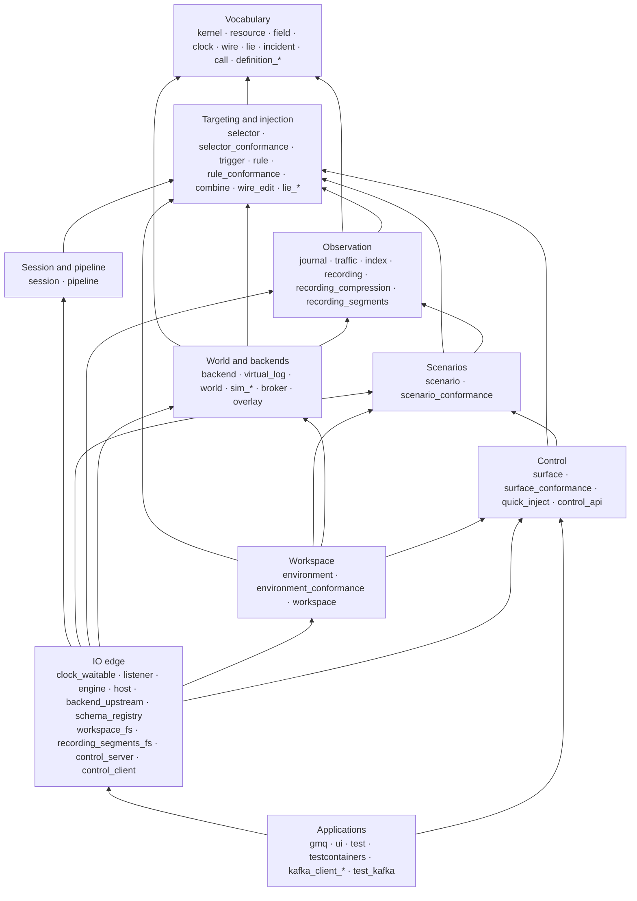

# Crate layout

The workspace splits GaslightMQ into many small crates.
Each crate holds one district of the [town plan](../townplan/README.md),
or one component of the [engine](README.md#components).
This document describes the target layout.
Moving the current crates to it is a separate plan.

Every crate name starts with `gaslightmq_` and uses underscores, never hyphens.
The name in `Cargo.toml`, the directory and the path in code are then one string,
so one search finds all three.
A family of crates shares a directory, and the path below `crates/` spells the name:
`crates/gaslightmq_definition/api` holds `gaslightmq_definition_api`.
A crate's directory may hold its conformance crate, and no other crate:
`crates/gaslightmq_selector/conformance` holds `gaslightmq_selector_conformance`.
The tables leave the prefix out: `selector` is the crate `gaslightmq_selector`.
Two crates stand apart: the facade is plain `gaslightmq`, and the binary is `gmq`.
The workspace's own checks are tooling, and not product code: they live in `xtask/`, outside these tables.

## Principles

- **Logic is sans-IO.**
  A sans-IO crate has no async code, no sockets, no file access, no system clock and no global randomness.
  It takes inputs and the current time as arguments, and returns what should happen.
  Tests drive it with plain function calls.
- **IO lives at the edge.**
  Only a few crates touch the network, the file system or a runtime.
  They are async and thin, and they call the sans-IO crates.
  No crate comes in a blocking and an async variant.
  See [the IO edge is async](#the-io-edge-is-async).
- **A crate boundary needs a reason.**
  A crate exists because something else reuses it,
  because it keeps a heavy dependency away from the rest,
  or because its types travel to the UI, so it must compile to WebAssembly without the Kafka codec.
  Code that always changes together stays in one crate.
- **An internal crate stays inside the crates that use it.**
  Some crates only hold what other crates share, such as the one rule that every name follows.
  Such a crate is internal, and its types are a detail of the crates that use it.
  A crate that uses one offers types of its own: a selector has a `SelectorName` with a `SelectorNameError`.
  Nothing it offers and nothing it documents names the internal crate or one of its types.
  See [internal crates](#internal-crates).
- **Dependencies follow the town plan.**
  Vocabulary crates depend only on other vocabulary crates.
  Logic crates depend on vocabulary.
  The engine depends on logic.
  Nothing depends on the engine except the binaries and the test library.
- **Definitions live with their domain.**
  The crate that owns a concept owns its definition type and its `serde` mapping.
  The `workspace` crate only assembles and cross-checks them.
- **The UI shares types, not logic.**
  The UI reaches the engine only through the control plane.
  It shares the engine's definition types.
  It runs none of the engine's behaviour and none of the Kafka codec.
  See [what compiles to WebAssembly](#what-compiles-to-webassembly).
- **A name says what a thing means.**
  A type, a variant, a method or a module carries a word of the [glossary](../domains/README.md#glossary),
  or it says what it holds or what went wrong.
  It never says which crate, module or type a thing came from, and it never says how the thing is built.
  A partition number that is not a number is an `InvalidPartition`, and not a `Kernel` error.
- **A value object owns its error.**
  A type that checks its value has an error type of its own, named after it:
  `TopicName` has `TopicNameError`, and `Offset` has `OffsetError`.
  Its constructor, its `TryFrom`, its `FromStr` and its `serde` form all return that type.
  The error holds only what can go wrong with that value, and each variant says what is wrong:
  a topic name is `Empty` or `TooLong`, and an offset is `Negative`.
  A type made of parts says which part failed, and it keeps the error of that part:
  `TopicPartitionError::InvalidPartition` holds a `PartitionNumberError`.
  A whole that checks its members does the same: `SelectorSet` has `SelectorSetError`.
  A type that checks nothing has no error type.
  Types may share their checks as private helpers.
- **A variant is something its caller decides on.**
  What a crate does can fail too: it decodes a frame, tells a lie or opens a listener.
  The crate has error types of its own for that.
  A variant is a case for which the caller does something else: it tries again, it closes a connection, it ends a session.
  The rest of what went wrong is text in the message.
  Operations that fail in different ways have an error each:
  a transport that receives and sends has a `ReceiveError` and a `SendError`.
  Operations that fail in the same ways share one: every call of a client returns a `ClientError`.
  No caller writes an arm for a variant that cannot come from what it called.
  An error that asks for such an arm is two errors.
  A crate that only holds value objects has no error of this kind.
- **A contract holds its errors.**
  A crate that holds a contract holds the errors of that contract, one for each thing the caller asks.
  `backend` is the model.
  A call that gets no answer ends with a `BackendFailure`.
  A listener that clients cannot be sent to gets a `ListenerRejection`.
  An incident that cannot happen gets an `IncidentRejection`.
  The engine does something else with each one, and it never handles two of them in one place.
  An implementation returns only the errors of its contract.
  Those errors hold no error of what an implementation uses:
  a lie returns a `LieError`, whatever it reads or writes to tell its lie.
- **A crate turns the errors it meets into its own.**
  A crate handles an error where it calls what failed: another crate, a library or the system.
  It returns a variant of its own error, in the words of its own subject.
  No variant, field or type names the tool, the library or the mechanism behind a failure:
  a connection is `ConnectionLost`, and the error is no `IoError`.
  What a library or the system said is text.
  The variant keeps it in a field, named `reason`.
  Every field of an error has a name: a variant is `ConnectionLost { reason }`, and not `ConnectionLost(reason)`.
  A variant keeps the error of a crate of the workspace, in a field named `error`, in two cases.
  The error is the error of a part: a `TopicPartitionError` keeps the `PartitionNumberError` of its partition.
  Or the caller reads it: `Refused { error: ResponseError }` of `test_kafka` keeps the error that the broker answered,
  and a test reads from it that its topic exists already.
  In every other case, what the other crate said is text in a `reason`.
  No variant copies the variant below it.
  A crate says what the failure below it means for its own caller, and no more:
  a refusal that cannot rewrite a call is `CallNotRewritten`, whichever of the failures of the surgery stood in the way,
  and what the surgery said is the reason.
  No error is made up to fill a field:
  a backend that finds an answer out of step has no error of the codec to show, so it does not build one.
  Nothing names `dyn Error`: no signature, no field, no doc example and no test.
  A doc example returns one error type, by its name.
- **No error type is `#[non_exhaustive]`.**
  A new variant is a new decision for every caller.
  With the attribute, every `match` outside the crate ends in an arm for whatever comes,
  and that arm takes the new variant without anyone deciding.
  Without it, a new variant breaks every `match` that decides on the error, and someone decides.
- **An error says everything in one message.**
  A file reader, the control plane and the UI show one line, and not a chain of causes.
  A variant that holds another error names its own value first, and then writes that error, once.
  It names the text it read too, when the other error read only a part of it:
  ``lifetime `0 firings`: a count is at least one``.
  A variant that holds a `reason` writes it the same way, once.
  The variant keeps the other error in a field, named `error`, for code that wants to look at it.
  No error type writes `source()`, because a reporter that walks the chain would print the cause twice.
  The path of a value in a file comes from the [reader](storage.md#reading), and not from the error of the value:
  `trigger.every: a count is at least one`.
- **Nothing tunable is hardcoded.**
  A timeout, a wait, a size, a count or an interval that someone may want to change is a property of a configuration.
  The property has a name and a default, and the code that waits or counts reads the property.
  A client waits for a response for its `request_timeout`, which is 30 seconds until someone sets it,
  and not for a `Duration::from_secs(30)` in the code that sends the request.
  A value with rules is a value object: a number of attempts that is at least one is not a plain `u32`.
  A number that the Kafka protocol fixes is not tunable, and stays a constant.
- **A Kafka client has Kafka's own properties.**
  A property that Kafka's own clients have keeps its name, its meaning, its unit and its default in our client.
  The configuration of the Java client is the reference.
  The doc comment of the field names the property, so someone who knows Kafka finds it at once:
  `request_timeout` is `request.timeout.ms`.
  A property that Kafka does not have is added only when the client needs it, and its doc comment says that it is ours.
  No property exists for behaviour that the client does not have.

The workspace rules apply to every crate:
Rust edition 2024, native async traits and workspace dependency versions.

## Checks

`cargo xtask` checks the rules of this document that a machine can decide and the compiler cannot see.
`cargo xtask sans-io` runs one check alone.
`just checks` runs them all.
CI builds the checks once, reads their list from `cargo xtask --list`, and runs each check as a job of its own, so a pull request names the check that failed.

| Check | Fails when |
|---|---|
| `dependencies` | A crate depends on a workspace crate that its row does not list, or its row lists one that it does not depend on. A listed crate that does not exist yet is a plan, and passes. |
| `crate-names` | A crate name does not start with `gaslightmq_` or holds a hyphen, or the crate's directory does not carry the name, or a crate's directory holds a crate other than its conformance crate. |
| `wasm-boundary` | A crate that [compiles to WebAssembly](#what-compiles-to-webassembly) reaches `kafka-protocol`. |
| `workspace-rules` | A crate builds with another edition than 2024, depends on `async-trait`, or names a dependency without `workspace = true`. |
| `sans-io` | [Sans-IO code](#sans-io-code) is async, or it names a runtime, a socket, the file system, the system clock, the process or global randomness. |
| `wrapped-errors` | An error type holds another error in a field that is not named `error`, its `source()` returns something other than `None`, or it makes another error its source. |
| `internal-crates` | A crate names an [internal crate](#internal-crates) it depends on, or one of its types, in something that other crates see or in a doc comment. |
| `dyn-errors` | Code, a test, a benchmark, an example or an example in a doc comment names `dyn Error`. |
| `exhaustive-errors` | An error type, or a variant of one, is `#[non_exhaustive]`. |
| `error-fields` | An error type has a field without a name, or its field `error` holds something else than an error of a crate of the workspace: an error of a library or of the system, or text. |
| `error-messages` | The message that an error type derives leaves out its `error` or its `reason`, or writes it more than once. |
| `error-conversions` | A `From` makes an error type from an error of a library or of the system. |
| `test-support` | A crate that is no [test support](#test-support-crates) builds with a test-support crate, through a dependency or a build dependency of its own or of a crate it builds with. Or a crate with the name of test support does not declare itself. |
| `ci-parity` | The CI workflow leaves a check without a job, because no matrix takes its entries from `cargo xtask --list`, or it has no job that runs a recipe of `just ci`, or the job `ci-success` does not need one of the other jobs, so a failure of that job does not block a merge. |
| `ui-tokens` | A Rust file of `ui` holds a string that styles without the tokens of its theme: a raw colour such as `#5e6ad2` or `rgb(`, a Tailwind arbitrary value such as `w-[216px]`, a class that names a colour of Tailwind's palette such as `bg-zinc-900` or `text-white`, or a `dark:` variant. |
| `ui-theme` | The theme of `ui`, `tailwind.css`, holds a colour that is no OKLCH, or a colour token that the dark theme of `@theme` or the light theme of `[data-theme="light"]` lacks. |

A check reads the names in the code, and not what the code does.
The documentation of each check, in `xtask/src/`, says what it does not catch.
The other principles need a reviewer.

### Sans-IO code

A crate whose row does not say "This crate does IO" is sans-IO as a whole.
The `sans-io` check reads its dependencies and every file of its source.

A crate that does IO declares the modules it keeps sans-IO in its `Cargo.toml`:

```toml
[package.metadata.gaslightmq]
sans_io_modules = ["logic"]
```

The check then reads `src/logic.rs`, or `src/logic/mod.rs` and every file below `src/logic/`, as it reads a sans-IO crate.
A sans-IO module names nothing of its own crate outside the sans-IO modules.
A module that holds the types it works on, such as a configuration or an error, is therefore declared too.

A trait of a sans-IO crate may declare an async method, because a declaration runs nothing.
[`backend`](#the-backend-seam) declares its contract that way, and so do the crates that hold [a store trait](#the-store-seam).
The return type of such a method may name the future it returns, where the trait declares the method and where a type implements it.
Nothing else in sans-IO code names a future, and no sans-IO code has an async block.

Some sans-IO code awaits a store: the crates `definition_memory` and `workspace`, the conformance crates, and one module of the crate of a definition.
That module, `store`, holds its store trait, whose methods with a body read what the store lists.
The module `store` of `definition_api` is such code too: the contract answers there for a store that nobody else changes,
in the methods with a body that such a store keeps as they are.
The check lets this code have async functions with a body and await, and no other async code.
A method of a trait whose whole body is one async block counts as such a function: it is written out so that its signature can say that its future is `Send`.
This code makes no other future, and it names no task and no runtime, so it starts nothing, waits for no timer and never blocks.
Everything else in the crate of a definition is held to the rule of every sans-IO crate.

`recording_segments` awaits in the same way: the [backing](#the-recording-seam) it is handed, and nothing else.
It awaits in two modules: `storage`, which keeps the storage contract over a backing, and `memory`, the backing in memory.
Its framing, its order of writing, its recovery and its budgets are plain functions over bytes, and the check holds them to the rule of every sans-IO crate.

### Internal crates

A crate declares itself internal in its `Cargo.toml`:

```toml
[package.metadata.gaslightmq]
internal = true
```

Its row says "This crate is internal".
The `internal-crates` check reads the name of the crate and of every type it exports,
and then every crate that depends on it.
In such a crate, only private code names them: a private `use`, a private field and the body of a function.
A public function, field, type alias or trait does not name them,
and neither does an implementation of a trait or a re-export.
No doc comment names them either, and no example in one.

### Test-support crates

A test-support crate is for the tests of other crates.
It holds what several of them test with: the check of a contract, or a cluster of real brokers.
It never ships, so only a dev-dependency names it.

A crate declares itself test support in its `Cargo.toml`:

```toml
[package.metadata.gaslightmq]
test_support = true
```

Its row says "This crate is test support".
The `test-support` check reads the dependencies and the build dependencies of every crate that does not declare itself,
and follows them through the workspace.
None of them leads to a test-support crate.
A test-support crate may build with another one: the check of a store of selectors builds on the check of every store.

A crate whose name ends in `_conformance` is test support, and so is `test_kafka`.
The check fails when such a crate does not declare itself, because it would then pass as a crate that ships.

| Test support | For the tests of |
|---|---|
| `definition_conformance` | Any store of definitions. |
| `selector_conformance`, `rule_conformance`, `scenario_conformance`, `surface_conformance`, `environment_conformance` | A store of the kinds that the crate before the `_conformance` defines. |
| `recording_conformance` | Any storage of recordings. |
| `recording_segments_conformance` | Any backing of the segment layout. |
| `test_kafka` | The crates that speak to a real Kafka cluster. |

## Layers



An arrow means "depends on".
Every crate outside the IO edge is sans-IO.
The tables list each IO crate next to the domain it serves, and mark it with "This crate does IO".

## Crates

### Vocabulary

Vocabulary crates hold types and almost no behaviour.
Every other crate speaks in them.

| Crate | Holds | Depends on |
|---|---|---|
| `kernel` | The value objects of Kafka: topic names and IDs, partition numbers, offsets, positions such as `orders.eu/3`, broker IDs, epochs, the IDs of clients, groups and producers, and API keys and error codes with the names Kafka gives them. Each type only holds valid values. | — |
| `resource` | The [resource](control-plane.md#resources) vocabulary: the name and the title of a resource, with the one rule that each of them follows. They are the rules of the [name](../domains/rules.md#names) and the [title](../domains/rules.md#titles) of a rule. Each kind of resource has a name and a title of its own that wrap them, so the name of a selector never stands where the name of a rule belongs. Also what a process keeps beside a resource: the [revision](identity.md#revision), with the counter that gives it, and the IDs that nobody counts, each made from the 128 random bits that its caller hands in: the [ID of a run](identity.md#run), and the ID of a [presence](control-plane.md#presence). It writes each of them into the crate that gives, holds or carries it, as it writes the names and the titles, so that crate offers them as its own. This crate is [internal](#internal-crates). | — |
| `field` | The [field vocabulary](../domains/targeting.md#fields): field names, their typed values, and the `FieldSource` trait that a live call and a recorded call both implement. Also the parts of a call, and the [target](../domains/lies-and-incidents.md#target) that a match yields. Every district of the town plan [shares this vocabulary](../townplan/README.md#targeting-is-a-shared-kernel). | `kernel`, `clock` |
| `clock` | The [clock](README.md#clock): a `Clock` trait, the virtual clock, and instants that do not come from the system. Also the instant in UTC to the millisecond, which names when a recording started, and the `UtcClock` trait that hands out the current one: an instant is such a clock that stands still, and the wall clock of `clock_waitable` is another. | — |
| `clock_waitable` | The clocks that a task waits on: a `WaitableClock` trait, which says when a clock reaches an instant, the wall clock, which also tells the instant in UTC that names a recording, and a clock that moves when its owner moves it, which is the virtual clock behind a handle. An engine waits on the clock that whoever starts it hands over. This crate does IO. | `clock` |
| `wire` | The Kafka codec: frames, headers, lazily decoded bodies and record batches. | — |
| `lie` | The [lie](../domains/lies-and-incidents.md#lies) vocabulary: kind, stage, combination class, aspect and priority, the definition of every lie kind as data, and a lie with the [target](../domains/lies-and-incidents.md#target) it applies to. It holds no behaviour. See [lies as crates](#lies-as-crates). | `field`, `kernel`, `clock` |
| `incident` | The [incident](../domains/lies-and-incidents.md#incidents) vocabulary, the expansion into consequences, and the support a backend declares for each kind of incident. | `kernel` |
| `call` | The [call](../domains/observation.md#call) record: identity, request summary, truth, delivered response, verdict, explanation and timing. | `field`, `lie`, `incident`, `kernel`, `resource`, `clock` |
| `definition_api` | The [store contract](#the-store-seam): the one async trait through which the definitions of one kind are listed, read, created, updated and deleted, and the errors of each. Through it, a store also says what a write would lose, and what changed behind it. A definition is whatever someone defined under a name, and the crate knows no kind of definition. It holds no logic and needs no runtime. | — |
| `definition_memory` | The store that keeps the definitions of one kind in memory, for any kind: for tests, and for an engine that runs [without a workspace](storage.md#without-a-workspace). It knows no kind of definition. | `definition_api` |
| `definition_conformance` | What every store does, as one check that the tests of any store run. Whoever runs it hands in the definitions that it stores, so it knows no kind of definition. This crate is [test support](#test-support-crates). | `definition_api` |

### Targeting and injection

| Crate | Holds | Depends on |
|---|---|---|
| `selector` | Conditions, selectors, includes and scope. The set of selectors, which resolves includes into effective selectors. Matching against a `FieldSource`, with the [target](../domains/lies-and-incidents.md#target) a match yields and the evaluation pass that decides it, and whether a selector can match a stretch of calls from the values that its [summary](recording-storage.md#summary) lists. An index of selectors by API. Also the [store trait](#the-store-seam) of the selectors, with the store in memory behind a feature. | `field`, `kernel`, `resource`, `definition_api`, `definition_memory` |
| `selector_conformance` | What a store of selectors does, as a check that the tests of any store of selectors run: the store contract with selectors, and who includes a selector. This crate is [test support](#test-support-crates). | `selector`, `definition_conformance`, `kernel` |
| `trigger` | [Triggers](../domains/rules.md#trigger), counters, dice, budgets and lifetimes. | `clock` |
| `rule` | The rule definition, the [preset](../domains/lies-and-incidents.md#presets), the rule's state, and the immutable snapshot of armed rules in priority order. The snapshot [evaluates a call](../domains/rules.md#evaluating-one-call): for each pass and each matching rule, the target, what the trigger rolled, and the lie or the incidents it fired. Also the [store traits](#the-store-seam) of the rules and of the presets, with the stores in memory behind a feature. | `selector`, `lie`, `incident`, `trigger`, `field`, `kernel`, `resource`, `clock`, `definition_api`, `definition_memory` |
| `rule_conformance` | What a store of rules and a store of presets do, as checks that the tests of any such store run: the store contract with rules and with presets, and which rules use a selector or a preset. This crate is [test support](#test-support-crates). | `rule`, `definition_conformance`, `selector`, `lie`, `kernel` |
| `combine` | [How lies combine](../domains/lies-and-incidents.md#how-lies-combine): which lies conflict, which win by priority, which are shadowed or pre-empted, across [both evaluation passes](request-pipeline.md#two-evaluation-passes). Also what the lies that apply do to the call at each stage: the refusals and rewrites per target, the summed delay and the maximum throttle. | `lie`, `field`, `clock` |
| `wire_edit` | Surgery on requests and responses: remove partitions, merge responses, synthesize an error response for any API, map topic IDs to names. It also reads what a response says about each [part](../domains/lies-and-incidents.md#target) of its request, and the error code of the response itself. | `wire`, `field`, `kernel` |
| `lie_api` | The contract between the pipeline and a lie kind: the `Lie` trait, and the effect that one lie asks the pipeline for. A lie gets the request decoded, with its parts named. Also the behaviour of timing, silence and hang-up. See [lies as crates](#lies-as-crates). | `lie`, `wire`, `wire_edit`, `field` |
| `lie_refusal` | Refusals for every API, before forwarding and after the response. | `lie`, `lie_api`, `wire_edit`, `wire`, `field`, `kernel` |
| `lie_topology` | Rewrites of Metadata, `FindCoordinator` and `DescribeCluster`. | `lie`, `lie_api`, `wire_edit` |
| `lie_data` | Altered, dropped, duplicated, reordered and corrupted records. | `lie`, `lie_api`, `wire_edit`, `schema` |
| `lie_progress` | Rewrites of watermarks, log start offsets and committed offsets. | `lie`, `lie_api`, `wire_edit` |
| `lie_config` | Rewrites of `DescribeConfigs` responses. | `lie`, `lie_api`, `wire_edit` |

### Session and pipeline

| Crate | Holds | Depends on |
|---|---|---|
| `session` | The state of one [session](../domains/session.md), which its pipeline owns: lifecycle, identity, session key, per-session counters, in-flight calls, response ordering and the stalled state. Also the client context that sessions share, and the count that gives every call of an environment its [call ID](identity.md#call-id). | `field`, `kernel`, `call`, `wire`, `trigger`, `clock` |
| `pipeline` | The [request pipeline](request-pipeline.md) as a state machine: all stages, both evaluation passes and partial refusals. Also the topics that a proxy knows by ID, which its sessions share. While a recording runs, a call that arrives hands the [frames it holds](recording-storage.md#handing-frames-to-the-recorder) out with its record: the request, the answer of the real cluster when the overlay changed it, the truth and the response that the client received. | `wire`, `wire_edit`, `selector`, `rule`, `trigger`, `lie`, `lie_api`, `combine`, `session`, `call`, `incident`, `field`, `kernel`, `clock` |

### Scenarios

| Crate | Holds | Depends on |
|---|---|---|
| `scenario` | The [scenario](../domains/scenarios.md) definition: its [mode](../domains/scenarios.md#modes), the rules it owns or names, and the [steps](../domains/scenarios.md#sequence) of a Sequence with the condition that ends each one. It checks what one scenario holds, and leaves what it names to the workspace. Also the [store trait](#the-store-seam) of the scenarios, with the store in memory behind a feature. Also the scenario resolved against the rules, the selectors and the presets of a workspace, which says the incidents that the backend of an environment must support, and the run: the step machine of a Sequence, which counts the calls of a step by their IDs and their fields, hands out the budget of a step that ends on firings, says when a step that ends after a time ends, and gives the rules that the scenario keeps armed in the order of its mode. It takes calls and time, and says what to arm and disarm. Also [capture](../domains/scenarios.md#capture): it reads the entries of a journal, marks every arm and disarm of the live set with its time, keeps a live rule as it was armed, and gives a step for every change when it stops, with the live rules that the steps arm. It takes journal entries, and the definition of a live rule as it arms. | `rule`, `selector`, `trigger`, `call`, `field`, `incident`, `journal`, `resource`, `clock`, `definition_api`, `definition_memory` |
| `scenario_conformance` | What a store of scenarios does, as a check that the tests of any store of scenarios run: the store contract with scenarios, and which scenarios name a rule, a selector or a preset. This crate is [test support](#test-support-crates). | `scenario`, `definition_conformance`, `rule`, `selector`, `trigger` |

### Observation

| Crate | Holds | Depends on |
|---|---|---|
| `traffic` | The live window of recent calls, subscriptions by selector, statistics per rule and per API, and the topics, groups and clients that the calls named. It takes the record of each call and says which subscriptions it goes to, and it sends nothing itself. | `call`, `selector`, `rule`, `field`, `kernel` |
| `index` | The [index](../domains/observation.md#index): facets, counts under the active filters, suggested patterns. It takes a call record, or the fields of a call that a reader of a recording built, and reads no recording itself. | `call`, `selector`, `field` |
| `journal` | The [journal](../domains/observation.md#journal): its entries, each with its [number](identity.md#journal-entry-id), its time, its [surface](../domains/observation.md#surfaces), its cause and the revision that its change left, and what changed. Also the name by which an entry names a rule or a definition, the parameter of a rule that an entry names, and the recent journal: it numbers the entries of one environment and keeps the latest in memory, as many as its size says. The start and the stop of a capture are entries too. Also the [ID of a recording](identity.md#recording-id), which the control plane and the UI name a recording by: it lives with the words of the journal, which compile to WebAssembly, next to the name of an environment and the instant of `clock` that it is made of, and `recording` names it as its own. | `incident`, `resource`, `clock` |
| `recording` | The [storage contract](recording-storage.md#the-storage-contract) of recordings: the traits through which a recording is started, appended to, committed, ended, listed, opened and read, and the errors of each. What a recording holds: its [ID](identity.md#recording-id) and the instant it started, which `journal` and `clock` hold and this crate names as its own, its description, its entries, which are session events, calls with their raw frames and journal entries, the position of an entry, the summary of a stretch, and how a recording ended. It owns the [encoding](recording-storage.md#a-message) of every message of a recording, which is an entry, a description, a summary or an end: a message is the archive of a stored type, and the crate holds the stored types of every [version](recording-storage.md#versions) of the encoding, one module for each, with the conversion from each version to the next, the samples of each version and their bytes. It writes entries in the current version. It checks the buffer of a batch once, and then reads it through views of a call, its fields, its explanation, a journal entry and a session event, which copy nothing and allocate nothing. It converts a batch of an older version to the current one first. A view builds the type of `call` or `journal` through its checks when a reader asks for it. It applies the recording mode and blanks credentials where an entry is made, so no storage sees what a recording must not keep. It builds the types of a call and of a journal entry through their checks, so it names the vocabulary that they hold: the value objects of Kafka, the lies and the incidents. It knows no layout, and it needs no runtime. | `call`, `journal`, `wire`, `field`, `kernel`, `lie`, `incident`, `clock`, `environment` |
| `recording_conformance` | What every storage of recordings does, as a check that the tests of any storage run. It writes a small recording of its own for that, in the vocabulary of a call and of a journal. Also a storage in memory, which is the smallest storage that keeps the contract: the check is held to it, and the tests of a recorder or of a reader use it where they need no layout. It hands every entry of a recording back as its type, for a test to compare. This crate is [test support](#test-support-crates). | `recording`, `call`, `journal`, `wire`, `field`, `kernel`, `lie`, `clock`, `environment` |
| `recording_segments` | The [segment layout](recording-storage.md#the-segment-layout), as a storage of recordings over any backing: data segments of compressed blocks, index chunks that describe the segments, and a manifest that lists the index chunks. It keeps the entries that `recording` wrote and the version of the encoding that they have, and never looks into one. It holds the framing of its objects, which is fixed binary: headers, and records that carry the summaries of a span of blocks, of a segment and of an index chunk. It has no message and no stored type of its own. It holds the order of writing, and the recovery of a recording that was cut short, each as plain functions over bytes, and the [memory budgets](recording-storage.md#memory) of one reader and of all readers of a process, which refuse a stream and make none wait. It compresses a block with the codec that a new recording is set to, and unpacks one with the codec that the header of the block names, through [`recording_compression`](recording-storage.md#the-codec), into one buffer that starts at a multiple of 16. Also the [backing contract](recording-storage.md#the-segment-backing): the one async trait through which the layout keeps its three kinds of object and reads them as streams, and its errors. Behind the feature `memory`, the backing in memory. It awaits the backing it is handed, in the module that keeps the storage contract and in the backing in memory, and does nothing else that is async. | `recording`, `recording_compression` |
| `recording_compression` | The [codecs](recording-storage.md#the-codec) of a recording: a compressor and a decompressor over a closed set of codecs, which is none and Zstandard with its level. A reader takes the codec at run time, from the number that a header names it by. Each block is a codec frame of its own, so a reader starts at any block and a torn tail loses the open block alone. It unpacks a block into the buffer of its batch, which starts at a multiple of 16, and it knows no entry and no segment. It is not async and starts no thread: it works on the thread that calls it. It is a crate of its own because it brings the library that compresses. | `recording` |
| `recording_segments_conformance` | What every backing of the segment layout does, as a check that the tests of any backing run. This crate is [test support](#test-support-crates). | `recording_segments`, `recording` |
| `recording_segments_fs` | The backing on files: one directory for each recording, with its segments, its index chunks and its manifest as files. An append is on the disk when it returns, a seal and a replacement happen in one step, and a sealed segment is mapped into memory, so its bytes go into the codec as ranges of the map, and the system is told which ranges come next. A file that grows is read into buffers. Every touch of a file runs on the blocking pool of the runtime. It returns the errors of the backing contract, and has none of its own. This crate does IO. | `recording_segments`, `recording` |

### World and backends

| Crate | Holds | Depends on |
|---|---|---|
| `backend` | The [backend contract](backends.md#contract): the request and answer messages, and the one async trait through which the engine reaches a backend. It holds no logic and needs no runtime. See [the backend seam](#the-backend-seam). | `wire`, `incident`, `call`, `field` |
| `schema` | Record [formats and schemas](../domains/world.md#schemas): encode and decode JSON, Avro and Protobuf, one feature per format. | — |
| `virtual_log` | [Virtual records](../domains/world.md#virtual-records): the record at a partition and offset as a pure function of the definition, templates, stable batches, and the mapping between offsets and time. | `wire`, `clock`, `schema` |
| `schema_registry` | The built-in [schema registry](backends.md#schema-registry) and a client for a real one. This crate does IO. | `schema` |
| `world` | The [World](../domains/world.md): its state, world definitions, how each incident changes it, and where each topic's records come from. | `wire`, `incident`, `clock`, `virtual_log` |
| `world_seed` | Seeding a world definition from a recording. | `world`, `index`, `recording` |
| `sim_log` | Produce, Fetch, offsets and idempotent producers against the World. | `world`, `wire` |
| `sim_group` | Group coordination against the World, for the classic and the consumer protocol. | `world`, `wire`, `clock` |
| `overlay` | The Upstream [overlay](backends.md#overlay): address translation, emulated incidents and sessionless Fetch. It rewrites requests and responses, and it opens no connection. | `backend`, `wire`, `wire_edit`, `incident`, `field`, `kernel` |
| `broker` | The broker instance as a [state machine](#the-broker-is-a-state-machine-too): it routes each request to a `sim_*` crate, applies incidents to the World and owns the virtual clock. It speaks the messages of the backend contract, so a proxy reaches it without a socket. | `backend`, `world`, `sim_log`, `sim_group`, `clock` |
| `backend_upstream` | The Upstream backend: the discovery of the brokers, and one connection to the real cluster for each connection of a client, with the overlay around them. This crate does IO. | `backend`, `overlay`, `environment`, `wire`, `field`, `kernel`, `incident`, `clock` |

Transactions arrive later as `sim_txn`, next to `sim_log` and `sim_group`.

### Workspace

| Crate | Holds | Depends on |
|---|---|---|
| `environment` | [Environments](storage.md#environments) with where their [brokers](storage.md#brokers) listen: a range of ports, a free port for each broker, or pins. Also [secret references](storage.md#secrets), and the order in which flags, variables and files set a value. It never reads a secret. Also the settings of a workspace, as `gaslight.yaml` holds them. Also the [store trait](#the-store-seam) of the environments, with the store in memory behind a feature. | `kernel`, `resource`, `definition_api`, `definition_memory` |
| `environment_conformance` | What a store of environments does, as a check that the tests of any store of environments run: the store contract with environments. This crate is [test support](#test-support-crates). | `environment`, `definition_conformance` |
| `workspace` | The whole set of definitions as one model, over a store for each kind: cross-reference validation, and the [revision](identity.md#revision) of every definition it holds. It keeps the revision in memory, beside the definition: no definition holds one, and no store does. It holds the counter of the process, which gives the revision of every change. It loads the definitions of its stores once, and takes in what changed there on a [reload](storage.md#reloading). It names the stores of every kind as one context, and it knows no files. Behind a feature, it has the stores of a workspace in memory and the context over them. See [the store seam](#the-store-seam). | `definition_api`, `definition_memory`, `resource`, `selector`, `rule`, `scenario`, `surface`, `world`, `environment` |
| `workspace_fs` | The stores that keep definitions in the files of a [workspace](storage.md#workspace): the YAML layout, loading, reading again for a reload and [writing back](storage.md#writing-back). A [reading error](storage.md#reading) names the file and the path of the key that failed. A write changes the one definition that changed, in its one written form, and the store says which definitions hold a comment that a write would lose. Before a write, the store [checks](storage.md#the-check-before-a-write) that nobody changed the file since it read it, and it replaces the file in one step. A workspace that [writes on save](storage.md#saving) holds every edit in memory, and a save checks every file it would write before it writes one. A [read-only workspace](storage.md#read-only-workspaces) is read, read again, and never written. It keeps the selectors, the presets, the rules, the scenarios, the pad layouts and the environments. The worlds with the templates, schemas and data files they name, the settings in `gaslight.yaml`, the scratch file, and reading the files that secret references name come next. This crate does IO. | `definition_api`, `workspace`, `selector`, `rule`, `scenario`, `surface`, `environment` |

### Control

| Crate | Holds | Depends on |
|---|---|---|
| `surface` | [Pad layouts](../domains/control-surfaces.md#pad-layout), layers, pads as positions, the encoder mapping, and the intents a surface sends. Also the ID of a [presence](control-plane.md#presence), which a hold belongs to, and the state of one surface: the layer it shows, its mode of play, its focus and the pads that someone holds, and the [store trait](#the-store-seam) of the pad layouts, with the store in memory behind a feature. | `rule`, `selector`, `trigger`, `lie`, `field`, `kernel`, `resource`, `clock`, `definition_api`, `definition_memory` |
| `surface_conformance` | What a store of pad layouts does, as a check that the tests of any store of layouts run: the store contract with layouts, and which layouts have a row for a selector or a column for a preset. This crate is [test support](#test-support-crates). | `surface`, `definition_conformance`, `selector`, `rule` |
| `quick_inject` | The ⌘K sentence parser: text to a rule definition, with completions for the word that is being typed, and the words it could not read. Whoever reads a sentence hands over the names the system knows. The host runs it behind the [control plane](control-plane.md#drafts). | `selector`, `lie`, `rule`, `trigger`, `field`, `kernel`, `clock` |
| `control_api` | The [control plane](control-plane.md) as types: every operation with its answer and its error, [where a request comes from](control-plane.md#where-a-request-comes-from), with the [presence](control-plane.md#presence) of its sender, the run and the [revision](control-plane.md#revisions) that a change expects and the revision it leaves, and the messages of the live stream, the first of which names the presence of its client. It carries the entries of the [journal](control-plane.md#the-journal) as their crate has them, with the query that reads them, and its revision is the one that an entry holds. It carries the ID of a recording as `journal` has it, and its own view of what a recording is, how far it goes and how it ended, and of the [index](control-plane.md#querying-a-recording) of a recording, so `index` is no crate of the UI. A query of a recording names its selector as a rule does, with a draft beside it. A capture that stops answers with its steps and its live rules, as the definitions of `scenario` and `rule` write them. It re-exports the crates of the definition types its messages carry, one module per domain, so the UI names them through it. It holds its own view of the World's state. | `call`, `journal`, `rule`, `scenario`, `selector`, `surface`, `incident`, `environment`, `lie`, `trigger`, `field`, `kernel`, `clock`, `resource` |
| `control_client` | A client for the control plane, for native targets and for WebAssembly. It sends an operation and returns what the control plane answered: the answer or the error of that operation, each typed by it. Every request says [where it comes from](control-plane.md#where-a-request-comes-from): the surface that the client is, which its configuration names, or the source that one request names itself. An operation without an answer of its own is a `SendError`, so a caller never takes it for a refusal of the operation. It opens and follows the live stream, which ends with a `StreamError`. A stream names the [presence](control-plane.md#presence) of its client. A stream does not reconnect: the caller opens a new one, as a new presence or as the one it was, and it starts with a fresh snapshot. A stream answers the pings of the control plane while its caller waits for its next message. A caller can close a stream with a word, and the call returns once the control plane let go of it. The client speaks plain HTTP and WebSocket, without TLS. Over HTTP and a WebSocket: on Tokio, or through the browser's own fetch and WebSocket, one feature each. This crate does IO. | `control_api` |
| `control_server` | The HTTP and WebSocket server in front of the host: it answers every [operation](control-plane.md#operations) with the host, reads [where each request comes from](control-plane.md#where-a-request-comes-from), refuses one that does not say so, and hands the surface and the cause to the host with every change, hands the run and every [revision](control-plane.md#revisions) of the host out as the control plane writes them, starts an environment of the workspace by its name, and sends the live stream: every change of the host, every entry of a [journal](control-plane.md#the-journal), the calls that a client follows, and the statistics at an interval. It holds the [presences](control-plane.md#presence) of the clients of the live stream: it makes the ID of each from the randomness of the system, opens it in the host, keeps it for a grace period once its last stream ended, and ends it in the host when its client stayed away or the server stops. It pings every client of the stream at an interval, and ends the stream of one that went silent. What it decides about a presence is sans-IO code, and the grace period and the pings run on the clock that the server is handed: the wall clock, or one that a test steps. It answers a probe of the [health](control-plane.md#health) of the process on `GET /health`. It serves the files of the UI on every other path, and a release build holds them. See [over the network](control-plane.md#over-the-network). This crate does IO. | `host`, `control_api`, `engine`, `session`, `recording`, `workspace`, `definition_api`, `quick_inject`, `clock_waitable` |

### Runtime and applications

| Crate | Holds | Depends on |
|---|---|---|
| `engine` | The runtime of one proxy: one task per session that owns the transport and drives the pipeline, a listener for every endpoint of the backend, the armed rules, the sessions that are open, the scenario runner, the event bus, the journal, the recorder and the indexer. It keeps the recent [journal](../domains/observation.md#the-journal-only-grows) of its environment: it numbers the entries that whoever changes the environment records, tells their time on its clock, and hands each one over with its events. It holds a [storage of recordings](#the-recording-seam) and names no layout, and its recorder writes the recording that runs on a thread of its own, behind a queue with bounds: the sessions hand it the calls with [their frames](recording-storage.md#handing-frames-to-the-recorder), the events of the sessions and the entries of the journal, and never wait for it. It lists and opens the recordings of its storage, and commits a recording that runs before someone reads it. It [queries](control-plane.md#querying-a-recording) a recording with a selector: it streams the stretches whose summaries the check of `selector` leaves, reads no frame, decides every call with the selector, and copies out the calls of one page as their type. Its indexer builds the index of a recording when someone first asks for it, and reads on from there with every ask. It keeps the recordings that someone read last open, as many as `recordings.open_recordings` says, each with its reader and its index, so the description of a storage, such as the manifest of the segment layout, stays in memory while they are open. A reading that finds no room in the budget of the readers is refused, and waits for nothing. Its armed rules are the live set above the scenario that is active, and it drives the run of that scenario: a session hands every call that it records to the armed rules before it takes its next frame, so a step ends on the call that ends it, a step that ends after firings hands its rule a budget of them, and a step that ends after a time ends on the clock of the engine. A step that ends by itself waits in the armed rules until whoever counts the changes of the environment takes it. Its journal runs the [capture](../domains/scenarios.md#capture) of the environment under the lock of its entries, so every entry reaches the capture in the order of the IDs, whoever records it; whoever arms a live rule by hand records the arming with the definition it arms with. This crate does IO. | `pipeline`, `session`, `rule`, `scenario`, `trigger`, `lie_api`, `call`, `incident`, `field`, `wire`, `journal`, `recording`, `index`, `selector`, `backend`, `listener`, `environment`, `kernel`, `clock`, `clock_waitable` |
| `ui` | The web UI, a Dioxus application compiled to WebAssembly. It reaches the engine only through the control plane: it applies every message of the live stream to the snapshot, follows the calls of the environment it shows with its filter as the selector, and sends operations and the intents of pads, each as a request of the surface that sends it: a view, the pads or ⌘K. It is one [presence](control-plane.md#presence) of the control plane: every request names it, a stream that opens again comes back as it, and a release that did not arrive goes out again until it does. It keeps the [undo history](../domains/control-surfaces.md#undo-and-redo) of its tab, and reads the inverse of every change from what the control plane answered. What it knows and decides is sans-IO code that the tests drive without a browser, and the components and the connection around it run in the browser. The control server serves its files. It styles with Tailwind and the tokens of its theme, each named by its role, in OKLCH, with a dark and a light value. This crate does IO. | `control_api`, `control_client`, `surface` |
| `listener` | Kafka on a socket: accept connections, frame bytes, and run whatever [handles a connection](#the-connection-handler). A proxy's pipeline and a broker alone both sit behind it. This crate does IO. | `wire`, `field`, `clock` |
| `host` | One process with several [environments](storage.md#several-environments-in-one-process): it starts and stops proxies and brokers, runs the task that drives each broker, and shares the workspace and the control plane between them. It holds the workspace over the context it is handed, whichever stores that names, resolves the rules it arms against that workspace, and reads ⌘K sentences with its names. It holds the live rules of every environment and keeps every rule name unique, among the rules of the workspace, the live rules and the rules that scenarios own, acts on what someone does at a pad, counts the traffic of every environment and hands its calls to whoever follows them, holds the [ID of its run](identity.md#run), keeps the environments that the process started with, for its [health](control-plane.md#health), activates, deactivates and steps the scenario of an environment, after its backend said that it supports the incidents of the scenario, gives every rule of an environment and the scenario of every environment its [revision](identity.md#revision), refuses a change that expects another revision or another run, counts the holds of a rule, ends the holds of a [presence](control-plane.md#presence) that whoever lets clients connect ended, takes [where every change comes from](control-plane.md#where-a-request-comes-from) and records the change in the [journal](../domains/observation.md#journal) of its environment, a change of a definition in the journal of every environment that runs, and tells every change of the process to whoever follows it. It starts and stops the recording of an environment, names it by the instant of the clock in UTC that it is handed, the wall clock unless a test hands another, keeps every recording of the process in the one storage that it is handed, and the segment layout in memory when it is handed none. It queries a recording with a selector of the workspace, inline conditions or a draft that stands in for the selector of its name, and gives its index under a filter, each resolved against the selectors of the workspace. It starts and stops the [capture](../domains/scenarios.md#capture) of an environment with the live set as it stands, keeps what the last capture captured, and saves it as a scenario with the seed of the proxy, keeping the live rules that the scenario uses under one hold of the workspace. See [the host](#the-host). This crate does IO. | `engine`, `broker`, `backend`, `backend_upstream`, `call`, `journal`, `recording`, `recording_segments`, `workspace`, `scenario`, `environment`, `quick_inject`, `surface`, `traffic`, `clock`, `clock_waitable`, `lie`, `lie_api`, `rule`, `trigger`, `selector`, `field`, `incident`, `definition_api`, `resource` |
| `test` | The test library: it starts a proxy, a broker, or a proxy in front of a broker inside the test's own process, on free ports, with a control plane on a free port of its own, and hands the test the addresses its clients connect to. A proxy gives a free port to each broker that it finds in the cluster, so a test names no broker. It holds the workspace over the context it is handed, as the host does, and over stores in memory when the test hands none. The proxy tells every lie that GaslightMQ has: the lies of every build, and the refusal, so a test arms whatever lie it needs without naming the lies of its build. The test reaches the instance through the control plane, and speaks its words, so the crate takes the vocabulary it names, such as an environment and a broker ID, through the re-exports of `control_api` and depends on no crate of it alone. The test arms rules there, creates and activates scenarios, and starts, stops, opens and queries recordings, which its host keeps in the segment layout in memory, and asserts on the verdicts and the explanations of the calls that a query answers with. This crate does IO. See [instances in a test](#instances-in-a-test). | `control_api`, `control_client`, `control_server`, `host`, `lie_api`, `lie_refusal`, `workspace` |
| `testcontainers` | A container module: it starts the GaslightMQ image next to a test, with the workspace the test hands over, waits until the instance is ready, and hands the test the addresses its clients connect to. The container runs on the network of the machine of the test, so the instance reaches the cluster under the addresses that the test reaches it under. The instance is ready once it printed where it listens, and its control plane says that its environment runs. The test reaches the instance through the control plane, and speaks its words, so the crate takes the vocabulary it names, such as an environment and a server address, through the re-exports of `control_api`. This crate does IO. See [instances in a test](#instances-in-a-test). | `control_client`, `control_api` |
| `kafka_client_api` | What a Kafka client offers to a test, whichever client it is: the producer, consumer and admin traits, one trait per protocol API, and a raw client that sends one request at a fixed version. Every call of a client returns one error, `ClientError`. A broker that refuses a call is the variant that holds the broker's error code, and a failure of the client holds no error code, so a test never takes one for the other. This crate does IO. | `wire`, `kernel` |
| `kafka_client_native` | Our own Kafka client behind those traits, as three types: a producer, a consumer and an admin. Every instance has its own connections, its own view of the cluster, its own configuration and its own `client.id`, so a fault or a lie reaches one role alone. The consumer is one member of each group it joins, and everything it says about a group travels on connections of its own, so a Fetch that waits never delays a Heartbeat. Each role follows partition leaders, negotiates API versions on every connection, and reports every failure as the `ClientError` of `kafka_client_api`. What a role decides is sans-IO code inside the crate, and the async part only owns sockets and timers. This crate does IO. | `kafka_client_api`, `wire`, `kernel`, `clock` |
| `test_kafka` | A real Kafka cluster for the tests of this workspace: brokers of the version the workspace tests against, each with an address for the clients of a test. Its own handles create topics, write records, read them back and open transactions, with one request at a fixed version each. They share the codec with the client a test is about, and no decision of a client. It starts no GaslightMQ. This crate is [test support](#test-support-crates). This crate does IO. See [a real cluster in a test](#a-real-cluster-in-a-test). | `wire`, `kernel`, `clock` |
| `gaslightmq` | The facade crate: `Proxy`, `Broker` and `Host`, and re-exports of what library users need. This crate does IO. | The public crates |
| `gmq` | The binary: `gmq proxy`, `gmq broker`, `gmq start`, `gmq run`, `gmq init`, `gmq health` and `gmq reload`. It reads the flags, the variables and the files once, and hands the host and the control server their configuration. It writes the context of the workspace, and picks its stores there: files, or memory when there are none. It picks the storage of the recordings the same way: the segment layout on files under `recordings.directory` of the workspace, or the host's in memory without one. It makes the [ID of the run](identity.md#run) from the randomness of the system, and hands it to the host. It names the lies of its build, one feature for each crate of a lie kind. It starts the environments of its start with the host, which keeps them for the [health](control-plane.md#health) of the process. `gmq proxy` in front of a real cluster, `gmq reload` and `gmq health` are there, with the [flags](storage.md#the-flags-of-gmq) that they take; `gmq broker`, `gmq start`, `gmq run` and `gmq init` come next, and so does reading `gaslight.yaml`. This crate does IO. | `host`, `engine`, `control_server`, `control_client`, `control_api`, `workspace_fs`, `workspace`, `definition_api`, `environment`, `recording_segments`, `recording_segments_fs`, `lie_api`, `lie_refusal` |

## The pipeline is sans-IO

`pipeline` is a state machine for one connection.
The engine feeds it what happened and performs what it returns.
The pipeline never reads a socket, never sleeps and never looks at a clock.

```rust
/// What happened. The engine reports it.
pub enum Input<'a> {
    ClientBytes(&'a [u8]),
    BackendAnswered { call: CallId, response: Response },
    BackendAnswerUnreadable { call: CallId, error: String },
    BackendFailed { call: CallId, failure: String },
    BackendClosed { reason: String },
    TimerFired(TimerId),
    SnapshotPublished(Arc<Snapshot>),
    ClientClosed,
}

/// What should happen. The engine performs it.
pub enum Output {
    Forward { call: CallId, request: Request },
    Send(Bytes),
    SetTimer { id: TimerId, at: Instant },
    Close,
    Emit(Box<Call>),
    Fire(Incident),
}

impl Pipeline {
    pub fn open(connection: Connection, ordinal: ConnectionOrdinal, shared: SharedBySessions, snapshot: Arc<Snapshot>, now: Instant) -> Pipeline;
    pub fn handle(&mut self, input: Input<'_>, now: Instant) -> Outputs;
}
```

- A delay is a `SetTimer`, and the delayed request or response leaves on `TimerFired`.
  A `TimerId` names the call that waits and the stage it waits at.
- A silence returns no `Send` and marks the session stalled.
- A hang-up returns a `Close`, and the record of every call that was in flight.
- `BackendFailed` and `BackendClosed` return the same, and every record says why the backend ended the session.
  The reason is text, because the pipeline knows no backend.
- `BackendAnswerUnreadable` leaves its call without an answer, and returns a `Close` once that answer would be the next to leave.
- A partial refusal returns a `Forward` with fewer partitions,
  and merges the refusals when `BackendAnswered` arrives.
- A [call ID](identity.md#call-id) is one number, and it names one call of the environment.
  The sessions of an engine count their calls together, so a higher ID is a later call, on whichever connection it came.
  The ID does not say the connection: the call record keeps the connection number next to it.
- An input that names a call or a timer the pipeline does not wait for changes nothing.
  The engine cannot avoid every race, such as an answer for a call whose session just closed.
  Only `BackendFailed` ends the session whichever call it names.
  The engine reports what a backend says about a call to the pipeline that forwarded the request, and to no other.
- Shared counters and budgets are handles to atomics.
  They travel inside the armed rules of the snapshot.
  The pipeline increments them, and it still does no IO.
- The engine passes in the other handles that the sessions of a proxy share, as `SharedBySessions`:
  - The [client contexts](../domains/session.md#client-context).
    At the Identify stage, the pipeline takes the context of its `client.id` and `host` from that handle.
    It reads learned fields from the context, and writes what it learns.
    The engine expires the contexts that no session has shared for a while.
  - The call IDs of the environment: one count of its calls, behind a handle to an atomic.
    Every request that arrives takes the next ID from it, so the pipeline keeps no count of its own.
  - The topics that the cluster named with their ID.
    A topic ID is a fact of the cluster, so the names belong to the proxy, and not to one client.
    Every pipeline learns them from the truth of Metadata, `CreateTopics` and `DescribeTopicPartitions` calls,
    and decodes its requests with what all of them learned.
  - The lies of the build, one behaviour per kind.

The same interface serves three drivers:

| Driver | Feeds the pipeline from |
|---|---|
| `engine` | Real sockets, real backends and the engine's clock. |
| Unit and property tests | Hand-written inputs and a virtual clock. |
| Replay | A recording: the recorded requests and truths go in, and the verdicts that come out are compared with the recorded ones. |

Replay makes every recording a regression test for the pipeline.

The other sans-IO crates follow the same pattern.
`scenario` consumes call records and time, and returns arm and disarm commands.
`overlay` and the `sim_*` crates consume a request and return a response.
`session` consumes headers and returns identity changes.

## A session is a transport and a pipeline

The engine runs every [session](../domains/session.md) as one task.
The task owns the session's two parts.

| Part | Comes from | Does |
|---|---|---|
| **Transport** | `listener`, part of the IO edge | Reads the client's bytes, and writes the bytes the client receives. |
| **Pipeline** | `pipeline`, sans-IO | Holds the session's state from the `session` crate, and decides what happens to each call. |

The task waits for the next thing to happen,
reports it to the pipeline as an `Input`,
and performs every `Output` the pipeline returns.

| What happens | Input | Comes from |
|---|---|---|
| The client sends bytes. | `ClientBytes` | The transport |
| The backend answers a call. | `BackendAnswered` | The [backend](#the-backend-seam) |
| The backend answers a call with something that is no response. | `BackendAnswerUnreadable` | The backend |
| The backend has no answer for a call. | `BackendFailed` | The backend |
| The endpoint of the session closes. | `BackendClosed` | The backend |
| A timer runs out. | `TimerFired` | The engine's clock |
| A rule changes. | `SnapshotPublished` | The armed rules |
| The client closes the connection. | `ClientClosed` | The transport |

The pipeline keeps the snapshot it received last.
A call that is in flight finishes on the snapshot it started with,
and the next call uses the new one.

The session ends when its transport closes, whoever closed it.
The task ends, and the pipeline and its state go with it.
A client that reconnects gets a new task, a new transport and a new pipeline.
See [disconnects](../domains/session.md#disconnects).

## The broker is a state machine too

`broker` is a state machine for one simulated cluster.
It has the shape of the pipeline:
requests, incidents and fired timers go in, and answers and timers come out.

A broker cannot always answer at once.
A Fetch waits for records until its maximum wait ends,
and a `JoinGroup` waits for the other members of the group.
The broker therefore answers each request under its call ID,
in the same step or in a later one.

A proxy in front of a broker needs no socket between the two.
The engine takes the pipeline's `Forward` and hands the request to the broker in memory.
The broker's answer returns to the pipeline as `BackendAnswered`.
Both state machines run on one virtual clock, so a run is reproducible down to the order in which things happen.

## The IO edge is async

The crates that do IO are async.
On a native target they run on Tokio.

| Crate | The IO it does |
|---|---|
| `clock_waitable` | The time of the system, and timers. |
| `listener` | Client sockets. |
| `backend_upstream` | Sockets to the real cluster. |
| `schema_registry` | The HTTP interface of the built-in registry, and requests to a real one. |
| `workspace_fs` | Files. It keeps the [store contract](#the-store-seam). |
| `recording_segments_fs` | Files. It keeps the [backing contract](#the-recording-seam) of the segment layout. |
| `control_server` | HTTP and WebSocket. |
| `control_client` | HTTP and WebSocket, from a native target or from the browser. |
| `engine` | Tasks, timers and channels, and the thread of its recorder. It opens no socket and no file itself. |
| `host` | One task per instance, and one that watches each environment. |

- **The edge waits, and a sans-IO crate decides.**
  A task in the edge waits for a socket, a timer or a channel.
  Then it calls a state machine with what happened.
  That call never waits, so it runs inside the task.
- **Time comes from the clock.**
  The engine turns a `SetTimer` into a wait on its [clock](README.md#clock).
  With a virtual clock, the wait ends when the clock reaches the instant,
  however fast the clock runs.
- **The edge exists once.**
  A sans-IO crate has no blocking or async side, so it needs no second variant.
  The edge has no blocking variant either.
  A caller that is not async, such as a blocking test, runs the edge on a runtime of its own.

### The connection handler

The listener hands every connection it accepts to a connection handler, as a transport.
The handler runs in a task of that connection alone, and the connection lives as long as the handler runs.
The listener knows nothing about what a handler does with the client's bytes.

| Instance | Behind the listener |
|---|---|
| A proxy | The `engine`: the handler is the task of a session, which owns the transport and drives the pipeline. |
| A broker that runs alone | The `host`: the handler passes each request to the task that drives the broker, and writes the answer. |

- **A transport carries what a session opens with.**
  It knows the connection number, the address of the client and the endpoint.
  The listeners of one proxy number their connections together,
  so a number names one connection of the proxy, whichever endpoint the client connected to.
- **Frames come in, and bytes go out.**
  The transport hands out whole frames, however the bytes of the client arrive.
  A client that announces a frame over the listener's limit sends no frame, and the handler closes the connection.
  The transport writes bytes as they are, so whoever builds a response puts its length in front.
- **Every side can end a connection.**
  The transport tells the handler when the client closed the connection, and whether it did so inside a frame.
  A handler that closes its transport lets the client read everything that was sent:
  the transport waits until the client has closed its side, for a time that the listener's configuration limits.
  A handler that only lets go of its transport ends the connection at once,
  and the client may lose bytes that were on their way.
- **Closing a listener ends its endpoint.**
  The address refuses new connections, and every open transport tells its handler that the listener closed.
  A handler that waits for a frame hears it at once, and so does a handler that waits for a client to take bytes.
  The handler ends its session and closes the connection.
  Whoever closes the listener can wait until every handler has done so.
  A client that stopped reading cannot hold that wait up, and a handler that never returns can.
  A new listener then opens on the same address, as when a [broker is back](backends.md#emulating-incidents).
- **A handler that panics ends its own connection.**
  The listener and the other connections go on, in every build.
- **A failed accept does not stop a listener.**
  A connection that failed on its way in costs nothing, and the listener accepts the next one at once.
  A process that has run out of sockets or of memory waits for a time that the configuration sets, and accepts again.
- **A listener takes any free port.**
  It says which address it got, so several instances run side by side in one process and in one test.

### The backend seam

The engine reaches its backend through one async trait in the `backend` crate.
The engine hands over a request under a call ID, with the number of the connection it arrived on,
and the answer arrives later under the same ID.
The backend names the [endpoints](backends.md#endpoints), and the engine opens a listener for each.
A listener says which address it got, and the engine passes that address on to the backend,
so the backend knows where to send clients.

The trait is a signature without logic.
`backend` needs no runtime, so it stays outside the IO edge.
Outside the IO edge, only a contract has an async signature: this one, the traits of [the store seam](#the-store-seam), and the two of [the recording seam](#the-recording-seam).

| Backend | Behind the trait |
|---|---|
| Upstream | `backend_upstream`: connections to the real cluster, with the sans-IO `overlay` around them. |
| Simulated | A task in `host` that owns the `broker` state machine. The task feeds the broker the requests of every session, and waits for the timers the broker sets. |

The same task drives a broker that runs alone.
The listener then stands in front of the broker, without an engine.

### The store seam

The workspace is not tied to files.
Each kind of definition has a store, and every store keeps one contract.
Every crate of the seam knows only what it needs.

| Crate | Holds | Knows |
|---|---|---|
| `definition_api` | The contract of every store, as one async trait, and its errors. | No kind of definition. A definition is whatever has a name. |
| `definition_memory` | The store in memory, which keeps the contract for any kind. | No kind of definition. |
| `definition_conformance` | The check of the contract, for any kind. Whoever runs it hands in the definitions that it stores. | No kind of definition. |
| `selector`, `rule`, `scenario`, `surface`, `environment` | The store of each kind they define: selectors, rules, presets, scenarios, pad layouts and environments. The store trait is the contract for that kind, with what only a store of that kind is asked. Behind a feature, the store in memory is a store of that kind. | Their own kinds. |
| `selector_conformance`, `rule_conformance`, `scenario_conformance`, `surface_conformance`, `environment_conformance` | The check of the store trait of each kind, with the definitions that the check stores. | The kinds of the crate they check. |
| `workspace` | The stores of every kind as one trait, and the context of a workspace: its stores. The revision of every definition, in memory. Behind a feature, the stores and the context of a workspace in memory. | Every kind. |

The crate of a definition depends on the contract and on the store in memory, and never the other way round.
Its conformance crate sits in its directory, and depends on it and on the check of the contract.

| A store | Keeps to |
|---|---|
| Lists and gets | Every name is there once within its kind. A list comes in the order of the names. |
| Creates | It refuses a name that is taken. |
| Updates and deletes | They need a name that exists. An update never creates a definition. |
| Fails | A change that fails changed nothing. What the store, a file or the system said is text in the error. |
| Writes | It takes a definition as its type holds it. A definition holds [what a person writes](identity.md#what-a-definition-holds) and no revision, so no store keeps one. |
| Says what a write loses | Whether the text it holds for a definition has a comment that a write would lose. A store in memory holds no text, and loses nothing. |
| Refuses a write over a change it has not read | A store whose definitions someone else can change, as a file that someone edits, changes nothing when they changed since it read them, and says so. A store in memory never does. |
| Reads again | A store whose definitions someone else can change reads them again when the workspace asks, and holds what it read only once the workspace takes it. It tells nobody of a change on its own. A store in memory has nothing to read again. |

Nothing overwrites another definition.
An error of a store names no definition and no kind, because whoever asked knows both.

The store trait of a kind also asks what only a store of that kind is asked.

| The store of the | Also says |
|---|---|
| Selectors | Which selectors include a selector. |
| Rules | Which rules use a selector, and which rules use a preset. |
| Pad layouts | Which layouts have a row for a selector, and which have a column for a preset. |
| Scenarios | Which scenarios name a rule, a selector or a preset. |
| Presets, environments | Nothing more. |

The workspace asks these before it deletes a selector, a preset or a rule.
The store trait answers each of them for every store, over the definitions that the store lists.
A store that knows a shorter way, such as an index, answers it itself.
A store trait gets such a question when the workspace needs the answer, and not before.

A store knows one kind, so it checks nothing between definitions.
The `workspace` crate does that before it asks a store for a change:
every reference names a definition that exists,
and a selector, a preset or a rule that another definition uses is not deleted.

The `workspace` crate also holds what no store holds: the [revision](identity.md#revision) of every definition.
It keeps it in memory, beside the definition, under its kind and its name.
It also holds the one counter of the process, and every change takes its next number from there.
The load takes the first number, and reads no store for it:
the workspace keeps the revision of every definition that changed since, and every other definition that a store holds has the revision of the load.

| When | The revision of the definition |
|---|---|
| The workspace loads its definitions. | The number of the load, for all of them. |
| Someone creates or updates the definition. | The number of that change. |
| Someone keeps a live rule. | The number of the keep. |
| A reload finds the definition new or changed. | The number of the reload. |
| A reload finds the definition as it was. | The one it had. |
| Someone deletes the definition, or a reload finds it gone. | Forgotten. The delete takes a number, which nothing has afterwards. |

A change that names the revision it expects changes nothing when the definition has another one.
The workspace checks that before it asks a store, so every store is held to it without knowing a revision.
The workspace knows no run: the host checks the run of a change before it asks the workspace.

`workspace`, `host` and `control_api` each offer the types they speak in: the workspace its revision and the counter, the host the ID of its run and what a change expects, and the control plane all of them in the form they travel in.
`resource` writes them, and stays [internal](#internal-crates).
`control_server` turns one into the other, by the number of a revision and the bits of a run ID.
`journal` writes a revision of its own the same way, for the revision that each entry holds.
`control_api` carries the entries of the journal, so it offers the UI one revision: the one of the journal, under its own name.
`host` turns the revision of a change into the one of its entry, by its number.

The workspace takes in what its stores hold at the load, and again on every [reload](storage.md#reloading).
On a reload it asks every store to read again, compares what they read with what it holds, by name, and validates the result as a whole.
It takes the changes in as one change, or none of them.
No store calls the workspace, so nothing changes behind it.

A workspace has one type parameter, its context.
The context names the stores of every kind, and the workspace reaches them through it.
`host` holds the workspace over the context it is handed, and names no store.
Only what puts a process together writes a context and names a store there: `gmq` picks files or memory, and `test` uses memory.

The traits are async, because a store of files waits for the file system, and a store can be a service somewhere else.
A blocking trait would make the edge block, and the edge [has no blocking variant](#the-io-edge-is-async).
A trait awaits nothing but the store itself, so the crates that hold one need no runtime and stay outside the IO edge.
They still compile to WebAssembly, with every feature: the store in memory brings no runtime either.
`workspace` awaits the stores it is handed, and does nothing else that is async.
Its rules are plain functions over the definitions that the stores gave it.

| Stores | Behind the traits |
|---|---|
| Files | `workspace_fs`: the YAML files of a [workspace](storage.md#workspace). |
| Memory | `definition_memory` has the store, the crate of each kind makes it a store of its kind, and `workspace` has the six as the stores of a workspace. For tests, and for an engine that runs without a workspace. |

A [run ID](identity.md#run) is made of random bits, and no sans-IO crate reads the randomness of the system.
Whoever puts a process together reads it once and hands the host its run ID: `gmq` does, and `test` does for a test that names none.
The ID of a [presence](control-plane.md#presence) has the same form, and `surface` holds its type, which the same macro of `resource` writes.
The control server reads the randomness of the system for each presence, and hands the bits in.

`definition_conformance` holds the behaviour of the contract once, as a check.
The conformance crate of each kind holds the check of its store trait on top of it.
Its own tests run the check against the store in memory, and the tests of `workspace_fs` run it against the files,
so a store of files is held to what a store in memory does.
The conformance crates are [test support](#test-support-crates): no code that ships holds a check or a sample.

### The recording seam

A recording is not tied to one format, and a format is not tied to files.
Three contracts keep them apart, and [recording storage](recording-storage.md) describes them.

| Contract | In | Speaks of | Behind it |
|---|---|---|---|
| [Recording storage](recording-storage.md#the-storage-contract) | `recording` | Recordings and their entries. It knows no bytes. | A layout: `recording_segments` is the first. |
| [The codec](recording-storage.md#the-codec) | `recording_compression` | Bytes in and bytes out, as a stream. It knows no entry and no segment. | A way to compress, out of a closed set that a header names by a number: Zstandard is the first and the default, and none is one. |
| [Segment backing](recording-storage.md#the-segment-backing) | `recording_segments` | The data segments, the index chunks and the manifest of a recording, as streams of bytes. It knows no entry. | A place for bytes: `recording_segments_fs` for files, and memory behind a feature of `recording_segments`. |

- **The engine holds a storage, and names no layout.**
  Whoever puts a process together picks one, as it picks the stores of the workspace:
  `gmq` picks the segment layout on files, and the host keeps the segment layout in memory when nobody hands it a storage: a test, and `gmq proxy` without a workspace.
- **Each contract holds its errors.**
  A storage returns the errors of `recording`, in the words of a recording, and none of them names a segment or a file.
  A backing returns the errors of `recording_segments`, and the layout turns each into one of `recording`.
- **Every reader is a stream, and nothing is copied twice.**
  A backing hands out the bytes of a segment as a stream of shared buffers: on files, ranges of a mapped file.
  The codec unpacks the chunks of a block into one buffer, once.
  A storage hands out that buffer as a batch, and `recording` checks it once and reads an entry through views into it, and a frame as a slice of the buffer of its frames.
  A reader holds a few blocks at most, by a budget that a property names, and whoever keeps a view keeps its block.
- **The encoding of an entry is the contract's, and it has versions.**
  Every layout keeps the same entries, so a reader is written once, against the views.
  A message cannot grow, so a change of `call` or `journal` is a new version of the encoding.
  `recording` keeps the stored types of every version and converts an older one, and no layout has a message of its own.
- **What decides is sans-IO.**
  The entries with their encoding and their views, the summaries, the recording mode and the blanking of credentials are in `recording`.
  The framing, the manifest, the order of writing and recovery are in `recording_segments`, as functions over bytes, and a codec is a transform of bytes.
  Only `recording_segments_fs` touches a file.
- **Both traits are async, for the reason the store traits are.**
  A backing waits for a disk, and it can be a service somewhere else.
- **Each contract has its check.**
  `recording_conformance` and `recording_segments_conformance` hold what every storage and every backing does.
  The tests of the backing on files run the check that the backing in memory passes.

## The host

`host` runs the environments of one process side by side, each with an engine of its own.

- **Whoever starts an environment configures it.**
  The host makes the configuration of each instance from the environment: where the proxy listens, and the cluster
  behind it. Everything else starts at its default.
  Whoever starts the environment then sets what a flag, a variable or a file says, in the
  [order](storage.md#process-configuration) in which they win, and hands the configuration to the host.
  The host does not care where the environment comes from: the workspace, or the flags of `gmq proxy`.
- **One start or stop at a time.**
  The host checks the listeners of an environment against those of the environments that run, and opens them,
  as one step. Two starts never claim one port, and a stop frees its addresses before the next start checks.
  Questions about the environments that run, and the rules they arm, wait for neither.
- **The lies of the build are handed over once.**
  Whoever makes the host names the lies of its build, and the engine of every environment tells the same set.
- **A rule resolves against the workspace.**
  Arming a rule in an environment looks up the selector and the preset it names in the workspace,
  and arms it in that environment alone.
- **A scenario runs in one environment.**
  Activating it resolves it against the workspace, and asks the backend of the environment whether it supports the
  incidents that its rules fire. Then the engine runs it, below the rules that someone armed by hand, with the
  definition that it had when someone activated it. An activation, a deactivation and a step by hand each take one
  number, which the scenario and the rules that the change armed or disarmed share.
- **A rule fires by hand in one environment.**
  A lie waits for the next call that the rule matches.
  An incident goes to the backend of the environment at once, and the firing counts once the backend applied it.
- **A ⌘K sentence knows the names of an environment.**
  A sentence is read for an environment that runs.
  The host hands quick inject the presets and the selectors of the workspace, with their titles,
  and the topics, groups and clients that the traffic of the environment has seen.
  The traffic keeps as many names of each kind as its configuration says, and lets go of the name seen longest ago.
- **Live rules belong to one environment.**
  A live rule resolves against the workspace when someone makes it or changes it.
  Someone can make it armed: the host arms it and adds it as one step, so it is a live rule and armed, or neither.
  It stays in the memory of its environment until someone keeps it, deletes it, or stops the environment.
  *Keep* saves it in the workspace under its name, and it stays in the state it has.
  A change of a live rule that is armed keeps its counters.
- **A rule of the workspace never stands next to a live rule of its name.**
  The host refuses a live rule under the name of a rule of the workspace, and a rule of the workspace under the name of a live rule of any environment.
  It refuses to keep a live rule while another environment has a live rule of that name.
- **Whatever someone changes has a revision.**
  The workspace holds the [revision](identity.md#revision) of every definition, and the one counter of the process.
  The host holds the number of the last change of state of every rule in an environment, and of the scenario of every environment.
  It takes that number from the counter of the workspace with every change, whoever makes it: a request, a pad, a step, a lifetime or the start of an environment.
  The revision of a rule in an environment is the later of that number and the revision of its definition.
  A request that expects another revision changes nothing, and the host answers every change with the revision it left.
  A lifetime that ends and a budget that is spent disarm a rule inside its proxy, and tell nobody.
  The host counts such a change when it next looks at the armed rules: in the task that watches the environment, or when someone reads or changes a rule before that.
  The look and the change share one lock, so the revision of an answer stays the revision of the rule until something else changes it.
- **A process has one run.**
  The host holds the [run ID](identity.md#run) that it is handed when it is made, and every snapshot names it.
  A request that expects a revision of another run changes nothing.
- **An intent says what it did.**
  The host answers a press or a turn with the rule it acted on, whether it made that rule, and what the rule is now.
  Whoever sent the intent takes it back with that, and works nothing out.
- **Every change has a surface.**
  Whoever asks the host for a change says [where it comes from](control-plane.md#where-a-request-comes-from): the surface, and the cause of a change that takes back or repeats an earlier one.
  It is the last argument of every call that changes a definition, a rule of an environment or a live rule, of a firing by hand and of an intent.
  The control server hands it over from the `from` of the request, without the presence, which the host takes for a hold alone.
  The host keeps no history of what to undo: an undo reaches it as one more change.
- **The host writes the journal of every environment.**
  The engine of an environment keeps its [journal](../domains/observation.md#journal), and the host records every change there, with where it comes from and the revision it left.
  A change of a definition enters the journal of every environment that runs, and no journal when none runs.
  A live rule that someone keeps is kept in the journal of its environment, and created in the journal of every other one.
  A live rule that is made armed is made and armed, and an armed one that is deleted is disarmed and deleted: two entries with one revision.
  A firing by hand leaves an entry without a revision, after an entry for every incident that the backend applied or emulated.
  The start and the stop of an environment and the close of a session leave no entry, so those calls take no source.
- **The host names the surface of a change that nobody asked for.**
  A rule whose lifetime ended or whose budget is spent disarmed inside its proxy: the host records it with the surface `lifetime` when it counts the change.
  A rule that disarms because the presence that held its pad ended has the surface `pad`, as the release would have had.
  What a reload takes in has the surface `file`, whoever asked for it, so a reload takes no source.
  A step that the condition of a scenario ended gets the surface `step`: the host counts it when it next looks at the
  armed rules, as a lifetime that ended, and the step and the rules that it disarmed and armed share one number.
- **Nobody changes the rules of an environment behind the host.**
  The host hands out the armed rules of an environment to read, and never the handle that arms and disarms.
  Every arming and every disarming therefore goes through the host, and has a surface.
- **A pad plays the rules of one environment.**
  The pad points at the rule that has the name of its position: a rule of the workspace, or a live rule.
  A press arms it or disarms it, as the press says, and makes the live rule of the position first when the pad has none.
  The host counts the holds of a rule, and disarms it when the last one goes.
  A hold belongs to the [presence](control-plane.md#presence) that its press came from, when it came from one.
  Whoever lets clients connect opens a presence in the host and ends it there: the host knows no connection, and waits for no client.
  It ends the holds of a presence that ended, and refuses a hold of a presence that is not open.
  A rule that disarms because its last hold ended with a presence takes the next number, as one that a release disarms, and whoever follows the host learns of it.
  A turn changes a live rule as the encoders of the host's configuration say, and never a rule of the workspace,
  which changes in the workspace.
- **A task watches each environment.**
  It counts the calls of the environment in its traffic, and tells what happens to its sessions and its armed rules.
  The traffic matches each call against the selectors that someone follows, and the task hands the call to them.
  A rule that a firing spent or whose lifetime ended disarms there, as one that someone disarmed.
  The task takes every entry of the journal from the events of the engine, and tells it, so the entries of one environment reach a follower in the order of their IDs.
  The task ends a moment after the proxy, once it took every event, and the stop waits for it.
- **Every change reaches whoever follows the host.**
  The host tells each change once: an environment started or stopped, a definition changed through the host,
  a rule changed its state or a live rule its definition, a live rule left, what happened to a session,
  and an entry of a journal.
  A change names what changed, and whoever follows the host asks it for the state of that thing.
  What happened is no state, so it comes whole: what happened to a session, and an entry of a journal.
  Changes are states, so a follower that reads one late reads the newest state, and one that falls behind learns how
  many it missed and asks for everything again.
  A [reload](storage.md#reloading) is a change like the others.
  The workspace says which definitions it changed and what the stores read, before it takes the reload in.
  The host checks there what only it knows: that no rule of the files has the name of a live rule, and that every armed rule still resolves.
  Then it takes the reload in, and replaces every armed rule that resolves to another rule, which keeps its counters.
  A rule of the workspace that the reload took away disarms.
  A reload that does not fit changes nothing, and the host answers with what does not fit.
- **An environment records on its own, into the storage of the process.**
  Whoever puts the process together hands the host a storage of recordings, and every engine holds it.
  The host starts and stops the recording of an environment, and names it by a clock of instants in UTC, to the
  millisecond: the wall clock, unless a test hands an instant that stands still. A recording that would start at the
  millisecond of the one before it in its environment starts at the next, as the [recording ID](identity.md#recording-id) says.
  A recording keeps as much of a call as the configuration of its environment says, and metadata alone in front of a
  real cluster until someone says otherwise.
  The start and the stop of a recording leave no entry in the journal, and no revision: what was recorded has happened.
  A recording that stops by itself leaves one, with the surface of its start, and whoever follows the host learns of
  every start and every end.
- **A recording is queried against the workspace.**
  The host resolves the selector of a query, or the filter of an index, against the selectors of the workspace,
  with a draft in place of the selector of its name, and the engine reads the recording.
  A query changes nothing: no file, no rule, no live state and no journal.

Until the [broker](#the-broker-is-a-state-machine-too) exists, the host runs a proxy in front of a real cluster alone,
and refuses an environment with a broker.

## Lies as crates

A lie has a definition and a behaviour, and they live in different crates.

| Part | Crate | Holds | Reaches `wire` |
|---|---|---|---|
| Definition | `lie` | Every lie kind as data: its parameters, its stage and its `serde` mapping. | No |
| Contract | `lie_api` | The `Lie` trait, and the effect that one lie asks the pipeline for. | Yes |
| Behaviour | One crate per kind, listed below | What a kind does to a request or a response. | Yes |

Rules, call records, the workspace and the control plane carry lie definitions.
A definition needs no Kafka codec, so none of them reaches `wire` through `lie`.
The `Lie` trait reads requests and responses, so `lie_api` depends on `wire`.
The pipeline decodes a request once, with the topics it knows by ID, and every lie reads that:
the trait takes the decoded request of `wire_edit`, and no behaviour decodes it again.

The split rests on one rule:
every lie definition is data in `lie`, and the `lie_*` crates hold behaviour only.
A `lie_*` crate with a definition type of its own would put `wire` back under every crate that carries a rule,
and so under `control_api` and the UI.

A lie kind gets its own crate when it reads or rewrites payloads.
Those kinds are large, they know specific Kafka APIs,
and they change at their own pace.

| Lie kind | Behaviour in | Reason |
|---|---|---|
| Refusal | `lie_refusal` | Knows the error shape of every API, and how to remove and merge partitions. |
| Topology | `lie_topology` | Knows Metadata, `FindCoordinator` and `DescribeCluster`. |
| Data | `lie_data` | Knows record batches, compression and checksums. |
| Progress | `lie_progress` | Knows offsets in Fetch, `ListOffsets` and `OffsetFetch`. |
| Configuration | `lie_config` | Knows `DescribeConfigs`. |
| Timing, silence, hang-up | `lie_api` | Each one is a single instruction to the pipeline: hold, drop or close. They need no payload code. |

Every kind implements the `Lie` trait from `lie_api`.
The pipeline works with a set of lies that the engine registers,
so `pipeline` depends on `lie` and `lie_api`, and on none of the crates of a lie kind.

The pipeline asks a lie when only the lie knows what to do to this call:
a refusal and a rewrite carry a request or a response, and a silence and a hang-up say whether to drop or to close.
It does not ask a timing lie.
The wait of a stage is the sum of the delays that apply there, and the throttle is their maximum.
Both are sums over lies, so they come from `combine`, and the pipeline holds the call once for all of them.
A new kind adds its definition to `lie` and its behaviour to a crate of its own, and it does not touch the pipeline.
A build can leave a kind out.
Such a build still reads that kind's definitions, because they are data in `lie`.

Incidents do not get a crate per incident.
An incident is a value in the `incident` crate.
`world` applies it, and `overlay` emulates it.

## What compiles to WebAssembly

The UI runs in the browser.
It reaches the engine only through the [control plane](control-plane.md).
It shares the engine's definition types, and it runs none of the engine's behaviour and none of the Kafka codec.

The definition types are a public contract already, because they are the workspace's YAML files.
The control plane carries the same types, so a rule has one form in a file, in a request and in the UI.
A definition type only holds valid values.
The UI therefore checks a value in a form with the engine's own types, and without a round trip.

| Crate | The UI uses it to |
|---|---|
| `kernel` | Check and show topic names, partitions and offsets with the engine's own types. |
| `definition_api` | Nothing by itself. The crates of the definitions hold their store traits over it, so it compiles wherever they do. |
| `resource` | Check a name or a title while someone types it, through the name and title types of `selector`, `rule` and `environment`. The crate is internal, so the UI never names it. |
| `field`, `selector` | Build and edit selector definitions. |
| `lie`, `incident`, `trigger`, `rule`, `scenario` | Edit definitions with the engine's own types. |
| `call`, `journal` | Render verdicts, explanations and the history of a rule. |
| `environment`, `clock` | Show environments, and the instants that calls and journal entries carry. |
| `surface` | Turn pad presses into intents. |
| `control_api`, `control_client` | Talk to the engine. |
| `ui` | Run in the browser: the views, and what the UI knows from the live stream. |

The UI names the definition types through `control_api`, which re-exports them.

Whatever needs the engine's logic is an operation of the control plane.

| The UI wants to | It asks the control plane to |
|---|---|
| Highlight the recorded calls a draft selector matches, while someone types. | Query the recording with the draft. |
| Preview a ⌘K sentence. | Parse the sentence. |
| Show the records of a topic in the World view. | Preview the records at an offset. |
| Check a definition against the rest of the workspace. | Create or update it. The host validates it with the `workspace` crate. |

See [drafts](control-plane.md#drafts).
The engine sees the whole recording and the whole workspace, and the browser only holds a window of both.
The CLI and tests get the same operations.

The World is the one district whose definition types the UI does not share.
Those types live in `world` and `virtual_log`, which reach `wire` and `schema`.
`control_api` holds its own view of the World's state instead.

`surface` does run behaviour in the browser:
it turns pad presses into intents.
That behaviour belongs to a control surface, not to the engine.

`ui` keeps the [undo history](../domains/control-surfaces.md#undo-and-redo) of its tab.
That is the memory of a surface, and no behaviour of the engine either:
the UI reads the inverse of a change from what the control plane answered, and the engine decides whether it still applies.

The crates in the table stay free of threads, files and sockets.
`control_client` is the exception.
It is part of the IO edge, and in the browser it reaches the engine through the browser's own HTTP and WebSocket.

The dependency closures of `control_api` and `ui` never reach `kafka-protocol`.
CI enforces the boundary for the crates in the table that exist.
It builds each one for WebAssembly, with all its features,
and it checks that the dependency closure of none of them reaches `kafka-protocol`.
Two missing edges keep it that way.
`lie` does not depend on `wire`, and `control_api` does not depend on `world`.

## Instances in a test

Two crates start GaslightMQ for a test.
`test` starts it inside the test's own process, and `testcontainers` starts it in a container.

| A test needs | `test` | `testcontainers` |
|---|---|---|
| An instance | A proxy, a broker, or a proxy in front of a broker, inside the test's own process. | A container from the GaslightMQ image, at the version the test names: `gmq proxy` in front of the cluster the test names. It starts the [environments](storage.md#environments) the test names once `gmq start` exists. |
| Definitions | A workspace in memory, which the test fills through the control plane or hands over filled. A test that wants other stores hands over their context. | The files of the workspace the test hands over. The crate copies them into the container before the process starts, so what the process writes stays in the container. Without one, a workspace in memory. |
| A control plane | A control server on a free port, in the test's process. The test reaches the instance through it, as it would reach a container. | The control plane of the container, under the address the crate hands out. |
| An address | Every listener takes a free port, so tests run side by side. The crate hands out the addresses the test's clients connect to. | The container runs on the network of the machine of the test, and every listener takes a free port of it, so tests run side by side. The crate hands out the addresses under which the test reaches the Kafka endpoints and the control plane. |
| A moment to begin | The listeners accept connections from the moment the test holds the instance. | The crate waits until the process printed where it listens and `ready`, and its [health](control-plane.md#health) says that its environments run. |

A cluster of several brokers needs no instances of its own.
One broker simulates a whole cluster, and its [World](../domains/world.md) says how many broker nodes the cluster has.
A proxy in front of that broker gives the test such a cluster behind a proxy.

From there, a test works the same way with both crates:
it activates a scenario, runs its clients and [asserts on the recording](control-plane.md#tests).
A test activates a scenario, starts and stops a recording, and queries it with a selector:
the answer holds the calls that the selector matches, with their verdicts and explanations, and their count over the whole recording.

`test` puts a process together, as `gmq` does:

- **The test holds GaslightMQ as one value.**
  The value holds the host, the control server in front of it and a client of the control plane.
  The listeners accept connections once the test holds it.
  A stop waits until everything has stopped and every address is free.
  A test that lets go of the value without a stop stops it a moment later, and waits for nothing.
- **It runs one environment.**
  The workspace gets the environment of the instance, under a name that the test may pick, so the control plane knows it by that name.
  `test` starts it, so it configures it: every instance runs with the defaults of its configuration, on the listeners of the test, unless the test changes them.
- **The proxy tells every lie that GaslightMQ has.**
  A test of a user arms whatever lie it needs, without naming the lies of its build.
- **Its client is the surface `test`.**
  Every request says that it comes from a [test](control-plane.md#where-a-request-comes-from), and names no presence.
  The test has the process to itself, so it leaves `expects` out of its changes, and the [last change wins](control-plane.md#revisions).
  A test that wants another client, such as the UI in a browser, takes the address of the control plane.
- **The test names its run, or gets one.**
  A test may name the [run ID](identity.md#run), and compare it with what it reads.
  A test that names none gets one from the randomness of the system.
- **Everything tunable is a property.**
  The configuration of the environment, with the engine of the proxy and its backend in front of the cluster,
  the address that the listeners listen on, the host that clients reach the brokers under,
  the configuration of the host and the one of the control server each have a default, which a test may change.

`testcontainers` starts the image, and `gmq` puts the process together in it:

- **The test holds the container as one value.**
  The value holds the container and a client of the control plane, and it has the words of the value of `test`:
  the bootstrap address, the environment, the client, the address of the control plane and the run.
  The test holds it once the process is ready. A stop asks the process to stop, kills it after a stop timeout,
  and waits until the container is gone. A test that lets go of the value without a stop removes the container,
  and waits for that.
- **It runs `gmq proxy` in front of the cluster.**
  The test names the bootstrap server of its cluster, and may name the environment.
  The proxy tells the lies of the build of the image.
- **The container runs on the network of the machine.**
  The process reaches what the test reaches, under the same addresses: the cluster under the bootstrap server that
  the test names, and every broker under the address that it advertises, also when the cluster runs in a container
  of its own whose brokers advertise ports of the machine, as `test_kafka` does.
  The test reaches every listener of the process under the address that the process advertises, because nothing
  maps a port between them. A container on a network of its own would break both: it does not reach the loopback of
  the machine, and the proxy would advertise ports of the container that the test does not reach.
  On Docker Desktop, the network of the machine needs its host networking turned on.
- **Every listener takes a free port, and the process says which.**
  Every listener listens on a free port of the loopback, unless the test names another address and another host
  that clients reach the brokers under. The crate reads the lines that `gmq proxy` prints: its run, where its
  bootstrap listener and its control plane listen, and `ready` last. It then asks the control plane for its health.
  The health check of the image asks the control plane on its default address, so the crate turns it off.
- **The files of the workspace are copied in.**
  The process runs as the owner of the copied files, so it writes its definitions and its recordings below them,
  in the container. The files of the test never change.
- **The image is a property.**
  The image of the release that the crate belongs to is the default. An environment variable names another image for
  a whole test run, and the configuration names one for a single container: `just test-image` builds the image and
  names it.
- **Its client is the surface `test`,** as the client of `test` is.
- **Everything tunable is a property.**
  The image, the name of the environment, the address that the listeners listen on, the host that clients reach the
  brokers under, the start timeout, the stop timeout and the lines of the log that an error shows each have a default.

A test arms its rules one by one through the control plane, or activates a scenario there, and asserts on what its clients
saw, on what the cluster holds, on where the scenario stands, and on the calls that its recording holds.
A test that follows the calls of its environment on the live stream knows when the proxy handed a call to the recording,
because a call reaches the recording before it reaches a follower.
A proxy in front of a real cluster gives a free port to each broker that it finds, so a test names no broker,
however many the cluster has.

## A real cluster in a test

`test_kafka` gives a test of this workspace a cluster of real brokers.
`test` and `testcontainers` start GaslightMQ for the test of a user, and `test_kafka` starts what GaslightMQ imitates.

It stands with the applications, because nothing of the product depends on it.
A crate that speaks to a real cluster takes it as a dev-dependency:
`kafka_client_native`, `backend_upstream`, `engine`, `host`, `control_server`, `test` and `testcontainers`.
It depends on vocabulary alone, so every crate above `wire` can use it without a cycle.

- **One cluster, several brokers.**
  A cluster has as many brokers as the test asks for.
  Each one is a real broker with an address of its own, and partitions have their leaders on different brokers.
  A client that does not follow leaders therefore fails against it.
- **The version of Kafka is a property.**
  The image has a default, which is the version this workspace tests against.
  An environment variable names another image for a whole test run, and a configuration names one for a single cluster.
- **What sets the cluster up is not what the test is about.**
  The handles of a cluster create topics, write records and read them back.
  Each sends one request at a fixed version to the broker that has to answer it.
  They negotiate nothing, retry nothing and follow no leader over time.
  A bug in a client cannot hide in the code that checks what the client did.
  Both sides share the codec of `wire`, so a bug that the codec makes the same way in both directions stays hidden.
- **The cluster ends with the test.**
  It ends when the test lets go of it, and when the process of the test ends for any other reason.
  Tests of one binary share one cluster, and keep apart by the names of their topics and groups.
- **The tests need Docker.**
  `cargo test --workspace` runs them, and so do `just test` and CI.
  Without Docker they fail, and the failure says that the cluster did not start and why.
- **A container next to the test reaches it.**
  Every broker advertises an address of the machine, the loopback and a port that the container runtime published.
  A process on the machine reaches it there, and so does a container on the network of the machine, such as the one
  of `testcontainers`. The cluster therefore needs no second listener and no network of its own for them.

## Features

- Every crate with definition types has a `serde` feature.
  `control_api` has none: its types exist to travel, so their `serde` forms are always on, and so are those of the definition types it carries.
- `control_client` has one feature per transport: native and WebAssembly.
- `gmq` has one feature per backend and one per crate of a lie kind,
  so a build can ship the proxy without the fake broker.
  Today it has `refusal`, on by default. The one backend, in front of a real cluster, comes with `host`, so it has no feature yet.

## Build order

The crates arrive in the order the [first version](../README.md#first-version) needs them.

| Step | Crates | Result |
|---|---|---|
| 1 | `kernel`, `resource`, `field`, `clock`, `wire`, `selector`, `lie`, `incident`, `trigger`, `rule`, `combine` | Rules evaluate against hand-written calls in tests. |
| 2 | `wire_edit`, `lie_api`, `lie_refusal`, `session`, `call`, `pipeline` | The pipeline runs in tests, with partial refusals and explanations. |
| 3 | `environment`, `backend`, `overlay`, `backend_upstream`, `listener`, `clock_waitable`, `engine` | A proxy that lies. |
| 4 | `host`, `control_api`, `control_server`, `control_client`, `traffic`, `index`, `surface`, `quick_inject`, `definition_api`, `definition_memory`, `definition_conformance`, `selector_conformance`, `rule_conformance`, `surface_conformance`, `environment_conformance`, `workspace`, `ui` | The UI with live traffic, rules, pads and ⌘K. Definitions live in stores in memory. |
| 5 | `journal`, `scenario`, `scenario_conformance`, `workspace_fs`, `recording`, `recording_conformance`, `recording_compression`, `recording_segments`, `recording_segments_conformance`, `recording_segments_fs`, `test`, `testcontainers`, `gmq` | Definitions and scenarios in files, the journal, recordings, undo and redo in the UI, and tests in CI. |
| 6 | `schema`, `schema_registry`, `virtual_log`, `world`, `sim_log`, `sim_group`, `broker`, `world_seed`, `gaslightmq` | The broker, alone and behind a proxy, and the facade for library users. |
| 7 | `lie_topology`, `lie_data`, `lie_progress`, `lie_config`, `sim_txn` | The remaining lies and transactions. |

`control_api` arrives in step 4 with the operations and the messages of that step:
the definitions, the environments, the rules of an environment and its live rules, pads, sessions, the backend and ⌘K.
The operations and messages of scenarios, the journal, recordings and capture join it in step 5, with the crates of their domains.
Its view of the World joins it in step 6, with the broker.

Step 5 also changes what step 4 built, before the new crates build on it:

| Change | In |
|---|---|
| A definition holds [what a person writes](identity.md#what-a-definition-holds): no definition, no `serde` form and no file holds a UUID. The workspace reads its stores at the load. | `resource`, `selector`, `rule`, `surface`, `environment`, `workspace`, `host`, `control_server`, and the examples. |
| Every request says [where it comes from](control-plane.md#where-a-request-comes-from), and a live rule can be created armed. | `control_api`, `control_server`, `control_client`, `host`, `ui`. |
| Whatever a request changes has a [revision](control-plane.md#revisions) from the one counter of the process, and the process has a [run ID](identity.md#run). A change can expect a revision of its run, keep and steps included, and every change answers with the revision it left. | `resource`, `workspace`, `host`, `control_api`, `control_server`, `control_client`, `ui`. |
| A press says the state it wants, and the host counts the holds of a rule. Keep and creating a rule refuse a name that a live rule of another environment has. | `surface`, `host`, `control_api`, `ui`. |
| A client of the control plane that is there is a [presence](control-plane.md#presence), and the holds of a presence end with it. | `surface`, `host`, `control_api`, `control_server`, `control_client`, `ui`. |
| Every call of the host that changes something says [where it comes from](control-plane.md#where-a-request-comes-from), and the host hands out the armed rules of an environment to read alone. | `host`, `control_server`. |
| The UI keeps an [undo history](../domains/control-surfaces.md#undo-and-redo) for each tab. | `ui`. |

The first three come before the crates of step 5 that build on them: the scenarios, the stores of files and the journal.
The source of every call of the host arrives with `journal`, which records it.

The stores of files bring two things with them, in `workspace_fs`, `workspace`, `host` and `control_api`:
the [check before a write](storage.md#the-check-before-a-write), and the [reload](storage.md#reloading) operation.
Nothing in step 5 watches a file.

In step 5, `gmq` runs a proxy in front of a real cluster, as [example 09](../../../examples/09-proxy-in-front-of-real-kafka/README.md) does.
`gmq proxy --upstream` runs it from its flags, over the files of a workspace or over memory, and its test arms the rule of the example.
Starting the environment of the example by its name, with `gmq start`, comes with that command, and its TLS and SASL with the backend that speaks them.
The stores of files read the definitions of every example: the selectors, presets, rules, scenarios, layouts and environments.
The worlds, templates, schemas and data files of the examples wait for step 6.
The views of the UI for scenarios, the journal and recordings come after step 5.

`test` and `testcontainers` arrive in step 5.
`testcontainers` needs the binary for its image and the files of a workspace to put into it.
`test` needs neither: its workspace is in memory, unless a test hands it another context.
Until step 6, the instance they start is a proxy in front of a real cluster.
From step 6 on, they start a broker too.
