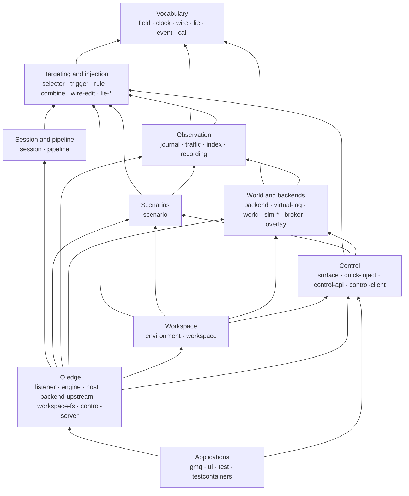

# Crate layout

The workspace splits GaslightMQ into many small crates.
Each crate holds one district of the [town plan](../townplan/README.md),
or one component of the [engine](README.md#components).
This document describes the target layout.
Moving the current crates to it is a separate plan.

Every crate name carries the `gaslightmq-` prefix.
The tables leave it out: `selector` is the crate `gaslightmq-selector`.

## Principles

- **Logic is sans-IO.**
  A sans-IO crate has no async code, no sockets, no file access, no system clock and no global randomness.
  It takes inputs and the current time as arguments, and returns what should happen.
  Tests drive it with plain function calls.
- **IO lives at the edge.**
  Only a few crates touch the network, the file system or a runtime.
  They are thin, and they call the sans-IO crates.
- **A crate boundary needs a reason.**
  A crate exists because something else reuses it,
  because it keeps a heavy dependency away from the rest,
  or because it must compile to WebAssembly for the UI.
  Code that always changes together stays in one crate.
- **Dependencies follow the town plan.**
  Vocabulary crates depend on nothing.
  Logic crates depend on vocabulary.
  The engine depends on logic.
  Nothing depends on the engine except the binaries and the test library.
- **Definitions live with their domain.**
  The crate that owns a concept owns its definition type and its `serde` mapping.
  The `workspace` crate only assembles and cross-checks them.

The workspace rules apply to every crate:
Rust edition 2024, native async traits and workspace dependency versions.

## Layers



An arrow means "depends on".
Everything below the IO edge is sans-IO.

## Crates

### Vocabulary

Vocabulary crates hold types and almost no behaviour.
Every other crate speaks in them.

| Crate | Holds | Depends on |
|---|---|---|
| `field` | The [field vocabulary](../domains/targeting.md#fields): field names, values, and the `FieldSource` trait that a live call and a recorded call both implement. This is the shared kernel of the town plan. | — |
| `clock` | The [clock](README.md#clock): a `Clock` trait, the virtual clock, and instants that do not come from the system. | — |
| `wire` | The Kafka codec: frames, headers, lazily decoded bodies and record batches. | — |
| `lie` | The [lie](../domains/lies-and-events.md#lies) vocabulary: kind, stage, target, combination class, the `Lie` trait, and the effect a lie asks the pipeline for. | `field`, `wire` |
| `event` | The [event](../domains/lies-and-events.md#events) vocabulary, the expansion into consequences, and the capabilities a backend declares. | — |
| `call` | The [call](../domains/observation.md#call) record: identity, request summary, truth, delivered response, verdict, explanation and timing. | `field`, `lie`, `event` |

### Targeting and injection

| Crate | Holds | Depends on |
|---|---|---|
| `selector` | Conditions, selectors, includes and scope. Matching against a `FieldSource`, with the [target](../domains/lies-and-events.md#target) a match yields. An index of selectors by API. | `field` |
| `trigger` | [Triggers](../domains/rules.md#trigger), counters, dice, budgets and lifetimes. | `clock` |
| `rule` | The rule definition, its state, and the immutable snapshot of armed rules in priority order. | `selector`, `lie`, `event`, `trigger` |
| `combine` | [How lies combine](../domains/lies-and-events.md#how-lies-combine): which lies conflict, which win by priority, which are shadowed or pre-empted. | `lie` |
| `wire-edit` | Surgery on requests and responses: remove partitions, merge responses, synthesize an error response for any API, map topic IDs to names. | `wire` |
| `lie-refusal` | Refusals for every API, before forwarding and after the response. | `lie`, `wire-edit` |
| `lie-topology` | Rewrites of Metadata, `FindCoordinator` and `DescribeCluster`. | `lie`, `wire-edit` |
| `lie-data` | Altered, dropped, duplicated, reordered and corrupted records. | `lie`, `wire-edit`, `schema` |
| `lie-progress` | Rewrites of watermarks, log start offsets and committed offsets. | `lie`, `wire-edit` |
| `lie-config` | Rewrites of `DescribeConfigs` responses. | `lie`, `wire-edit` |

### Session and pipeline

| Crate | Holds | Depends on |
|---|---|---|
| `session` | The [session](../domains/session.md): lifecycle, identity, session key, client context, per-session counters, in-flight calls, response ordering and the stalled state. | `field`, `wire`, `trigger`, `clock` |
| `pipeline` | The [request pipeline](request-pipeline.md) as a state machine: all stages, both evaluation passes and partial refusals. | `wire`, `wire-edit`, `selector`, `rule`, `trigger`, `lie`, `combine`, `session`, `call`, `event`, `clock` |

### Scenarios

| Crate | Holds | Depends on |
|---|---|---|
| `scenario` | The [scenario](../domains/scenarios.md) definition, modes as priority orders, the step machine of a Sequence, the live set and capture. It consumes call records, journal entries and time, and it emits arm and disarm commands. | `rule`, `trigger`, `call`, `journal`, `event`, `clock` |

### Observation

| Crate | Holds | Depends on |
|---|---|---|
| `traffic` | The live window of recent calls, subscriptions by selector, and statistics per rule and per API. | `call`, `selector` |
| `index` | The [index](../domains/observation.md#index): facets, counts under the active filters, suggested patterns. | `call`, `selector` |
| `journal` | The [journal](../domains/observation.md#journal): its entries, and the window of recent entries the engine keeps in memory. | `event`, `clock` |
| `recording` | The [recording](storage.md#recordings) format: append-only chunks with summaries, calls and journal entries, metadata-only mode, blanked credentials, a reader and a writer over `std::io`. | `call`, `journal`, `wire` |

### World and backends

| Crate | Holds | Depends on |
|---|---|---|
| `backend` | The [backend contract](backends.md#contract) as a trait: answer a request, apply an event, report endpoints. | `wire`, `event`, `clock` |
| `schema` | Record [formats and schemas](../domains/world.md#schemas): encode and decode JSON, Avro and Protobuf, one feature per format. | — |
| `virtual-log` | [Virtual records](../domains/world.md#virtual-records): the record at a partition and offset as a pure function of the definition, templates, stable batches, and the mapping between offsets and time. | `wire`, `clock`, `schema` |
| `schema-registry` | The built-in [schema registry](backends.md#schema-registry) and a client for a real one. This crate does IO. | `schema` |
| `world` | The [World](../domains/world.md): its state, world definitions, how each event changes it, and where each topic's records come from. | `wire`, `event`, `clock`, `virtual-log` |
| `world-seed` | Seeding a world definition from a recording. | `world`, `index`, `recording` |
| `sim-log` | Produce, Fetch, offsets and idempotent producers against the World. | `world`, `wire` |
| `sim-group` | Group coordination against the World, for the classic and the consumer protocol. | `world`, `wire`, `clock` |
| `overlay` | The Upstream [overlay](backends.md#overlay): address translation, emulated events and sessionless Fetch. It rewrites requests and responses, and it opens no connection. | `wire`, `wire-edit`, `event` |
| `broker` | The broker instance as a state machine: it routes each request to a `sim-*` crate, applies events to the World and owns the virtual clock. It implements the backend contract, so a proxy calls it directly. | `backend`, `world`, `sim-log`, `sim-group`, `clock` |
| `backend-upstream` | The Upstream backend: connections to the real cluster, with the overlay around them. This crate does IO. | `backend`, `overlay` |

Transactions arrive later as `sim-txn`, next to `sim-log` and `sim-group`.

### Workspace

| Crate | Holds | Depends on |
|---|---|---|
| `environment` | [Environments](storage.md#environments), [secret references](storage.md#secrets), and the order in which flags, variables and files set a value. It never reads a secret. | — |
| `workspace` | The whole set of definitions as one model: cross-reference validation, renames that cascade, and the YAML layout of the [workspace](storage.md#workspace). It works on file contents, not on files. | `selector`, `lie`, `event`, `rule`, `scenario`, `surface`, `world`, `environment` |
| `workspace-fs` | Loading, watching and writing back, the scratch file, and reading the files that secret references name. This crate does IO. | `workspace` |

### Control

| Crate | Holds | Depends on |
|---|---|---|
| `surface` | [Pad layouts](../domains/control-surfaces.md#pad-layout), layers, pads as positions, the encoder mapping, and the intents a surface sends. | `rule` |
| `hardware-push2` | The Push 2 mapping: controller messages to surface intents, and rule state back to pad colours. | `surface` |
| `quick-inject` | The ⌘K sentence parser: text to a rule definition, with completions. | `selector`, `lie`, `rule` |
| `control-api` | The [control plane](control-plane.md) as types: resources, commands and stream messages. | `call`, `journal`, `rule`, `scenario`, `selector`, `surface`, `world`, `event`, `environment` |
| `control-client` | A client for the control plane, for native targets and for WebAssembly. | `control-api` |
| `control-server` | The HTTP and WebSocket server in front of the host. This crate does IO. | `host`, `control-api` |

### Runtime and applications

| Crate | Holds | Depends on |
|---|---|---|
| `engine` | The runtime of one proxy: one task per session that drives a pipeline, the rule store, the scenario runner, the event bus, the journal, the recorder and the indexer. This crate does IO. | `pipeline`, `session`, `rule`, `scenario`, `journal`, `traffic`, `index`, `recording`, `backend`, `listener`, `workspace`, `environment`, `clock` |
| `ui` | The web UI, a Dioxus application. | `control-client`, `surface`, `hardware-push2`, `quick-inject`, `selector`, `call` |
| `listener` | Kafka on a socket: accept connections, frame bytes, and drive whatever handles a connection. A proxy's pipeline and a broker alone both sit behind it. This crate does IO. | `wire`, `clock` |
| `host` | One process with several [environments](storage.md#several-environments-in-one-process): it starts and stops proxies and brokers, and shares the workspace and the control plane between them. This crate does IO. | `engine`, `broker`, `listener`, `backend-upstream`, `workspace-fs`, `environment` |
| `test` | The test library: create a proxy or a broker, activate a scenario, assert on the recording. | `host`, `control-client` |
| `testcontainers` | A container module that starts GaslightMQ next to a test. | `control-client` |
| `gaslightmq` | The facade crate: `Proxy`, `Broker` and `Host`, and re-exports of what library users need. | The public crates |
| `gmq` | The binary: `gmq proxy`, `gmq broker`, `gmq start` and `gmq run`. | `host`, `control-server` |

## The pipeline is sans-IO

`pipeline` is a state machine for one connection.
The engine feeds it what happened and performs what it returns.
The pipeline never reads a socket, never sleeps and never looks at a clock.

```rust
/// What happened. The engine reports it.
pub enum Input<'a> {
    ClientBytes(&'a [u8]),
    BackendAnswered { call: CallId, response: Response },
    TimerFired(TimerId),
    SnapshotPublished(Arc<Snapshot>),
    ClientClosed,
}

/// What should happen. The engine performs it.
pub enum Output {
    Forward { call: CallId, request: Request },
    Send(Bytes),
    SetTimer { id: TimerId, at: Instant },
    Close,
    Emit(Call),
    Fire(Event),
}

impl Pipeline {
    pub fn handle(&mut self, input: Input<'_>, now: Instant) -> Outputs;
}
```

The sketch shows the shape of the interface, not its final names.

- A delay is a `SetTimer`, and the delayed response leaves on `TimerFired`.
- A silence returns no `Send` and marks the session stalled.
- A partial refusal returns a `Forward` with fewer partitions,
  and merges the refusals when `BackendAnswered` arrives.
- Shared counters and budgets are handles to atomics that the engine passes in.
  The pipeline increments them, and it still does no IO.

The same interface serves three drivers:

| Driver | Feeds the pipeline from |
|---|---|
| `engine` | Real sockets, real backends and the engine's clock. |
| Unit and property tests | Hand-written inputs and a virtual clock. |
| Replay | A recording: the recorded requests and truths go in, and the verdicts that come out are compared with the recorded ones. |

Replay makes every recording a regression test for the pipeline.

A proxy in front of a broker needs no socket between the two.
The engine takes the pipeline's `Forward` and calls the `broker` crate directly,
and the broker's answer comes back as `BackendAnswered`.
Both state machines run on one virtual clock, so a run is reproducible down to the order of events.

The other sans-IO crates follow the same pattern.
`scenario` consumes call records and time, and returns arm and disarm commands.
`overlay` and the `sim-*` crates consume a request and return a response.
`session` consumes headers and returns identity changes.

## Lies as crates

A lie kind gets its own crate when it reads or rewrites payloads.
Those kinds are large, they know specific Kafka APIs,
and they change at their own pace.

| Lie kind | Crate | Reason |
|---|---|---|
| Refusal | `lie-refusal` | Knows the error shape of every API, and how to remove and merge partitions. |
| Topology | `lie-topology` | Knows Metadata, `FindCoordinator` and `DescribeCluster`. |
| Data | `lie-data` | Knows record batches, compression and checksums. |
| Progress | `lie-progress` | Knows offsets in Fetch, `ListOffsets` and `OffsetFetch`. |
| Configuration | `lie-config` | Knows `DescribeConfigs`. |
| Timing, silence, hang-up | `lie` | Each one is a single instruction to the pipeline: hold, drop or close. They need no payload code. |

Every kind implements the `Lie` trait from the `lie` crate.
The pipeline works with a set of lies that the engine registers,
so `pipeline` depends on `lie` and on none of the `lie-*` crates.
A build can leave a kind out, and a new kind does not touch the pipeline.

Events do not get a crate per event.
An event is a value in the `event` crate.
`world` applies it, and `overlay` emulates it.

## What compiles to WebAssembly

The UI runs in the browser.
It reuses the engine's own logic instead of a second implementation in the front end.

| Crate | The UI uses it to |
|---|---|
| `field`, `selector` | Highlight the recorded calls a draft selector matches, while someone types. |
| `call` | Render verdicts and explanations. |
| `lie`, `event`, `rule`, `trigger`, `scenario` | Edit definitions with the engine's own types and validation. |
| `quick-inject` | Parse and preview a ⌘K sentence without a round trip. |
| `surface`, `hardware-push2` | Turn pad presses and controller messages into intents. |
| `virtual-log`, `world` | Render the World view, and preview the record a template gives at any offset. |
| `control-api`, `control-client` | Talk to the engine. |

These crates stay free of threads, files and sockets.
The same `surface` and `hardware-push2` crates later serve a hardware bridge in the CLI,
which sends the same intents through `control-client`.

## Features

- Every crate with definition types has a `serde` feature.
- `control-client` has one feature per transport: native and WebAssembly.
- `gmq` has one feature per backend and one per `lie-*` crate,
  so a build can ship the proxy without the fake broker.

## Build order

The crates arrive in the order the [first version](../README.md#first-version) needs them.

| Step | Crates | Result |
|---|---|---|
| 1 | `field`, `clock`, `wire`, `selector`, `lie`, `trigger`, `rule`, `combine` | Rules evaluate against hand-written calls in tests. |
| 2 | `wire-edit`, `lie-refusal`, `session`, `call`, `pipeline` | The pipeline runs in tests, with partial refusals and explanations. |
| 3 | `event`, `environment`, `backend`, `overlay`, `backend-upstream`, `listener`, `engine` | A proxy that lies. |
| 4 | `host`, `control-api`, `control-server`, `control-client`, `traffic`, `index`, `surface`, `quick-inject`, `ui` | The UI with live traffic, rules, pads and ⌘K. |
| 5 | `journal`, `scenario`, `workspace`, `workspace-fs`, `recording`, `test`, `gmq` | Scenarios in files, recordings, and tests in CI. |
| 6 | `schema`, `schema-registry`, `virtual-log`, `world`, `sim-log`, `sim-group`, `broker`, `world-seed` | The broker, alone and behind a proxy. |
| 7 | `lie-topology`, `lie-data`, `lie-progress`, `lie-config`, `hardware-push2`, `sim-txn` | The remaining lies, hardware and transactions. |
