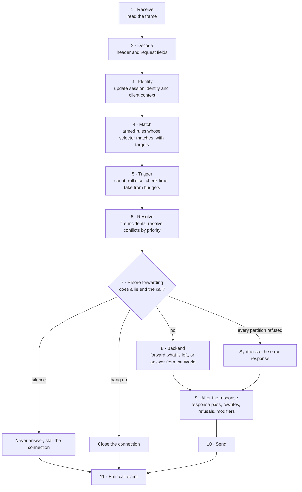

# Request pipeline

The pipeline takes one call from the moment its request arrives
to the moment the client receives an answer, or nothing.
It runs inside the call's [session](../domains/session.md).

## Stages

| Stage | Does |
|---|---|
| **1 · Receive** | Reads one frame from the client. |
| **2 · Decode** | Decodes the request header and the fields selectors need. Decoding is lazy: the pipeline only decodes the body when an armed rule tests a body field, when the backend's overlay needs it, or when recording is on. |
| **3 · Identify** | Moves the session from Opened to Identified on its first request, and records the client software from `ApiVersions`. Updates the [client context](../domains/session.md#client-context) with a group or transactional ID the request names. |
| **4 · Match** | Finds the armed rules whose effective selector matches, and each rule's [target](../domains/lies-and-incidents.md#target). The rule snapshot keeps an index by API, so most calls test only a few rules. |
| **5 · Trigger** | Evaluates each matching rule's trigger: increments the rule's counter, rolls its die, checks its time window. A rule that fires sets one firing aside in its [budget](../domains/rules.md#budgets), and does not fire when no firing is free. |
| **6 · Resolve** | Hands the incidents of firing rules to the scenario runner. Lets lies that do not conflict through. Resolves conflicts with the snapshot's priority order: the live set first, then the scenario's mode. Marks the losers as shadowed or pre-empted, and gives their firings back to the budget. |
| **7 · Before forwarding** | Applies lies of the before-forwarding [stage](../domains/lies-and-incidents.md#stage). A silence or a hang-up ends the call. A delay holds the request back. A refusal removes its partitions from the request. A request rewrite changes the request. |
| **8 · Backend** | Forwards what is left of the request to the real cluster, or hands it to the broker in memory. The response is the truth. The backend does not see a request whose partitions were all refused. |
| **9 · After the response** | Learns what the truth teaches: the member ID of the client, and the topics that the cluster names with their ID. Runs the response pass. Applies rewrites and after-response refusals per target, and then merges the refusals of stage 7 into the response, so each refused partition keeps its own refusal. Then applies modifiers: the summed delay and the maximum throttle. A hang-up at this stage closes the connection instead of sending. |
| **10 · Send** | Writes the delivered response to the client, in the order the client sent its requests. |
| **11 · Emit** | Publishes the call event with request, truth, delivered response, verdict and explanation. |

## Who does the IO

The pipeline is a state machine, and it does no IO.
It decides, and the [session](../domains/session.md#parts) around it acts.
The stages describe the journey of one call.
At these points the session acts for the pipeline:

| Stage | The pipeline | The session |
|---|---|---|
| 1 · Receive | Takes the bytes it is given. | Reads them from the transport. |
| 6 · Resolve | Hands out the incidents of firing rules. | Passes them to the scenario runner. |
| 7 and 9 · Delay | Asks for a timer, and continues when the timer fires. | Waits on the engine's clock. |
| 7 and 9 · Hang-up | Asks to close the connection. | Closes the transport, which ends the session. |
| 8 · Backend | Hands out the request, and continues when the answer arrives. | Passes the request to the backend, and waits for the answer. |
| 10 · Send | Hands out the bytes of the response. | Writes them to the transport. |
| 11 · Emit | Hands out the call event. | Publishes it on the event bus. |

The pipeline never waits.
While one call waits for a timer or for the backend,
the pipeline takes the next request of the same connection, within the rules of [ordering](#ordering).

The [crate layout](crates.md#the-pipeline-is-sans-io) shows the interface between the two.

## Partial refusals

One Produce or Fetch request can carry partitions that different rules treat differently.
A refusal before forwarding must keep the refused partitions away from the backend,
and still let the others through.

1. Stage 7 removes the refused partitions from the request.
2. Stage 8 forwards the remaining partitions.
3. Stage 9 adds the refused partitions to the response, each with its error code.

The client receives one response that covers every partition it asked for.
Records for a refused partition never reach the backend.

## Two evaluation passes

Some rules test [response fields](../domains/targeting.md#response-fields),
such as "only when the truth was a success".
Those rules cannot match before the backend answers.

The pipeline therefore runs stages 4 to 6 twice:

- The **request pass** runs before forwarding.
  It evaluates every rule whose selector uses only connection, request and learned fields.
- The **response pass** runs after the backend answers.
  It evaluates the rules that also test response fields.

A rule belongs to one pass, so a call counts as one match of it.

Priority orders the rules within one pass.
Between the passes, the stage decides:

- A silence or a hang-up before forwarding that won the request pass ends the call before the truth exists.
  The response pass does not run.
  A rule that waited for the truth is pre-empted, even when it has a higher priority,
  and the explanation says so.
  Nobody evaluated that rule, so the call does not count as a match of it.
- A partition that the request pass refused before forwarding has no truth.
  The response pass skips that partition.
  A response-pass lie on that partition is pre-empted there, even when it has a higher priority,
  and the explanation names the refusal.
  A response-pass lie on the whole call has the other partitions left to change, so that refusal does not pre-empt it.
  A response-pass refusal of the whole call replaces the truth of every partition that reached the backend,
  and the refused partition keeps its own refusal.
- A whole call that the request pass refused before forwarding has no truth at all.
  A response-pass refusal or rewrite is pre-empted, on any target.
- Everything else from the request pass meets the response pass in stage 9,
  where conflicts resolve by priority as usual.

What acted before forwarding stays.
The outcome of a request-pass lie that acts before forwarding is final when the request pass ends:

- A refusal before forwarding that lost a conflict in the request pass stays shadowed,
  even when its winner loses a conflict in the response pass.
  The request was forwarded by then, so the refusal cannot act before forwarding any more.
  The explanation still names that winner, and the firing of the refusal goes back to its budget.
- A response-pass hang-up does not conflict with a refusal before forwarding.
  The refused partition never reached the backend,
  and the connection closes after the backend answered the rest.
  Both lies apply.

The outcome of a request-pass lie that acts after the response is open until the response pass ends.
A hang-up after the response that won the request pass loses to a response-pass refusal with a higher priority.
A refusal after the response that the hang-up shadowed then applies.

This is the only place where a rule with a lower priority can beat a higher one.
A live rule that waits for the truth does not stop a scenario rule from ending the call first.

## Incidents

Incidents that rules fire go to the scenario runner during resolve.
The runner hands them to the backend,
which adds their [consequences](../domains/lies-and-incidents.md#consequences).
They take effect on the World or the overlay after this call,
not during it.

## Ordering

Kafka clients expect responses in the order they sent requests on one connection.
A delayed or silenced call must not let later calls overtake it.

- A **delay after the response** holds back its response and every response behind it on the same connection.
  The backend still receives later requests on time.
- A **delay before forwarding** holds back its request and every request behind it on the same connection.
- A **silence** never answers, and it stalls the connection.
  The session stops forwarding:
  later requests on the same connection never reach the backend and never get an answer.
  The client sees a stalled connection, as it would with a real hung broker.
  No rule is evaluated for a request behind a silence: it counts as no match, and it sets no firing aside.
  Such a request does not identify the session either, and the client context learns nothing from it.
  Calls before the silence still finish.
- A **hang-up** acts when its call is at the head of the line.
  Before forwarding, that is once every request before it went on.
  After the response, it is once every answer before it left.

A delay before forwarding counts from the moment the request arrived.
A delay after the response counts from the moment the backend answered.

A session can end while calls are in flight: the client closes the connection, or a hang-up acts.
Each of those calls ends without an answer, and its record says so.
A lie that already acted stays applied: a refused partition never reached the backend, and a held request did wait.
A lie whose turn had not come is not told, and its firing goes back to the [budget](../domains/rules.md#budgets).
A lie acts before forwarding when its request goes on, and after the response when its answer leaves.

## Calls without a response

A Produce with `acks=0` has no response.
The pipeline forwards it and sends nothing, also when a refusal answered the call before forwarding.
Such a call has no truth, so the response pass does not run for it.
A lie that acts after the response is not told, and the explanation says so.

## Failure inside the pipeline

A bug in GaslightMQ must never look like a lie.
What fails changes nothing, and the explanation says what failed and why.

- A request whose body cannot be decoded goes through untouched.
  No rule sees it.
- A lie that cannot be told changes nothing.
  Its kind can be missing from the build, or the response can have no place for its error code.
  The other lies of the call still apply, as the lies combined:
  a lie that it shadowed stays shadowed, and its explanation still names the winner.
  The verdict does not list the lie, and its firing goes back to the [budget](../domains/rules.md#budgets).
- A lie that kept a partition from the backend did act, also when it then cannot put its error into the response.
  It stays applied, and the explanation says what the response lacks.
- A silence or a hang-up before forwarding that cannot be told ends nothing, and it takes nothing from the other lies.
  Nothing acted on the call yet, so the lies combine again without it:
  the lies that it would have shadowed or pre-empted apply, and the rules that wait for the truth get their pass.
- A truth that cannot be read goes to the client as the backend sent it.
  It has no outcome, so the response pass does not run, and the record does not say what the client received:
  a response that nobody read is no success.
- A call always has a record.
  A moment that does not follow the one before it is missing from its timing, and the explanation says which.

Sometimes the pipeline cannot keep the answers of a connection in order.
It then closes the connection, as a broker does, and the session records that the proxy closed it.

- Bytes that are no request cannot be answered, and nothing says where the next request starts.
- A Produce whose body ends before its `acks` does not say whether a response comes.
  A Produce whose body is broken behind its `acks` goes through untouched, and the pipeline knows whether to wait.
- An answer of the backend that is no response to the request must not reach the client.
  The connection closes when that answer would be the next to leave.
  It makes no difference who finds out: the backend, which cannot read the bytes of the cluster as a response,
  or the pipeline, which gets a response that does not answer the request.

## Failure of the backend

A backend that has no answer for a call ends the session.
It cannot reach the cluster, or it lost its connection to it.
The pipeline closes the connection at once, and the session records that the backend closed it.
The same happens when the endpoint of the session closes, because its broker went down.

- No call in flight gets an answer, and none gets a response that the cluster did not send.
- Every call in flight gets its record, and the explanation says why the backend ended the session.
- A failure ends the session whichever call of the connection it names.
  A Produce with `acks=0` has left the pipeline by the time its failure arrives.

See [answers](backends.md#answers).
