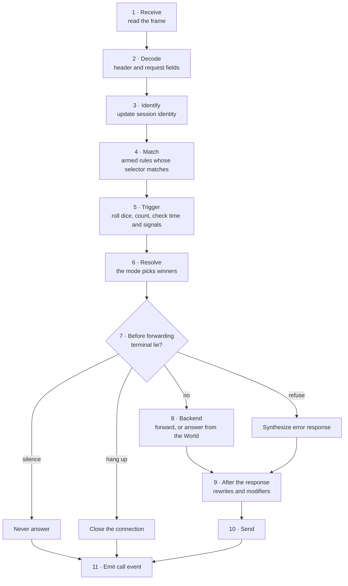

# Request pipeline

The pipeline takes one call from the moment its request arrives
to the moment the client receives an answer, or nothing.
It runs inside the call's [session](../domains/session.md).

## Stages

| Stage | Does |
|---|---|
| **1 · Receive** | Reads one frame from the client. |
| **2 · Decode** | Decodes the request header and the fields selectors need. Decoding is lazy: the pipeline only decodes the body when an armed rule tests a body field, or when recording is on. |
| **3 · Identify** | Moves the session from Opened to Identified on its first request, and records the client software from `ApiVersions`. |
| **4 · Match** | Finds the armed rules whose effective selector matches. The rule snapshot keeps an index by API, so most calls test only a few rules. |
| **5 · Trigger** | Evaluates each matching rule's trigger with the session's dice and the right counters. |
| **6 · Resolve** | Hands the firing rules to the active scenario's mode. Modifiers and rewrites of different targets pass through. The mode picks one terminal lie, and one rewrite per target. Live-layer rules win first. Then scope specificity, then the mode. |
| **7 · Before forwarding** | Applies a terminal lie, if one won. Rewrites the request, if a request rewrite won. |
| **8 · Backend** | Forwards the request upstream, or lets the World answer. The response is the truth. |
| **9 · After the response** | Applies rewrites per partition, topology, data, progress and configuration lies. Then applies modifiers: the summed delay and the maximum throttle. Rules that depend on the truth evaluate here. |
| **10 · Send** | Writes the delivered response to the client, in the order the client sent its requests. |
| **11 · Emit** | Publishes the call event with request, truth, delivered response, verdict and explanation. |

## Two evaluation passes

Some rules test [response fields](../domains/targeting.md#response-fields),
such as "only when the truth was a success".
Those rules cannot match before the backend answers.

The pipeline therefore runs stages 4 to 6 twice:

- The **request pass** runs before forwarding.
  It evaluates every rule whose selector uses only connection and request fields.
- The **response pass** runs after the backend answers.
  It evaluates the rules that also test response fields.

A terminal lie that won the request pass ends the call.
Then the backend never answers, and the response pass does not run.
A response pass can still pick a terminal lie of its own,
such as refusing the whole response or hanging up after it.

## Events

Events that rules fire go to the scenario runner during resolve.
They take effect on the World or the emulation after this call,
not during it.

## Ordering

Kafka clients expect responses in the order they sent requests on one connection.
A delayed or silenced call must not let later calls overtake it.

- A **delay** holds back its response and every response behind it on the same connection.
- A **silence** never answers.
  Later calls on the same connection wait behind it,
  so the client sees a stalled connection, as it would with a real hung broker.

## Failure inside the pipeline

When a stage fails, for example because a frame cannot be decoded,
the pipeline forwards the call untouched and records the failure in the explanation.
A bug in GaslightMQ must never look like a lie.
