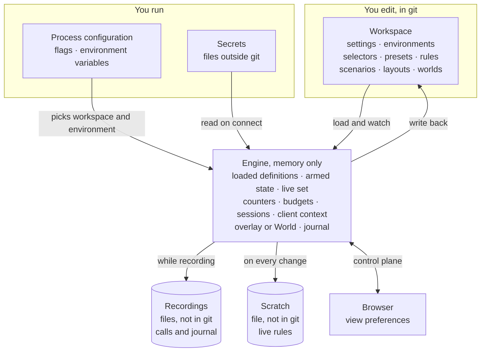

# Storage and configuration

GaslightMQ has no database.
Definitions are files, configuration is flags and files,
and everything that changes while the engine runs stays in memory.



## What lives where

| Thing | Lives in | In git | Written by |
|---|---|---|---|
| Selectors, presets, rules, scenarios, layouts, worlds | Workspace files | Yes | A person, or the UI |
| Record templates, schemas and data files for a World | Workspace files | Yes | A person |
| Virtual records | Nowhere. The broker computes them. | No | Nobody |
| Environments: which proxies and brokers, which ports | Workspace files | Yes | A person |
| Workspace settings: default environment, default seed | `gaslight.yaml` | Yes | A person |
| Secrets: passwords, keys, tokens | Files outside git, referenced by path | No | A person or the platform |
| Armed state, counters, budgets, sessions, client context | Memory, per environment | No | The proxy |
| World state, or the Upstream overlay | Memory, per environment | No | The broker, or the proxy |
| Live rules from pads and ⌘K | Memory and a scratch file, per environment | No | The proxy |
| Journal: who armed what, and when | Memory and recordings, per environment | No | The proxy |
| Recordings | Append-only files | No | The engine |
| View preferences | The browser | No | The UI |

## Process configuration

Process configuration says how one process runs:
which workspace it loads, which environments it starts and where the control plane listens.

A setting can come from several places.
The first one that sets it wins:

1. A command-line flag.
2. An environment variable.
3. The [environment](#environments) the setting belongs to.
4. The workspace's `gaslight.yaml`.
5. The built-in default.

A flag overrides a file.
`gmq start --env orders-sim --advertise localhost` starts the environment
with another advertised host than its file names.

```yaml
# gaslight.yaml
environments: [staging-proxy, orders-sim]   # the environments to start by default
seed: 1337                      # the seed when no scenario is active
control:
  listen: 127.0.0.1:7092
  token: { file: secrets/control-token }
recordings:
  directory: recordings
```

## Workspace

A workspace is a directory of plain-text files.
The files are the source of truth:
the engine loads them, watches them for changes,
and writes edits from the UI back to them.

```
gaslight/
├── gaslight.yaml            # workspace settings
├── environments/
│   ├── staging-proxy.yaml
│   └── orders-sim.yaml
├── selectors.yaml           # every selector, by name
├── presets.yaml             # every preset, by name
├── rules/
│   └── background-noise.yaml
├── scenarios/
│   ├── leader-election.yaml
│   └── producer-recovers-from-leader-churn.yaml
├── layouts/
│   └── order-desk.yaml
├── worlds/
│   └── orders-sim.yaml
├── schemas/                 # record schemas: Avro, Protobuf, JSON Schema
│   └── order.avsc
├── templates/               # how the broker fills a record
│   └── order.json
├── data/                    # fixed record sets for a World
│   └── payments.jsonl
├── secrets/                 # gitignored
├── recordings/              # gitignored
│   └── 2026-11-21T14-02-11.rec
└── .gaslight/               # gitignored
    └── scratch/
        └── orders-sim.yaml
```

`gmq init` creates this layout with a `.gitignore` for the three ignored directories.

The workspace works in git.
Teams review scenarios in pull requests,
and CI runs them with `gmq run`.

### Stores

The engine reaches definitions through a store, and each kind of definition has a store of its own.
The files of a workspace are one store of the definitions.
Memory is another: the engine keeps its definitions there [without a workspace](#without-a-workspace), and so do tests.
Every store keeps the same contract, so nothing else can tell which one it works with.
A store also says who uses a selector or a preset, and the engine asks that before a delete.
[Names](#names) and [validation](#validation) are the same for every store.
The layout above and [reading](#reading) are about files alone.
See [the store seam](crates.md#the-store-seam).

### Reading

When the engine cannot read a file, the error names the path of the key that failed:

```
trigger.every: a count is at least one
```

The path comes from the reader.
The message after it comes from the type of the value, which knows nothing about files.

### Names

- Every definition has a name, unique within its kind.
  A selector and a rule can share a name, because every reference says which kind it means.
- A name is a slug, and it is the identity of its definition.
  See [names](../domains/rules.md#names).
- Definitions reference each other by name, and by nothing else.
- A file that holds one definition carries the name of that definition: `scenarios/leader-election.yaml`.
  The name inside the file is authoritative.
- A definition can have a `title`, which is free text.
  See [titles](../domains/rules.md#titles).
- A definition also has a `uuid`, which the engine writes into its file.
  Nobody writes it by hand, and no definition references another by it.
  See [UUID](identity.md#uuid).
- Nothing renames a definition, so no change rewrites references.
  A definition under another name is a new definition.
  A reference to a name that no definition has is an error, as on every [validation](#validation).

### What files do not hold

A rule file defines a rule.
It does not say whether the rule is armed.
Workspace rules load disarmed, and a scenario, a step or a person arms them.

No file holds a secret.
See [secrets](#secrets).

### Validation

The engine validates the whole workspace on load and on every change:

- every reference resolves,
- no two definitions have the same [UUID](identity.md#uuid),
- every selector uses known fields,
- every scenario's incidents are supported by the current backend,
- every secret is a reference, not a value.

An invalid file does not stop the engine.
The engine keeps the last valid version and reports the error in the UI.

### Without a workspace

The engine starts without a workspace.
`gmq proxy --upstream kafka:9092` is enough to put GaslightMQ in front of a cluster.

Everything is then live state:
rules are live rules, and nothing is written to disk.
The UI offers to save the session as a new workspace.

### Read-only workspaces

In CI, the workspace is often mounted read-only.
The engine then loads and validates it, and never writes back.
Pads and ⌘K still create live rules in memory.
Keeping a rule, saving a scenario and the scratch file are switched off.

## Environments

An environment describes the instances that run together:
a proxy, a broker, or a proxy in front of a broker.
It says where they listen and what stands behind them.
Environments are definitions in the workspace.

A proxy in front of a real cluster:

```yaml
# environments/staging-proxy.yaml
name: staging-proxy
proxy:
  upstream:
    bootstrap: kafka-1.staging:9092
    tls:
      ca: /run/secrets/kafka-ca.pem
    sasl:
      mechanism: SCRAM-SHA-512
      username: gaslight
      password: { file: /run/secrets/kafka-password }
  listen:
    bootstrap: 0.0.0.0:9092
    brokers: 0.0.0.0:19092-19191   # one port per broker
    advertise: gaslight.staging    # the host clients see in Metadata
  recording: metadata-only
```

A proxy in front of a broker.
The proxy has no `upstream`, so its backend is the broker of the same environment:

```yaml
# environments/orders-sim.yaml
name: orders-sim
broker:
  world: orders-sim
proxy:
  listen:
    bootstrap: 0.0.0.0:29092
    brokers: 0.0.0.0:29093-29192
    advertise: localhost
```

A broker alone.
It has its own listeners, and nothing lies:

```yaml
# environments/plain-kafka.yaml
name: plain-kafka
broker:
  world: orders-sim
  listen:
    bootstrap: 0.0.0.0:39092
    brokers: 0.0.0.0:39093-39192
    advertise: localhost
```

The name of an environment follows the same rule as the [name of a rule](../domains/rules.md#names),
and so does the name of the world that a broker names.
An environment can have a `title`, which follows the rule for the [title of a rule](../domains/rules.md#titles).

An environment has one of these three shapes.
A proxy stands in front of its `upstream` or in front of the broker of its environment, and never in front of both.
A broker behind a proxy has no listeners of its own, because clients reach it through the proxy.

The bootstrap listener and the broker listeners use different ports.
A listener on port `0` takes a free port that the system picks.

An environment can also name a [schema registry](backends.md#schema-registry):
a built-in one next to a broker, or the real one of a real cluster.

The [examples](../../../examples/README.md) show workspaces from one file to a complete setup
with Docker Compose, Kubernetes and CI files around it.

### Brokers

Nobody lists the brokers of a real cluster.
The proxy asks the bootstrap address for Metadata,
discovers the brokers and opens one listener per broker from the port range.
It assigns ports in the order of the broker IDs,
so a broker keeps its port for as long as the set of brokers stays the same.
A cluster with more brokers than the range has ports is an error.
An environment can pin a broker to a port when the ports are published one by one:

```yaml
listen:
  brokers:
    1: 0.0.0.0:19092
    2: 0.0.0.0:19093
    3: 0.0.0.0:19094
```

Every broker of the cluster then needs a pin.

The brokers of a simulated cluster come from the [world definition](../domains/world.md#seeding).

### Several environments in one process

A process starts one environment or several.

- **Each environment is separate.**
  It has its own listeners, sessions, armed rules, live set, active scenario, counters, journal and recordings.
  Arming a rule in one environment does not arm it in another.
- **Environments share the workspace.**
  The same selectors, rules, scenarios and layouts are available in every environment.
- **Environments share the control plane.**
  One UI address shows all of them.
  The environment switcher changes which one the UI shows.
  Nothing restarts, and no client loses its connection.
- **Listeners must not overlap.**
  The process refuses to start two environments that claim the same port.
  Two listeners claim the same port when they name it on the same address.
  `0.0.0.0` stands for every IPv4 address, and `::` for every address, so they share a port with those.
  A built-in schema registry is a listener too.

The flags of `gmq proxy` and `gmq broker` describe an environment without a file.
See [deployment shapes](README.md#deployment-shapes).

## Secrets

A secret is a password, a private key or a token.

- **A secret field takes a reference, never a value.**
  The reference names a file, or an environment variable for quick local runs.
  The engine rejects a literal, so a secret cannot land in git by accident.
  No error about a secret reference repeats what it read: not the literal, and not a key, a path or a name.
- **Files are the default.**
  Container platforms mount secrets as files, and TLS material is files anyway.
- **The engine reads a secret when it needs it.**
  It reads the file again for every new upstream connection,
  so a rotated secret works without a restart.
- **The engine only reads secrets.**
  It never writes them.
  The control plane and the UI show the reference, not the value.

```yaml
password: { file: /run/secrets/kafka-password }
password: { env: KAFKA_PASSWORD }
```

A relative path resolves against the workspace.
The `secrets/` directory of a workspace is for local development, and git ignores it.

## Live state

Live state stays in memory.
It is lost when the engine stops,
unless someone saves it:

- **Keep rule** saves a live rule as a workspace rule.
- **Save as scenario** saves the current armed rules as a Chain scenario,
  with the most recently armed rule first, so conflicts resolve as they did live.
- **Capture** saves the live set's changes over time as a Sequence scenario.
- **Save world** saves the current World as a world definition.

Pad presses and ⌘K create live rules.
They never write to the workspace by themselves,
so playing with the pads leaves git clean.

### A restart is a clean slate

Nothing is armed after a restart.
The engine does not remember which rules were armed, which scenario was active or how far its counters were.
A fault injector that resumes on its own is a hazard:
someone restarts it after an outage and the faults are back.

A command can name a scenario to activate at start,
such as `gmq run <scenario>` or `gmq start --scenario <scenario>`.
That is a decision of the person who runs the command.

### Scratch

The scratch file keeps the definitions of live rules, so a crash does not lose them.

- The engine writes `.gaslight/scratch/<environment>.yaml` whenever a live rule changes.
- On start, the engine loads the rules in the scratch file as live rules, disarmed.
- Keeping or deleting a live rule removes it from the scratch file.
- Git ignores the file.

The scratch file holds definitions only.
It does not hold armed state.

## Recordings

A recording file is append-only.
It holds a header, the sessions, and the calls and [journal](../domains/observation.md#journal) entries in the order they happened.
It is one file, so it is easy to attach to a bug report or to seed a World from.

Each call holds:

- session reference and timing,
- the raw request and response frames, or their metadata only,
- the decoded fields,
- the truth and the delivered response,
- the real cluster's response, when the overlay changed it,
- the verdict and the explanation.

The file is split into chunks, so a long recording can be opened from the end.
Each chunk carries a summary of the field values it contains.
A query with a selector skips the chunks that cannot match.

The index is not stored.
The engine rebuilds it when it opens a recording.

### Privacy

Records can hold personal or secret data.
A **metadata-only** recording drops record keys, values and headers,
and keeps everything else.

| Backend | Default | Reason |
|---|---|---|
| Upstream | Metadata-only | The real cluster can carry production-like data. |
| Simulated | Full | The World's data is synthetic or was already recorded. |

An environment or a workspace setting overrides the default.

### Credentials on the wire

A `SaslAuthenticate` request carries a client's password or token.
The engine blanks that payload in every recording, full ones included,
and in every call it streams to the UI.
A client's credentials never reach the disk.

## Browser

The browser keeps view preferences: the open view and display options.
Nothing else lives there.
Pad layouts are definitions in the workspace, so a team shares them.
