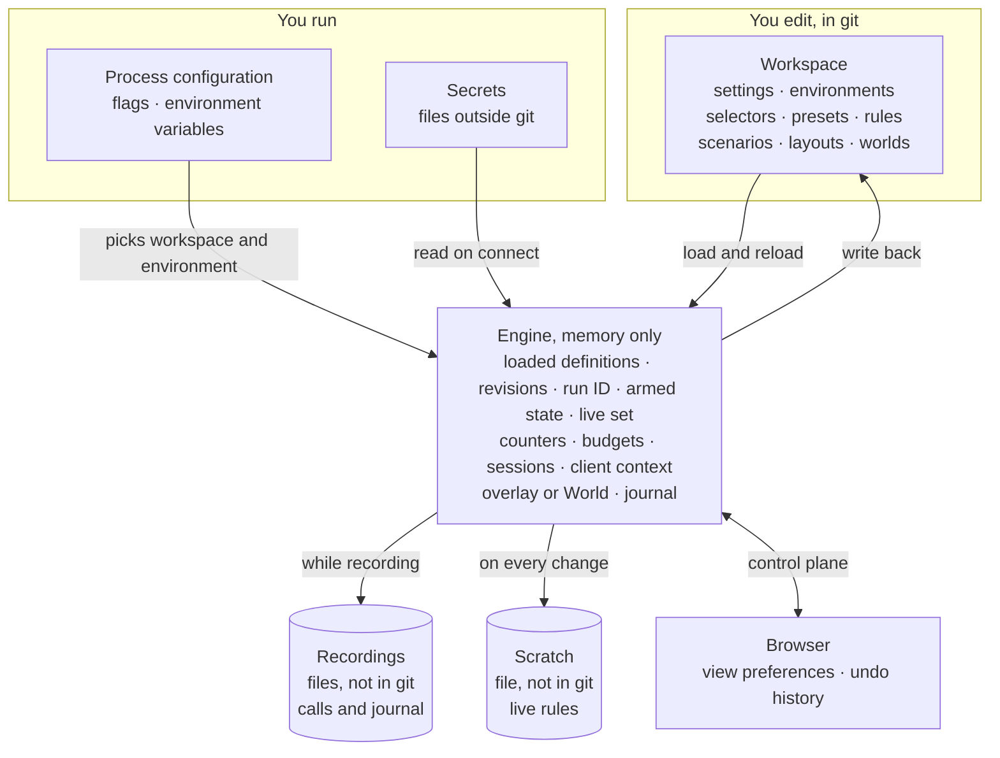

# Storage and configuration

GaslightMQ has no database.
Definitions are files, configuration is flags and files,
and everything that changes while the engine runs stays in memory.



## What lives where

| Thing | Lives in | In git | Written by |
|---|---|---|---|
| Selectors, presets, rules, scenarios, layouts, worlds | Workspace files | Yes | A person, or the UI |
| Record templates, schemas and data files for a World | Workspace files | Yes | A person |
| Virtual records | Nowhere. The broker computes them. | No | Nobody |
| Environments: which proxies and brokers, which ports | Workspace files | Yes | A person |
| Workspace settings: default environment, default seed | `gaslight.yaml` | Yes | A person |
| Secrets: passwords, keys, tokens | Files outside git, referenced by path | No | A person or the platform |
| The [revision](identity.md#revision) of a definition, and the [run ID](identity.md#run) | Memory | No | The engine |
| Armed state, counters, budgets, sessions, client context | Memory, per environment | No | The proxy |
| World state, or the Upstream overlay | Memory, per environment | No | The broker, or the proxy |
| Live rules from pads and ⌘K | Memory and a scratch file, per environment | No | The proxy |
| Journal: who armed what, and when | Memory and recordings, per environment | No | The proxy |
| Recordings | Append-only files | No | The engine |
| View preferences, and the [undo history](../domains/control-surfaces.md#undo-and-redo) of a tab | The browser | No | The UI |

## Process configuration

Process configuration says how one process runs:
which workspace it loads, which environments it starts and where the control plane listens.

A setting can come from several places.
The first one that sets it wins:

1. A command-line flag.
2. An environment variable.
3. The [environment](#environments) the setting belongs to.
4. The workspace's `gaslight.yaml`.
5. The built-in default.

A flag overrides a file.
`gmq start --env orders-sim --advertise localhost` starts the environment
with another advertised host than its file names.
A flag or a variable that sets something of an environment, such as `--advertise`, belongs to one environment,
so `gmq` refuses it on a command that starts several.

`gmq` reads the flags, the variables and the files once, when it starts.
It hands the host and the control plane their configuration as one value each, and neither reads a flag, a variable or a file of its own.

A command takes its workspace from `--workspace`, and from the directory it runs in when the flag is not there.

```yaml
# gaslight.yaml
environments: [staging-proxy, orders-sim]   # the environments to start by default
seed: 1337                      # the seed when no scenario is active
control:
  listen: 127.0.0.1:7092
  token: { file: secrets/control-token }
  ping_interval: 15s            # how often the server asks a client of the live stream whether it is there
  presence_grace: 10s           # how long a presence stays once its live stream ended
recordings:
  directory: recordings
  backlog: 10000                # the calls that the recorder may be behind
```

## Workspace

A workspace is a directory of plain-text files.
The files are the source of truth.
The engine loads them once, when it starts, and works on the copy in its memory from there.
It writes edits from the UI back to them, and reads them again when someone asks for a [reload](#reloading).
It does not watch them.

```
gaslight/
├── gaslight.yaml            # workspace settings
├── environments/
│   ├── staging-proxy.yaml
│   └── orders-sim.yaml
├── selectors.yaml           # every selector, by name
├── presets.yaml             # every preset, by name
├── rules/
│   └── background-noise.yaml
├── scenarios/
│   ├── leader-election.yaml
│   └── producer-recovers-from-leader-churn.yaml
├── layouts/
│   └── order-desk.yaml
├── worlds/
│   └── orders-sim.yaml
├── schemas/                 # record schemas: Avro, Protobuf, JSON Schema
│   └── order.avsc
├── templates/               # how the broker fills a record
│   └── order.json
├── data/                    # fixed record sets for a World
│   └── payments.jsonl
├── secrets/                 # gitignored
├── recordings/              # gitignored
│   └── orders-sim.2026-11-21T14-02-11.527Z.rec
└── .gaslight/               # gitignored
    └── scratch/
        └── orders-sim.yaml
```

`gmq init` creates this layout with a `.gitignore` for the three ignored directories.

`selectors.yaml` and `presets.yaml` hold a list each, and so does every file in `rules/`.
A file in `environments/`, `scenarios/` or `layouts/` holds one definition.
A directory holds the files in it that end in `.yaml` and whose name does not start with a `.`, and no file below them.
A file or a directory that is not there holds nothing, so an empty directory is an empty workspace.

The workspace works in git.
Teams review scenarios in pull requests,
and CI runs them with `gmq run`.

### Stores

The engine reaches definitions through a store, and each kind of definition has a store of its own.
The files of a workspace are one store of the definitions.
Memory is another: the engine keeps its definitions there [without a workspace](#without-a-workspace), and so do tests.
Every store keeps the same contract, so nothing else can tell which one it works with.
A store also says who uses a selector or a preset, and the engine asks that before a delete.
[Names](#names) and [validation](#validation) are the same for every store.
The layout above and [reading](#reading) are about files alone.
See [the store seam](crates.md#the-store-seam).

### Reading

When the engine cannot read a file, the error names the path of the key that failed:

```
trigger.every: a count is at least one
```

The path comes from the reader.
The message after it comes from the type of the value, which knows nothing about files.
The error names the file before the path, and a definition in a list starts its path with its place there:

```
rules/orders.yaml: [2].trigger.every: a count is at least one
```

The engine reads every definition of every file before it says what failed, so one start names every error.
A name that two definitions of a kind have is an error of the second one.

The files are YAML 1.2: `true` and `false` are the only booleans, so a selector named `on` keeps its name.

A key that a definition does not have is a reading error too.
A definition holds [what a person writes](identity.md#what-a-definition-holds), so no key holds something that GaslightMQ keeps: `revision` and `armed` are such keys.

### Names

- Every definition has a name, unique within its kind.
  A selector and a rule can share a name, because every reference says which kind it means.
- A name is a slug, and it is the identity of its definition.
  See [names](../domains/rules.md#names).
- Definitions reference each other by name, and by nothing else.
- A file that holds one definition carries the name of that definition: `scenarios/leader-election.yaml`.
  The name inside the file is authoritative.
- A definition can have a `title`, which is free text.
  See [titles](../domains/rules.md#titles).
- A file holds what someone defined, and nothing that GaslightMQ keeps.
  The [revision](identity.md#revision) of a definition is live state: it sits beside the definition, in memory.
  See [what a definition holds](identity.md#what-a-definition-holds).
- Nothing renames a definition, so no change rewrites references.
  A definition under another name is a new definition.
  A reference to a name that no definition has is an error, as on every [validation](#validation).

### What files do not hold

A rule file defines a rule.
It does not say whether the rule is armed.
Workspace rules load disarmed, and a scenario, a step or a person arms them.

No file holds a secret.
See [secrets](#secrets).

### Validation

The engine validates the whole workspace when it loads it, when it [reloads](#reloading) it, and before every change:

- every reference resolves: the selector and the preset of a rule, the rules of a scenario and of its steps,
  the selectors and presets of the rules a scenario owns, the selector of a step that ends on calls,
  and the rows and columns of a pad layout,
- no two rules share a name, whether the workspace or a scenario holds them,
- every selector uses known fields,
- every secret is a reference, not a value.

The workspace does not ask whether a backend supports the incidents of a scenario.
A workspace serves every environment, and each has a backend of its own.
The backend of an environment checks that when someone [activates the scenario](../domains/scenarios.md#portability) there.

The engine only ever holds a valid workspace.

- **A process does not start on an invalid workspace.**
  `gmq` names every error with its file and the path of its key, and ends.
- **A change that would make the workspace invalid changes nothing.**
  That holds for a request of the control plane and for a reload.

### Loading

The engine reads the files of the workspace once, when it starts.
From there, its memory is the working copy: every answer of the control plane, every armed rule and every ⌘K sentence comes from it.

- **A file that someone edits while the engine runs changes nothing.**
  The engine does not watch the files.
  It takes the edit in with the next [reload](#reloading), or with the next start.
- **An edit by hand never changes a fault behind someone's back.**
  A branch that someone checks out, a file that an editor saved half-way and a pull from a colleague leave every armed rule as it is.
- **The engine never overwrites an edit that it has not read.**
  See [the check before a write](#the-check-before-a-write).

### Reloading

A reload reads the files of the workspace again, and takes what changed as one change.
It is an [operation of the control plane](control-plane.md#resources): `gmq reload` asks for it, and so does the UI.

- **A reload compares what the files hold with what the engine holds, by name.**
  A definition whose content differs is an update.
  A name that the files no longer hold is a delete, and a new name is a create.
  A definition that did not change keeps its [revision](identity.md#revision).
- **A reload is one change.**
  Every definition that it creates or updates gets the revision of the reload.
  It applies as a whole or not at all.
- **A reload that does not fit changes nothing.**
  When the files cannot be read, or the definitions in them do not [fit each other](#validation), the reload fails with every error.
  It also fails when a new rule of the files has the name of a [live rule](control-plane.md#resources) of an environment that runs,
  whether the workspace or a scenario holds that rule,
  and when a live rule that is armed would not resolve against the files, because they no longer have its selector or its preset.
  The engine keeps what it holds, armed rules included.
- **An armed rule follows a reload.**
  The engine resolves every armed rule of every environment that runs against what the files hold,
  and replaces each one that resolves to another rule than the one that is armed: its definition changed, or a selector or a preset that it uses.
  The rule stays armed, and it keeps its counters and its budget, as after a change of a parameter.
  A rule of the workspace that the reload takes away while it is armed disarms, and the journal records that too.
- **A change that a reload takes in has the surface `file`.**
  The [journal](../domains/observation.md#journal) records each one, whoever asked for the reload.
  Nobody undoes it in the UI.
- **A store in memory has nothing to reload**, so a reload [without a workspace](#without-a-workspace) changes nothing.
- **Nothing changes before the reload is taken.**
  Every store reads its files again and holds what it read aside, and the workspace compares and validates.
  Whoever asked for the reload sees what it would change, and can still refuse it for what only it knows.
  The host checks there that no new rule has the name of a live rule, and refuses the reload when one does.
  Nothing else changes the workspace in between, so what the host checked is what it takes in.
  Until it takes the reload in, every store holds what it held, and the files that changed hold up the writes to them.

Something can ask for a reload on its own later, such as a watcher of the files.
It would be one more sender of this operation, and nothing else would change.

### Writing back

The UI writes its edits back to files that people also write by hand.
GaslightMQ never talks to git: it reads and writes the files of the directory, and people commit them.
So what it writes has to read well in a diff.

- **A write changes one definition.**
  The store of files writes the definition that changed, and leaves every other byte of the file as it was.
  An edit of one selector in `selectors.yaml` keeps the comments and the layout of every other selector.
- **A definition has one written form.**
  Its keys come in a fixed order, the order of the examples in these documents.
  A definition that GaslightMQ wrote once never changes again in a diff, unless its content changes.
  In a list, it is an item that starts with `- `, and it keeps the indentation of the list.
  Its lines end as the lines of its file do, in `\n` or in `\r\n`, so a file never mixes them.
- **A new definition goes where its kind goes.**
  A selector or a preset comes after the last one of its file, with an empty line before it when the first two have one between them.
  A rule goes to `rules/<name>.yaml`, after the rules that the file holds already.
  A scenario, a pad layout and an environment get a file of their own name.
- **A delete takes the lines of the definition away**, with one empty line next to them.
  A file that holds nothing else after it goes too.
- **A list in flow style is not edited.**
  A file that holds its definitions as `[…]` reads as any other, and a write of one of them fails.
- **A write loses the comments inside the definition it writes.**
  The store knows whether the text of a definition holds a comment, and the control plane says so with the definition.
  The UI asks before it saves an edit of such a definition.
- **A file holds nothing that GaslightMQ keeps.**
  No revision and no time of the last change, so a file changes only when someone changed a definition.

#### The check before a write

Someone can edit a file while the engine runs, and the engine does not see it.
The store of files therefore checks each file before it writes it.

- **The store remembers what it read.**
  It keeps a hash of the bytes of every file that it read, and of every file that it wrote.
- **The store reads the file again before it writes.**
  When the bytes have another hash, someone changed the file since, and the store writes nothing.
  A file that should be there and is gone, and a file that should not exist and does, count as changed.
- **A refused write changes nothing.**
  Neither the file nor the memory of the engine changes, and the operation fails with `changed-outside`.
  The error says which file changed, and how: its bytes changed, it is gone, or it exists now.
  A [reload](#reloading) takes the edit in, and whoever made the change makes it again on top of it.
- **The check is per file.**
  An edit of one selector in `selectors.yaml` holds up the write of every other selector, until someone reloads.
- **A write replaces the file in one step.**
  The store writes the new content to a temporary file next to it, and renames that over the file.
  A reader never sees half a file, and a crash leaves the old file or the new one.
  The name of the temporary file starts with a `.`, so the engine never reads it as a definition.
- **A write reads back.**
  The store reads the new text before it writes it, and writes nothing when it does not read back as the definitions of the file with the change.

An edit that lands between the check and the rename is still lost.
An editor takes no lock that the store could wait for, so the store cannot rule that out, and the window is as short as one rename.

### Without a workspace

The engine starts without a workspace.
`gmq proxy --upstream kafka:9092` is enough to put GaslightMQ in front of a cluster.

Everything is then live state:
rules are live rules, and nothing is written to disk.
The UI offers to save the session as a new workspace.

### Read-only workspaces

In CI, the workspace is often mounted read-only.
The engine then loads and validates it, and never writes back.
Pads and ⌘K still create live rules in memory.
Keeping a rule, saving a scenario and the scratch file are switched off.
A reload still works, because it only reads.

Whoever starts the process says that the workspace is read-only.
The engine does not guess it from the permissions of the files.
The stores of the files then refuse every write, and the error says that the workspace is read-only.
The [snapshot](control-plane.md#live-stream) says it beforehand, so a surface can leave out what would write.

## Environments

An environment describes the instances that run together:
a proxy, a broker, or a proxy in front of a broker.
It says where they listen and what stands behind them.
Environments are definitions in the workspace.

A proxy in front of a real cluster:

```yaml
# environments/staging-proxy.yaml
name: staging-proxy
proxy:
  upstream:
    bootstrap: kafka-1.staging:9092
    tls:
      ca: /run/secrets/kafka-ca.pem
    sasl:
      mechanism: SCRAM-SHA-512
      username: gaslight
      password: { file: /run/secrets/kafka-password }
  listen:
    bootstrap: 0.0.0.0:9092
    brokers: 0.0.0.0:19092-19191   # one port per broker
    advertise: gaslight.staging    # the host clients see in Metadata
  recording: metadata-only
```

A proxy in front of a broker.
The proxy has no `upstream`, so its backend is the broker of the same environment:

```yaml
# environments/orders-sim.yaml
name: orders-sim
broker:
  world: orders-sim
proxy:
  listen:
    bootstrap: 0.0.0.0:29092
    brokers: 0.0.0.0:29093-29192
    advertise: localhost
```

A broker alone.
It has its own listeners, and nothing lies:

```yaml
# environments/plain-kafka.yaml
name: plain-kafka
broker:
  world: orders-sim
  listen:
    bootstrap: 0.0.0.0:39092
    brokers: 0.0.0.0:39093-39192
    advertise: localhost
```

The name of an environment follows the same rule as the [name of a rule](../domains/rules.md#names),
and so does the name of the world that a broker names.
An environment can have a `title`, which follows the rule for the [title of a rule](../domains/rules.md#titles).

An environment has one of these three shapes.
A proxy stands in front of its `upstream` or in front of the broker of its environment, and never in front of both.
A broker behind a proxy has no listeners of its own, because clients reach it through the proxy.

The bootstrap listener and the broker listeners use different ports.
A listener on port `0` takes a free port that the system picks.

An environment can also name a [schema registry](backends.md#schema-registry):
a built-in one next to a broker, or the real one of a real cluster.

The [examples](../../../examples/README.md) show workspaces from one file to a complete setup
with Docker Compose, Kubernetes and CI files around it.

### Brokers

Nobody lists the brokers of a real cluster.
The proxy asks the bootstrap address for Metadata,
discovers the brokers and opens one listener per broker from the port range.
It assigns ports in the order of the broker IDs,
so a broker keeps its port for as long as the set of brokers stays the same.
A cluster with more brokers than the range has ports is an error.
An environment can pin a broker to a port when the ports are published one by one:

```yaml
listen:
  brokers:
    1: 0.0.0.0:19092
    2: 0.0.0.0:19093
    3: 0.0.0.0:19094
```

Every broker of the cluster then needs a pin.

The brokers of a simulated cluster come from the [world definition](../domains/world.md#seeding).

### Several environments in one process

A process starts one environment or several.

- **Each environment is separate.**
  It has its own listeners, sessions, armed rules, live set, active scenario, counters, journal and recordings.
  Arming a rule in one environment does not arm it in another.
- **Environments share the workspace.**
  The same selectors, rules, scenarios and layouts are available in every environment.
- **Environments share the control plane.**
  One UI address shows all of them.
  The environment switcher changes which one the UI shows.
  Nothing restarts, and no client loses its connection.
- **Listeners must not overlap.**
  The process refuses to start two environments that claim the same port.
  Two listeners claim the same port when they name it on the same address.
  `0.0.0.0` stands for every IPv4 address, and `::` for every address, so they share a port with those.
  A built-in schema registry is a listener too.

The flags of `gmq proxy` and `gmq broker` describe an environment without a file.
See [deployment shapes](README.md#deployment-shapes).

## Secrets

A secret is a password, a private key or a token.

- **A secret field takes a reference, never a value.**
  The reference names a file, or an environment variable for quick local runs.
  The engine rejects a literal, so a secret cannot land in git by accident.
  No error about a secret reference repeats what it read: not the literal, and not a key, a path or a name.
- **Files are the default.**
  Container platforms mount secrets as files, and TLS material is files anyway.
- **The engine reads a secret when it needs it.**
  It reads the file again for every new upstream connection,
  so a rotated secret works without a restart.
- **The engine only reads secrets.**
  It never writes them.
  The control plane and the UI show the reference, not the value.

```yaml
password: { file: /run/secrets/kafka-password }
password: { env: KAFKA_PASSWORD }
```

A relative path resolves against the workspace.
The `secrets/` directory of a workspace is for local development, and git ignores it.

## Live state

Live state stays in memory.
It is lost when the engine stops,
unless someone saves it:

- **Keep rule** saves a live rule as a workspace rule.
- **Save as scenario** saves the current armed rules as a Chain scenario,
  with the most recently armed rule first, so conflicts resolve as they did live.
- **Capture** saves the live set's changes over time as a Sequence scenario.
- **Save world** saves the current World as a world definition.

Pad presses and ⌘K create live rules.
They never write to the workspace by themselves,
so playing with the pads leaves git clean.

### A restart is a clean slate

Nothing is armed after a restart.
The engine does not remember which rules were armed, which scenario was active or how far its counters were.
It is a new [run](identity.md#run): it has a new run ID, and its [revisions](identity.md#revision) start again.
A fault injector that resumes on its own is a hazard:
someone restarts it after an outage and the faults are back.

A command can name a scenario to activate at start,
such as `gmq run <scenario>` or `gmq start --scenario <scenario>`.
That is a decision of the person who runs the command.

### Scratch

The scratch file keeps the definitions of live rules, so a crash does not lose them.

- The engine writes `.gaslight/scratch/<environment>.yaml` whenever a live rule changes.
- On start, the engine loads the rules in the scratch file as live rules, disarmed.
  It leaves out a rule whose name a rule of the workspace has by then, and says which.
- Keeping or deleting a live rule removes it from the scratch file.
- Git ignores the file.

The scratch file holds definitions only.
It does not hold armed state.

## Recordings

A recording file is append-only.
It holds a header, the sessions, and the calls and [journal](../domains/observation.md#journal) entries in the order they happened.
It is one file, so it is easy to attach to a bug report or to seed a World from.

Each call holds:

- session reference and timing,
- the raw request and response frames, or their metadata only,
- the decoded fields,
- the truth and the delivered response,
- the real cluster's response, when the overlay changed it,
- the verdict and the explanation.

The name of the file is the [ID of the recording](identity.md#recording-id): its environment and the instant it started.

The engine hands the recorder the raw frames of a call next to the call, and only while a recording runs.
A call itself holds no frames, so a call that nobody records costs no copy of its bytes.

The recorder writes on a thread of its own, behind a queue of the calls and journal entries it has not written yet.
The queue holds as many as `recordings.backlog` says.
A session never waits for the disk.
When the queue is full, the recording stops, and its last entry and the control plane say why.
What the file holds up to there is a complete recording.

The file is split into chunks, so a long recording can be opened from the end.
Each chunk carries a summary of the field values it contains.
A query with a selector skips the chunks that cannot match.

The index is not stored.
The engine rebuilds it when it opens a recording.

### Privacy

Records can hold personal or secret data.
A **metadata-only** recording drops record keys, values and headers,
and keeps everything else.

| Backend | Default | Reason |
|---|---|---|
| Upstream | Metadata-only | The real cluster can carry production-like data. |
| Simulated | Full | The World's data is synthetic or was already recorded. |

An environment or a workspace setting overrides the default.

### Credentials on the wire

A `SaslAuthenticate` request carries a client's password or token.
The engine blanks that payload in every recording, full ones included,
and in every call it streams to the UI.
A client's credentials never reach the disk.

## Browser

The browser keeps view preferences: the open view and display options.
A tab also keeps its [undo history](../domains/control-surfaces.md#undo-and-redo) in memory, and loses it when it closes.
Nothing else lives there.
Pad layouts are definitions in the workspace, so a team shares them.
