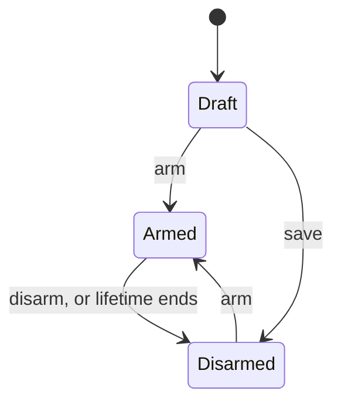

# Rules and triggers

A rule decides what happens to a call or to the world.
Rules are the unit that fires, that shows up in explanations and that has a history.

## Rule

A rule has:

| Part | Meaning |
|---|---|
| **Name** | Unique among rules. Other things reference the rule by this name. |
| **Selector** | Which calls the rule considers. A selector name, or inline conditions. |
| **Action** | What happens when the rule fires: a lie or an incident. A preset name, or inline. |
| **Trigger** | When the rule fires among the calls its selector matches. |
| **Lifetime** | How long the rule stays armed. |

```yaml
name: Slow down order producers
selector: Order producers
scope:
  client.id: order-ingest
action: Delay 1 s
trigger:
  chance: 40%
lifetime: until disarmed
```

`scope` is shorthand for extra conditions over connection fields.
The rule's effective selector is the selector **and** the scope.

### Where rules live

- A **workspace rule** is a definition in the [workspace](../architecture/storage.md#workspace).
  Scenarios reference it by name.
- A **live rule** exists only in the engine's memory.
  Pad presses and ⌘K create live rules in the [live set](scenarios.md#the-live-set).
  Keeping a live rule saves it as a workspace rule.
  A [scratch file](../architecture/storage.md#scratch) keeps live rules across a crash.
  They come back disarmed.

## Action

An action is either a lie or an incident.
See [lies and incidents](lies-and-incidents.md).

- A **lie** applies to its [target](lies-and-incidents.md#target) on the call that fired the rule.
- An **incident** changes the world.
  The call that fired the rule passes through unchanged,
  unless another rule lies about it.

## Trigger

A trigger decides whether a matching call fires the rule.

| Trigger | Fires | Example |
|---|---|---|
| **Chance** | When the rule's die rolls under the probability. | `chance: 40%` |
| **Count** | On specific matching calls. | `nth: 3`, `every: 10`, `first: 5`, `skip: 100` |
| **Time** | Inside a time window, measured from the moment the rule was armed. | `after: 10s`, `between: [10s, 40s]` |
| **Manual** | When someone fires it. | A pad press, a keyboard shortcut, an API call. |

A rule without a trigger fires on every matching call.

Triggers combine.
`nth: 3` with `chance: 50%` fires on the 3rd matching call, half of the time.
All parts of a combined trigger must agree.

A count trigger counts matching calls, whatever happens to them afterwards.
When a rule fires on its 3rd match and another rule [shadows](lies-and-incidents.md#how-lies-combine) it,
that firing is spent.
The explanation shows it.

Time triggers use the [engine's clock](../architecture/README.md#clock).
A time trigger only opens a window.
The [lifetime](#lifetime) decides when a rule stops.

### Manual firing

Firing a rule by hand skips its trigger once.

- A rule with an **incident** fires the incident immediately.
- A rule with a **lie** has no call to lie about yet.
  It lies on the next call its selector matches, once.

### Reacting to other things

A rule cannot trigger on another rule or on an incident.
A [Sequence](scenarios.md#sequence) step expresses "when this happened, arm that":
the step ends on a number of calls or firings, and the next step arms the reaction.

## Counters

Every armed rule counts the calls its selector matches.
Count triggers and dice use that **match number**.

| Counter | Kept in | "The 3rd Produce" means |
|---|---|---|
| Per rule (default) | The engine, shared by all sessions | The 3rd Produce this rule matched, from anyone its selector allows. |
| Per session, with `per: session` | Each [session](session.md) | The 3rd Produce this rule matched on this connection. |

```yaml
trigger: { first: 2, per: session }
```

With the default counter, `nth: 3` fires once per arming.
The rule's selector and scope already decide whose calls count.

Sessions increment the shared counter atomically.
When several connections match the same rule at once,
their arrival order decides which call gets which match number.

## Dice

A chance trigger rolls a die.
The roll derives from four values:

```
scenario seed
└─ dice key (the rule's name, unless the rule sets `dice`)
   └─ counter key (none, or the session key with `per: session`)
      └─ match number
```

- The same seed makes the same match numbers fire, in every run.
- Each rule rolls its own die.
  Adding or removing a rule does not shift the rolls of the other rules.
- The roll does not depend on the order in which connections open.
- Renaming a rule in the UI writes the old name as the rule's `dice` key,
  so a rename does not change which calls the rule hits.

Without an active scenario, the workspace's default seed takes the scenario seed's place.

## Lifetime

A lifetime decides when an armed rule disarms itself.

| Lifetime | Disarms |
|---|---|
| Until disarmed | Never by itself. |
| Duration | After a period, such as 30 s. |
| Matches | After a number of matching calls. |
| Firings | After the rule's action applied a number of times. |

"Next 100 calls" is ambiguous.
The lifetime names whether it counts matches or firings.
Shadowed and pre-empted firings do not count as firings.

Matches and firings are **budgets**.
The engine keeps one budget per armed rule, shared by all sessions.
A call takes from the budget at the moment its rule fires,
and a rule with an empty budget does not fire.
A budget of three firings never yields a fourth,
however many connections match at the same time.

## State

A rule's state is live state.
It is not part of the definition, and files do not store it.



- **Draft**: being written. Never evaluated.
- **Armed**: evaluated for every matching call.
- **Disarmed**: kept, but not evaluated.

Workspace rules load disarmed.
A scenario, a step or a person arms them.

Arming a rule resets its counters, its budget and its time window.
Changing a parameter of an armed rule resets nothing.

## Evaluating one call

For each call, the session:

1. Collects every armed rule whose effective selector matches the call,
   and works out each rule's [target](lies-and-incidents.md#target).
2. Evaluates each rule's trigger with the rule's counter and die,
   and takes from the rule's budget when it fires.
3. Fires the incidents of the rules that fired.
4. Lets the lies that do not conflict apply,
   and resolves conflicts by priority:
   the [live set](scenarios.md#the-live-set) first, then the active scenario's [mode](scenarios.md#modes).
5. Records an [explanation](observation.md#explanation) of every step.

Rules never see each other directly.
Only priority decides between them.
