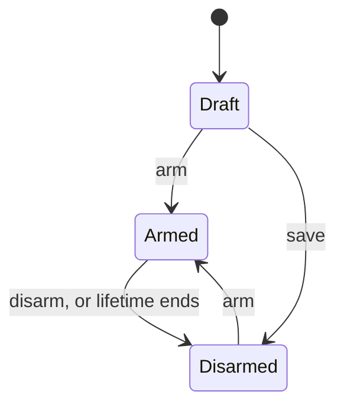

# Rules and triggers

A rule decides what happens to a call or to the world.
Rules are the unit that fires, that shows up in explanations and that has a history.

## Rule

A rule has:

| Part | Meaning |
|---|---|
| **Name** | Unique among rules. Other things reference the rule by this name. |
| **Selector** | Which calls the rule considers. A selector name, or inline conditions. |
| **Action** | What happens when the rule fires: a lie or an event. A preset name, or inline. |
| **Trigger** | When the rule fires among the calls its selector matches. |
| **Lifetime** | How long the rule stays armed. |
| **State** | Draft, armed or disarmed. |

```yaml
name: Slow down order producers
selector: Order producers
scope:
  client.id: order-ingest
action: Delay 1 s
trigger:
  chance: 40%
lifetime: until disarmed
```

`scope` is shorthand for extra conditions over connection fields.
The rule's effective selector is the selector **and** the scope.

## Action

An action is either a lie or an event.
See [lies and events](lies-and-events.md).

- A **lie** applies to the call that fired the rule.
- An **event** changes the world.
  The call that fired the rule passes through unchanged,
  unless another rule lies about it.

## Trigger

A trigger decides whether a matching call fires the rule.

| Trigger | Fires | Example |
|---|---|---|
| **Chance** | When the rule's die rolls under the probability. | `chance: 40%` |
| **Count** | On specific matching calls. | `nth: 3`, `every: 10`, `first: 5`, `after: 100` |
| **Time** | Inside a time window. | `after: 10s`, `for: 30s`, `between: [10s, 40s]` |
| **Signal** | When something else happens. | `on: rule "Coordinator flaps" fired`, `on: event rebalance`, `on: call JoinGroup from analytics-etl` |
| **Manual** | When someone fires it. | A pad press, a keyboard shortcut, an API call. |

Triggers combine.
`nth: 3` with `chance: 50%` fires on the 3rd matching call, half of the time.
All parts of a combined trigger must agree.

Count triggers name a [counting scope](session.md#counters):
session, client or global.

Time triggers use the engine's clock.
The Simulated backend runs on a virtual clock,
so time triggers are deterministic there.
The Upstream backend runs on the wall clock.

## Lifetime

A lifetime decides when an armed rule disarms itself.

| Lifetime | Disarms |
|---|---|
| Until disarmed | Never by itself. |
| Duration | After a period, such as 30 s. |
| Matches | After a number of matching calls. |
| Firings | After the rule fired a number of times. |

"Next 100 calls" is ambiguous.
The lifetime names whether it counts matches or firings.

## State



- **Draft**: being written. Never evaluated.
- **Armed**: evaluated for every matching call.
- **Disarmed**: kept, but not evaluated.

Arming a rule resets its counters and its lifetime.

## Evaluating one call

For each call, the session:

1. Collects every armed rule whose effective selector matches the call.
2. Evaluates each rule's trigger with the session's dice and counters.
3. Hands the rules that fire to the active scenario's [mode](scenarios.md#modes),
   which resolves conflicts between them.
4. Applies the winning lies and fires the winning events.
5. Records an [explanation](observation.md#explanation) of every step.

Rules never see each other directly.
Only the mode decides between them.
