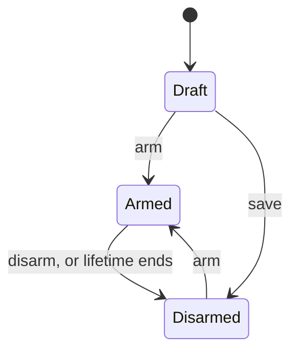

# Rules and triggers

A rule decides what happens to a call or to the world.
Rules are the unit that fires, that shows up in explanations and that has a history.

## Rule

A rule has:

| Part | Meaning |
|---|---|
| **Name** | Unique among rules. Other things reference the rule by this name. |
| **Selector** | Which calls the rule considers. A selector name, or inline conditions. |
| **Action** | What happens when the rule fires: a lie or an incident. A preset name, or inline. |
| **Trigger** | When the rule fires among the calls its selector matches. |
| **Lifetime** | How long the rule stays armed. |

```yaml
name: Slow down order producers
selector: Order producers
scope:
  client.id: order-ingest
action: Delay 1 s
trigger:
  chance: 40%
lifetime: until disarmed
```

`scope` is shorthand for extra conditions over connection fields.
The rule's effective selector is the selector **and** the scope.

A rule needs a name, a selector and an action.
`selector: {}` has no conditions, so it matches every call.
`scope`, `trigger`, `lifetime` and `dice` are optional.

A rule name has at least one character.
It does not start or end with white space, and it holds no control character such as a line break.
It holds no format character either, such as a zero-width space or a mark that turns the text direction.
Nobody sees those, so two names could look the same and still differ.
Upper and lower case differ.
The names of presets and of selectors follow the same rule.

### Where rules live

- A **workspace rule** is a definition in the [workspace](../architecture/storage.md#workspace).
  Scenarios reference it by name.
- A **live rule** exists only in the engine's memory.
  Pad presses and ⌘K create live rules in the [live set](scenarios.md#the-live-set).
  Keeping a live rule saves it as a workspace rule.
  A [scratch file](../architecture/storage.md#scratch) keeps live rules across a crash.
  They come back disarmed.

## Action

An action is either a lie or an incident.
See [lies and incidents](lies-and-incidents.md).

- A **lie** applies to its [target](lies-and-incidents.md#target) on the call that fired the rule.
- An **incident** changes the world.
  The call that fired the rule passes through unchanged,
  unless another rule lies about it.

A rule whose selector tests a [response field](targeting.md#response-fields) waits for the truth.
Its lie must act after the response, and a rule with a lie before forwarding is an error.
An incident has no stage, so such a rule can fire one.

### The subject of an incident

An incident changes a subject: a partition, a topic, a broker, a group or a transactional producer.
An action names the subject, or leaves it to the call that fires the rule.

```yaml
action: { incident: leader-moves, partition: orders.eu/3 }
```

```yaml
action: { incident: leader-moves }
```

A subject that the action leaves out comes from the call:

| Subject | Comes from |
|---|---|
| Partitions and topics | The rule's [target](lies-and-incidents.md#target) on this call. |
| Broker | The broker endpoint the call arrived on. |
| Groups | The `group` field. |
| Transactional IDs | The `transactional.id` field. |

Every subject the call offers gives one incident.
A rule that targets three partitions of a Produce moves three leaders.

A call can offer no subject at all: a `Heartbeat` names no partition.
The rule's trigger still agrees, but the rule does not fire, and no incident happens.
The call counts as a match, the firing goes back to the [budget](#budgets),
and the explanation names the missing subject.
It does not say that the rule fired.

## Trigger

A trigger decides whether a matching call fires the rule.

| Trigger | Fires | Example |
|---|---|---|
| **Chance** | When the rule's die rolls under the probability. | `chance: 40%` |
| **Count** | On specific matching calls. | `nth: 3`, `every: 10`, `first: 5`, `skip: 100` |
| **Time** | Inside a time window, measured from the moment the rule was armed. | `after: 10s`, `between: [10s, 40s]` |
| **Manual** | When someone fires it. | A pad press, a keyboard shortcut, an API call. |

A rule without a trigger fires on every matching call.

Triggers combine.
`nth: 3` with `chance: 50%` fires on the 3rd matching call, half of the time.
All parts of a combined trigger must agree.

```yaml
trigger: { chance: 50%, nth: 3 }
```

A manual trigger does not combine: `trigger: manual` has no other parts.
Such a rule never fires by itself.

A rule with `trigger: manual` and an incident names the [subject](#the-subject-of-an-incident) in its action.
A hand firing has no call to take the subject from, so a rule that leaves it out could never fire.
That rule is an error.

### Count

| Part | Fires |
|---|---|
| `nth: 3` | On the 3rd match. |
| `every: 10` | On every 10th match. |
| `first: 5` | On the first 5 matches. |
| `skip: 100` | On none of the first 100 matches. |

`skip` passes over the first matches,
and `nth`, `every` and `first` count from the match after them.
`skip: 100` with `first: 5` fires on the matches 101 to 105.

A count trigger counts matching calls, whatever happens to them afterwards.
When a rule fires on its 3rd match and another rule [shadows](lies-and-incidents.md#how-lies-combine) it,
`nth: 3` has had its match, and the rule does not fire on the 4th instead.
The explanation shows it.

### Time

Time triggers use the [engine's clock](../architecture/README.md#clock).
A trigger has one window: `after` or `between`, not both.
`between: [10s, 40s]` opens 10 s after arming, and it is closed again from 40 s on.

A time trigger only opens a window.
The [lifetime](#lifetime) decides when a rule stops.

### Manual firing

Firing a rule by hand skips its trigger once.
Any armed rule can fire by hand, whatever its trigger.

- A rule with an **incident** fires the incident immediately.
  An incident that takes its [subject](#the-subject-of-an-incident) from the call cannot fire by hand,
  because there is no call.
  The hand firing is an error, and it takes nothing from the rule's budget.
- A rule with a **lie** has no call to lie about yet.
  It lies on the next call its selector matches, once.
  That call can come from any session, and it gets a match number like every other match.

Every hand firing is one firing.
Two pad presses lie on the next two matching calls.
A hand firing counts for a [lifetime](#lifetime) of firings like any other firing.

A hand firing is only used up when its lie applied.
The matching call that takes it can lose it again:
another rule shadows or pre-empts the lie on every target, or the call ends before it settles.
The hand firing then waits for the next matching call, so every pad press lies on a call.
A [count trigger](#count) differs: `nth: 3` has had its match, whatever happened to the call.

A hand firing that still waits for a call when the rule disarms is dropped.
A rule whose lifetime has ended does not fire by hand, whatever its action.

### Reacting to other things

A rule cannot trigger on another rule or on an incident.
A [Sequence](scenarios.md#sequence) step expresses "when this happened, arm that":
the step ends on a number of calls or firings, and the next step arms the reaction.

## Counters

Every armed rule counts the calls its selector matches.
Count triggers and dice use that **match number**.

| Counter | Kept in | "The 3rd Produce" means |
|---|---|---|
| Per rule (default) | The engine, shared by all sessions | The 3rd Produce this rule matched, from anyone its selector allows. |
| Per session, with `per: session` | Each [session](session.md) | The 3rd Produce this rule matched on this connection. |

```yaml
trigger: { first: 2, per: session }
```

With the default counter, `nth: 3` fires once per arming.
The rule's selector and scope already decide whose calls count.

Sessions increment the shared counter atomically.
When several connections match the same rule at once,
their arrival order decides which call gets which match number.

## Dice

A chance trigger rolls a die.
The roll derives from four values:

```
scenario seed
└─ dice key (the rule's name, unless the rule sets `dice`)
   └─ counter key (none, or the session key with `per: session`)
      └─ match number
```

- The same seed makes the same match numbers fire, in every run.
- Each rule rolls its own die.
  Adding or removing a rule does not shift the rolls of the other rules.
- The roll does not depend on the order in which connections open.
- Renaming a rule in the UI writes the old name as the rule's `dice` key,
  so a rename does not change which calls the rule hits.
  A rule that has a `dice` key already keeps it.

Without an active scenario, the workspace's default seed takes the scenario seed's place.

The counter key of a session is the text of its [session key](session.md#state).

### Chance and roll

A chance is a percentage with at most four decimals, such as `40%` or `0.5%`.
A bare number such as `40` or `0.4` is an error, because it does not say which of the two it means.

The engine holds a chance as a whole number of parts per million: `40%` is 400 000.
A roll is a whole number from 0 up to, and not including, one million.
The rule fires when the roll is under the chance,
so `100%` fires on every match and `0%` on none.
No floating point takes part.

### Derivation

The derivation is fixed.
A seed gives the same rolls in every run, on every platform and with every version of Rust.
It uses 64-bit unsigned arithmetic that wraps, and no hasher of the standard library.

| Step | Value |
|---|---|
| The die of a rule | `mix(seed ^ fnv1a(dice key))` |
| The die of a rule on one session, with `per: session` | `mix(die ^ fnv1a(counter key))` |
| The bits for one match | `mix(die + match number × 0x9e3779b97f4a7c15)` |
| The roll | `(bits × 1 000 000) >> 64` |
| The die of the jitter of a rule's delay | `mix(die ^ fnv1a("jitter"))` |
| The wait of a delay, for one match | `delay − jitter + (2 × jitter × roll) / 1 000 000`, in whole milliseconds |

- `fnv1a` is 64-bit FNV-1a over the UTF-8 bytes of the key.
- `mix` is the finalizer of SplitMix64.
- The bits for match *n* are output number *n* of the SplitMix64 generator that starts at the die.
  A die keeps no state, so the order in which calls arrive does not change a roll.
- The jitter of a delay rolls a die of its own, below the die of its rule.
  With `per: session`, that is the die of the rule on the session.
  It rolls for the match that fired the rule, so the same seed gives the same waits.
  The wait does not follow the roll of the rule's chance trigger.

A change to this derivation changes which calls every existing scenario hits.
The `trigger` crate pins it in its tests, with fixed rolls for fixed seeds.

## Lifetime

A lifetime decides when an armed rule disarms itself.

| Lifetime | Disarms | Example |
|---|---|---|
| Until disarmed | Never by itself. | `lifetime: until disarmed` |
| Duration | After a period, measured from the moment the rule was armed. | `lifetime: 30s` |
| Matches | After a number of matching calls. | `lifetime: 100 matches` |
| Firings | After the rule's action applied a number of times. | `lifetime: 3 firings` |

A rule without a lifetime stays armed until disarmed.

"Next 100 calls" is ambiguous.
The lifetime names whether it counts matches or firings.
Shadowed and pre-empted firings do not count as firings.

A call can arrive after the lifetime ended and before the engine disarmed the rule.
That call does not count as a match, and the rule neither rolls nor fires for it.
The rule does not wait for the truth of that call either,
so the explanation does not list it as [pre-empted](observation.md#explanation) when a lie ends the call.

### Budgets

Matches and firings are **budgets**.
The engine keeps one budget per armed rule, shared by all sessions.

A match counts the moment it happens.
A call takes its match from a budget of matches at once.

A firing only counts when the rule's action applied.
A call learns that later, when its lies [resolve](#evaluating-one-call).
A budget of firings therefore works in two steps:

1. A rule that fires **sets one firing aside** in its budget.
   A rule that finds no firing free does not fire.
2. The call **settles** the firing when it knows what happened.
   A firing whose action applied is spent for good.
   A firing that was shadowed or pre-empted on every target goes back to the budget.
   So does the firing of a call that ended before it could settle.
   A [hand firing](#manual-firing) that goes back also waits for the next matching call.

The firings that are spent and the firings that are set aside never add up to more than the budget.
A budget of three firings never yields a fourth,
however many connections match at the same time.

While a firing is set aside, another call can find the budget empty.
That call does not fire, even when the firing goes back to the budget afterwards.
The rule stays armed, and a later match takes the firing.
The lifetime ends when the action applied for the last time.

## State

A rule's state is live state.
It is not part of the definition, and files do not store it.



- **Draft**: being written. Never evaluated.
- **Armed**: evaluated for every matching call.
- **Disarmed**: kept, but not evaluated.

Workspace rules load disarmed.
A scenario, a step or a person arms them.

The diagram shows every change there is.
Arming an armed rule is not one of them: disarm the rule first to reset it.

Arming a rule resets its counters, its budget and its time window.
Changing a parameter of an armed rule resets nothing.
A budget keeps what calls spent, and takes the new number.

## Evaluating one call

For each call, the session:

1. Collects every armed rule whose effective selector matches the call,
   and works out each rule's [target](lies-and-incidents.md#target).
2. Evaluates each rule's trigger with the rule's counter and die,
   and sets a firing aside in the rule's [budget](#budgets) when it fires.
3. Fires the incidents of the rules that fired.
4. Lets the lies that do not conflict apply,
   and resolves conflicts by priority:
   the [live set](scenarios.md#the-live-set) first, then the active scenario's [mode](scenarios.md#modes).
5. Settles every firing: spent when its action applied, and back to the budget when it did not.
6. Records an [explanation](observation.md#explanation) of every step.

Rules never see each other directly.
Only priority decides between them.

The session evaluates against a snapshot of the armed rules.
The snapshot holds each rule with its selector and its preset resolved, in priority order,
so a call looks up no name.
