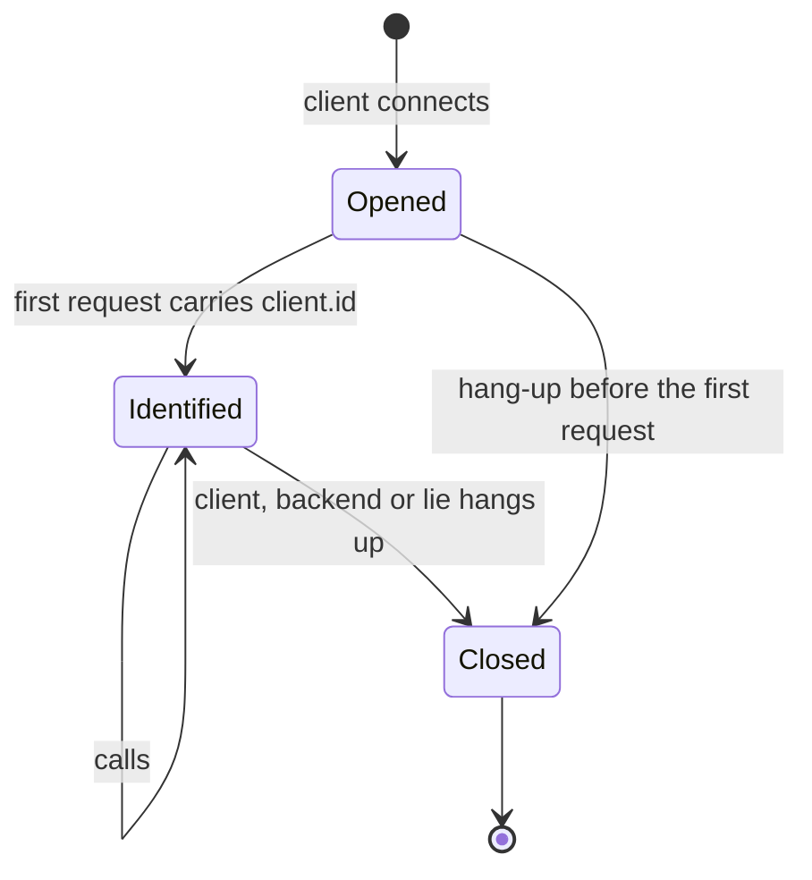

# Session

A session is the runtime of one client connection.
Every call travels through exactly one session.
The session holds everything rules need to decide about that call.

## Lifecycle



- **Opened**: the connection exists, but the client is anonymous.
  Only connection fields such as the address and the endpoint are known.
- **Identified**: the first request carries `client.id`.
  An `ApiVersions` request also carries the client software name and version.
  From here on, every connection field is known.
- **Closed**: the session ends.
  The session records who closed it: the client, the backend or a lie.

Rules scoped to a client cannot apply before the session is identified.
Lies that act before identification, such as refusing the connection,
can only target connection fields that are known at that point.

## Identity

| Field | Known from | Example |
|---|---|---|
| `connection` | Opened | `#7` |
| `address` | Opened | `10.0.4.27:51459` |
| `endpoint` | Opened | `bootstrap`, `broker 2` |
| `client.id` | Identified | `order-ingest` |
| `client.software` | First `ApiVersions` | `apache-kafka-java 3.8.0` |

Identity fields are part of the [field vocabulary](targeting.md#fields).
Scope selectors test them.

## State

A session keeps this state in memory:

- **Rule snapshot**: the armed rules at this moment.
  The session swaps in a new snapshot whenever a rule changes.
  A call always uses one consistent snapshot from start to finish.
- **Dice**: seeded random streams for chance triggers.
  See [Dice](#dice).
- **Counters**: per-session counts for count triggers.
  See [Counters](#counters).
- **In-flight calls**: requests waiting for a response,
  so post-response lies apply to the right call.

None of this state is persisted.
A session dies with its connection.

## Dice

Chance triggers draw from dice.
Every die derives from a seed, so a run with the same seed and the same traffic gives the same verdicts.

The seed hierarchy is:

```
scenario seed
└─ session ordinal (1st, 2nd, … session opened in this run)
   └─ rule name
```

Each rule rolls its own die.
Adding or removing a rule does not shift the rolls of the other rules.

## Counters

Count triggers such as "the 3rd Produce" need a counter.
A counter has a **counting scope**:

| Counting scope | Lives in | "The 3rd Produce" means |
|---|---|---|
| Session | The session | The 3rd Produce on this connection. |
| Client | The engine, keyed by `client.id` | The 3rd Produce from this client, across its connections. |
| Global | The engine | The 3rd Produce through GaslightMQ, from anyone. |

Session counters live in the session.
Client and global counters live in the engine,
because they outlive single connections.
The trigger names its counting scope explicitly.
See [open questions](../open-questions.md) for the default.
