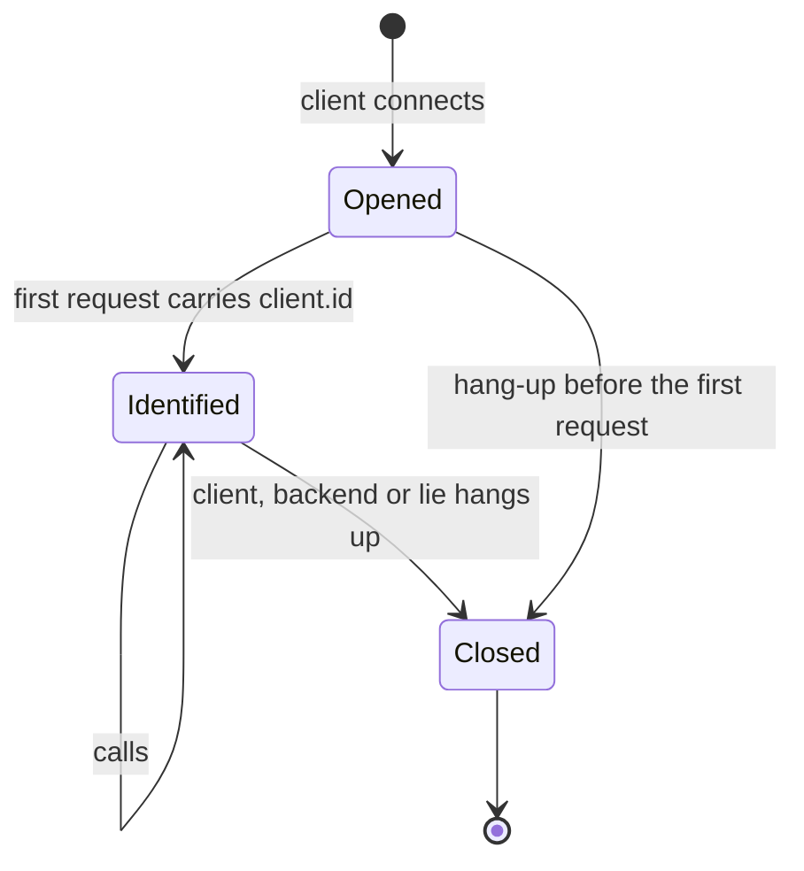

# Session

A session is the runtime of one client connection.
Every call travels through exactly one session.
The session holds everything rules need to decide about that call.

## Lifecycle

- **Opened**: the connection exists, but the client is anonymous.
  Only connection fields such as the address and the endpoint are known.
- **Identified**: the first request carries `client.id`.
  An `ApiVersions` request also carries the client software name and version.
  From here on, every connection field is known.
- **Closed**: the session ends.
  The session records who closed it: the client, the backend or a lie.

Rules scoped to a client cannot apply before the session is identified.
Lies that act before identification, such as refusing the connection,
can only target connection fields that are known at that point.

## Identity

| Field | Known from | Example |
|---|---|---|
| `connection` | Opened | `#7` |
| `address` | Opened | `10.0.4.27:51459` |
| `host` | Opened | `10.0.4.27` |
| `endpoint` | Opened | `bootstrap`, `broker 2` |
| `client.id` | Identified | `order-ingest` |
| `client.software` | First `ApiVersions` | `apache-kafka-java 3.8.0` |

Identity fields are part of the [field vocabulary](targeting.md#fields).
Scope selectors test them.

A `connection` number only lives as long as its connection.
A client that reconnects gets a new session and a new number.
`client.id` with `host` identifies one client instance across reconnects.

## Client context

One Kafka client opens several connections,
and most of them never say which group or transaction the client belongs to.
A consumer names its group on the coordinator connection,
and fetches on other connections.

The engine therefore keeps a **client context** for every pair of `client.id` and `host`.
Sessions with the same pair share it.
The context remembers what any of those sessions learned:

| Learned field | Learned from |
|---|---|
| `group` | Group protocol requests, classic and consumer protocol alike. |
| `member.id` | The response to joining the group. |
| `group.instance.id` | Group protocol requests of static members. |
| `transactional.id` | `InitProducerId` and other transactional requests. |

Selectors use these as [learned fields](targeting.md#learned-fields),
so "delay Fetch for group `analytics-etl`" works
although a Fetch request never names a group.

The context lives in the engine, because it outlives single connections.
It ends when the last session of the pair has been closed for a while.

## State

A session keeps this state in memory:

- **Rule snapshot**: the armed rules at this moment.
  The session swaps in a new snapshot whenever a rule changes.
  A call always uses one consistent snapshot from start to finish.
- **Session key**: the host, the endpoint,
  and the ordinal of this connection among the connections from that host to that endpoint.
  The key is stable across runs, unlike the connection number.
- **Per-session counters**: the match numbers of rules that count `per: session`.
  See [counters](rules.md#counters).
- **In-flight calls**: requests waiting for a response,
  so lies after the response apply to the right call.
- **Stalled**: whether a [silence](../architecture/request-pipeline.md#ordering) stopped the connection.

None of this state is persisted.
A session dies with its connection.

## Dice and counters

The session evaluates every trigger.
It rolls the [dice](rules.md#dice) of chance triggers
and reads or increments the [counters](rules.md#counters) of count triggers.

- A rule's default counter and its budget live in the engine.
  All sessions share them and update them atomically.
- A `per: session` counter lives in the session.
  Its dice use the session key, so two runs give each connection the same rolls.
