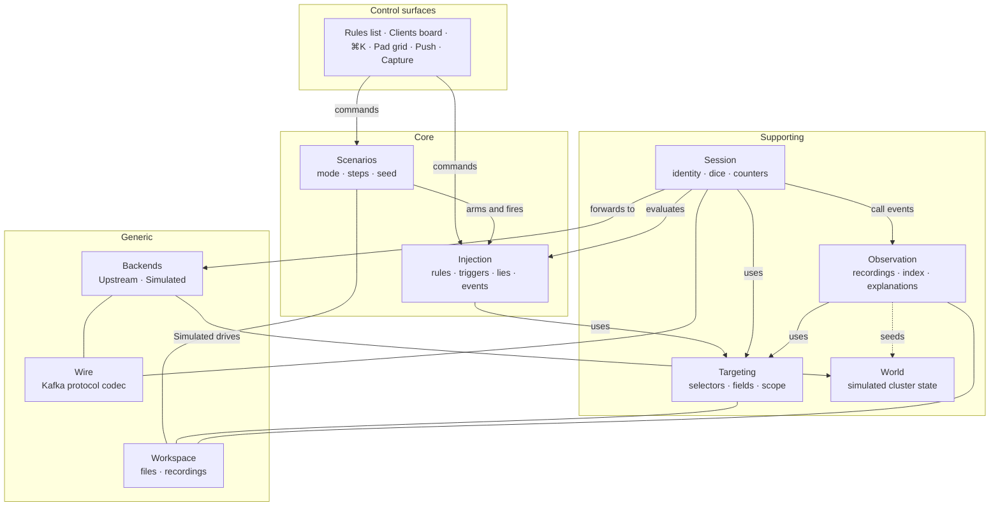

# Town plan

The town plan splits GaslightMQ into districts.
Each district owns a set of concepts and a clear responsibility.
Districts talk to each other through narrow, named contracts.

## Map

## Districts

| District | Type | Owns | Responsibility |
|---|---|---|---|
| [Scenarios](../domains/scenarios.md) | Core | Scenario, Mode, Step, Live layer, Capture | Tells failure stories over time and resolves conflicts between rules. |
| [Injection](../domains/rules.md) | Core | Rule, Action, Trigger, Lifetime | Decides what happens to a call or to the world. |
| [Lies and events](../domains/lies-and-events.md) | Core | Truth, Lie, Event, Preset | Defines the vocabulary of everything GaslightMQ can make a client believe. |
| [Targeting](../domains/targeting.md) | Supporting | Field, Condition, Selector, Scope | Provides one predicate language for filtering, targeting and indexing. |
| [Session](../domains/session.md) | Supporting | Session, Identity, Counter, Dice | Runs every connection and holds the state rules need per connection. |
| [Observation](../domains/observation.md) | Supporting | Call, Verdict, Explanation, Recording, Index | Shows what happened and why. |
| [World](../domains/world.md) | Supporting | Cluster, Broker, Topic, Partition, Group, Generator | Holds the state of a simulated cluster. |
| [Control surfaces](../domains/control-surfaces.md) | Supporting | View, Pad layout, Layer, Hardware mapping | Gives people fast ways to change rules and scenarios. |
| [Backends](../architecture/backends.md) | Generic | Backend, Capability, Emulation | Answers calls, either from a real cluster or from the World. |
| Wire | Generic | Frame, Request, Response | Encodes and decodes the Kafka protocol. |
| [Workspace](../architecture/storage.md) | Generic | Workspace, Recording file | Persists definitions and recordings. |

The core districts are where GaslightMQ differs from every other Kafka tool.
The supporting districts exist to serve the core.
The generic districts solve problems that are not specific to GaslightMQ.

## Relationships

### Targeting is a shared kernel

Targeting defines the field vocabulary: `api`, `topic`, `client.id`, `group`, and so on.
Observation, Injection, Session and Control surfaces all speak this vocabulary.
A change to a field affects all of them,
so the vocabulary changes deliberately and rarely.

### Scenarios drive Injection

Scenarios arm, disarm and fire rules.
Injection does not know about modes, steps or timelines.
It only knows which rules are armed and how to evaluate one call against them.
The active scenario's mode tells Injection how to resolve conflicts.

### Session evaluates Injection

Every session receives a snapshot of the armed rules.
The session evaluates that snapshot for each call,
using its own dice and counters.
Injection publishes a new snapshot whenever a rule changes.

### Backends sit behind an anti-corruption layer

Injection speaks in lies and events.
A backend translates an event into something it can do.
The Simulated backend applies the event to the World.
The Upstream backend emulates the event with a bundle of lies.
Neither backend leaks its internals back into Injection.

### Observation is downstream of everything

Sessions emit a call event for every call,
including the explanation of the verdict.
Observation stores, indexes and shows those events.
Nothing upstream depends on Observation.

### Observation seeds the World

A recording from a real cluster knows its topics, partitions, groups and transactional IDs.
The World can be seeded from that knowledge.
This is how a team captures reality and then breaks it deterministically and offline.

### Control surfaces hold no domain state

Every surface sends commands to Scenarios or Injection.
A pad layout is the only state a surface owns,
and a layout only maps positions to names.

## Boundaries that matter

- **A pad is not a rule.**
  A pad is a position that points at zero or one rule.
- **Scope is not a separate concept.**
  Scope is a selector over connection fields that the UI shows as its own axis.
- **Broker state is not a separate concept.**
  In the World, a broker going down is an event.
  On the proxy, the Upstream backend emulates it by refusing and dropping connections.
- **A lie is not always a fault.**
  A lie is anything the client is told that differs from the truth,
  including rewritten addresses and altered data.
